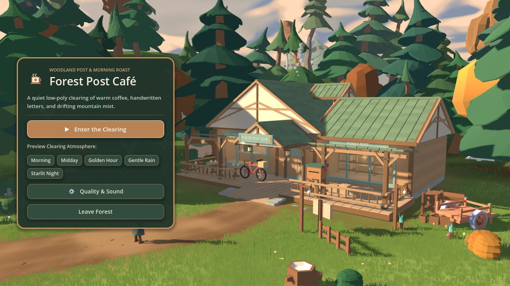
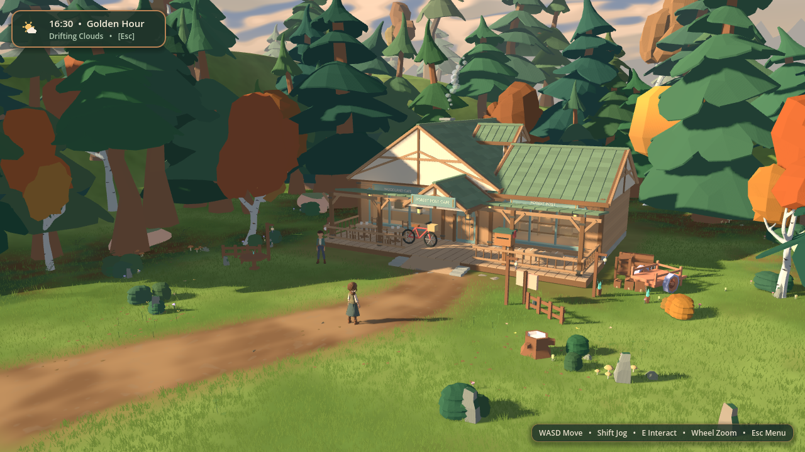

# Forest Post Café — Preview V10 (Complete Map 01 Visual Overhaul & Scenic Menu)

- **Code commit (`feature/map01-lighting-presets`, PR #10):** [`3351c01`](https://github.com/VietCodeBug/forest-post-cafe/commit/3351c01d7c24b527f068fcb84d2163b3652bf4bd)
- **Before V09 baseline:** [`2313e7b`](https://github.com/VietCodeBug/forest-post-cafe/commit/2313e7b) / [`preview/ver-09-grass-sky-weather`](https://github.com/VietCodeBug/forest-post-cafe/tree/preview/ver-09-grass-sky-weather) (preserved intact)
- **Renderer & GPU:** Godot 4.7.2 · OpenGL 3.3 Compatibility · NVIDIA GeForce RTX 3050 Laptop GPU (Windows)
- **1080p Realtime Benchmark (1920×1080, VSync Off, Grass High):** Golden Hour **101.1 FPS** · Starlit Night **113.5 FPS** · Heavy Rain + Puddles **93.8 FPS**

## 1. Live 3D Scenic Main Menu & First-30s Gameplay

## 2. Environment, Path, Woodland & 360° Mountain Backdrop
- [Café Exterior](v10/02-cafe-exterior.png)
- [Path, Flagstones & Signpost Lantern Nook](v10/03-path-closeup.png)
- [Forest Floor, Canopy Color Separation & Reading Bench Nook](v10/04-forest-floor-woodland.png)
- [Wide Valley & Layered Low-Poly Mountain Backdrop](v10/05-wide-environment.png)
- [Stylized Multi-Layer Cumulus Sky & Soaring Birds](v10/12-stylized-sky-clouds.png)

## 3. Time-of-Day & Weather Atmosphere (Actual Gameplay Camera)
- [Crisp Morning (08:11)](v10/06-morning.png)
- [Golden Hour / Sunset (17:21)](v10/07-sunset.png)
- [Starlit Night, Lanterns & Fireflies (21:45)](v10/08-night.png)
- [Rainy Afternoon & Wheel-Track Puddles (15:11)](v10/09-rain.png)

## 4. Cozy UI/UX Redesign
- [Stationery Mailbox Dispatch Card](v10/10-ui-mailbox-letter.png)
- [Café Break Pause & Atmosphere Studio Menu](v10/11-ui-pause-atmosphere-menu.png)

## 5. Camera-Matched Before (V09) vs After (V10)
| View | Before V09 | After V10 (Matched Camera) |
| --- | --- | --- |
| Default V09 Pose | [before-v09/01-default-gameplay.png](before-v09/01-default-gameplay.png) | [matched-v09/01-default-gameplay.png](matched-v09/01-default-gameplay.png) |
| Ground Grass (Locked V09) | [before-v09/02-ground-grass.png](before-v09/02-ground-grass.png) | [matched-v09/02-ground-grass.png](matched-v09/02-ground-grass.png) |
| Path & Eggeght Pose | [before-v09/03-path-transitions.png](before-v09/03-path-transitions.png) | [matched-v09/03-path-transitions.png](matched-v09/03-path-transitions.png) |
| Shaded Forest Floor | [before-v09/04-forest-floor.png](before-v09/04-forest-floor.png) | [matched-v09/04-forest-floor.png](matched-v09/04-forest-floor.png) |
| Wide Composition & Horizon | [before-v09/05-map01-composition.png](before-v09/05-map01-composition.png) | [matched-v09/05-map01-composition.png](matched-v09/05-map01-composition.png) |

All 23 PNGs are direct unedited Godot runtime captures (`captures.json` records SHA-256 hashes). No AI concept images. Do not auto-merge PR #10.