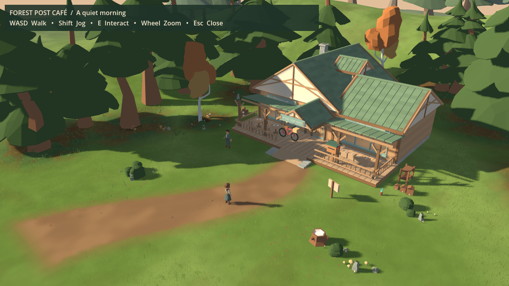

# Forest Post Café — Preview V09

**Bố cục cuối:** [`9d937ff`](https://github.com/VietCodeBug/forest-post-cafe/commit/9d937ff98405bba7272e056b6f4bc5afbb84ec99).
**Bộ cỏ / sky / weather / video trước tinh chỉnh bố trí hoa-nấm cuối:** [`2076354`](https://github.com/VietCodeBug/forest-post-cafe/commit/207635454420034821d834a40b6dc3d42cc44a24).
**Before V08:** `68c21d6731bf105b21d22a6f62560f1f29c38e2b`. Không merge PR #10.

Cỏ nền dày nối các cụm; 50 hoa trắng/tím đặt thành sáu pocket ven lối đi và đá.
24 nấm + 12 đá nhỏ theo rìa bụi/bóng cây. Quán, cây lớn, path/collision, nhân vật,
camera và tương tác được giữ nguyên. Bố cục cuối xem **final-layout**.

- [Cận cỏ / nấm / đá](final-layout/02-ground-grass.png)
- [Mép đường](final-layout/03-path-transitions.png)
- [Dưới bóng cây](final-layout/04-forest-floor.png)
- [Toàn cảnh](final-layout/05-map01-composition.png)
- [Bãi mẫu 5×5 m](grass-demo/close.png)
- [Before V08](before-v08) / [cùng camera + Golden Hour](matched-golden)
- [Ngày, hoàng hôn, đêm, overcast, mưa nhẹ/nặng](weather)
- [Bảy clip Godot thật](motion): cận cỏ 4 giây High; các clip khác 2 giây Medium,
  12 fps xuất offline. Clip sunset tua nhanh 16:30→19:30. Không phải benchmark FPS.

PNG: 1280×720. MP4: H.264, khoảng 854×480 (pad tối đa 1 pixel để encoder nhận kích
thước chẵn). Không ảnh AI, không chỉnh màu hậu kỳ. Camera before/matched-golden
cùng pose/FOV và ánh sáng; final-layout dùng default dynamic 16:30.
Video/weather là mốc trước lần dàn hoa/nấm cuối; không gán bố cục cũ cho SHA mới.
`captures.json` ghi SHA-256, nguồn và thông số media từng file; JSON từng clip ghi
camera/time/weather. Mưa ghép WAV procedural đang dùng trong runtime, không thu
mixer trực tiếp vì host dùng Dummy audio.

110 assertion qua ở các bộ logic/GPU integration; xem [logs](logs).
Godot 4.6.3 / OpenGL Compatibility / Linux llvmpipe CPU renderer. Một số lần thoát
báo hai texture GL chưa giải phóng; đã ghi trong báo cáo, không nhận log sạch hoàn
toàn. Chưa benchmark Windows 1080p/60 FPS hoặc Terrain3D (repo chưa có plugin).
Không coi test qua là duyệt mỹ thuật hay chứng minh production-ready.

[Báo cáo tiếng Việt](https://github.com/VietCodeBug/forest-post-cafe/blob/feature/map01-lighting-presets/docs/grass-sky-weather-v09.md) · [PR #10](https://github.com/VietCodeBug/forest-post-cafe/pull/10).
