# V08 — Sky, sunlight and atmosphere presets

Code: `2c901267359475fafc5c82db0722d068ba9f4b80` on `feature/map01-lighting-presets`. Baseline PR #9: `82cfd4ed68627bcfdb428e10947c20f1b692b15b`.
Remote versions checked before publishing: highest existing version 07; this is new version 08. Every prior preview ref remains unchanged.

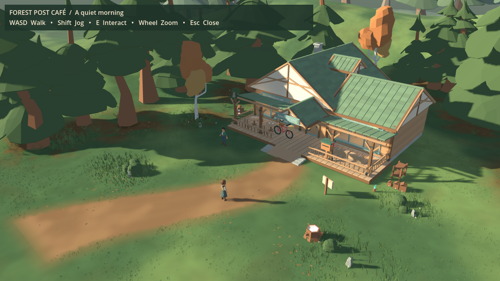

## Matching five-camera comparison

| Góc | PR #9 baseline | Golden Hour — default | Blue Hour — cinematic |
| --- | --- | --- | --- |
| Gameplay thực tế | 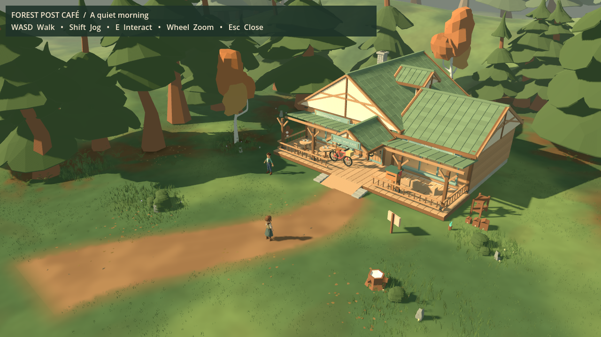 |  | 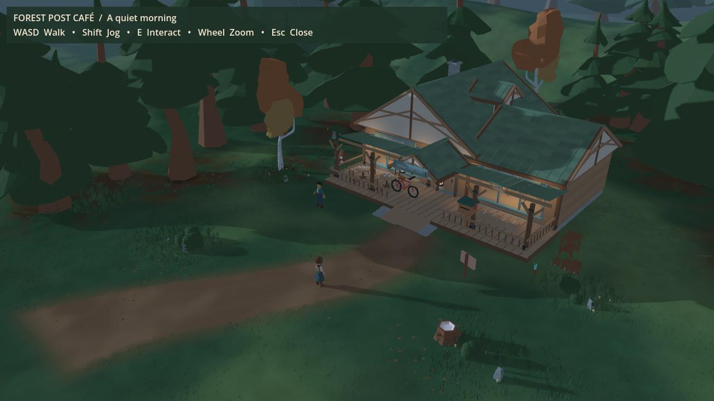 |
| Café exterior | 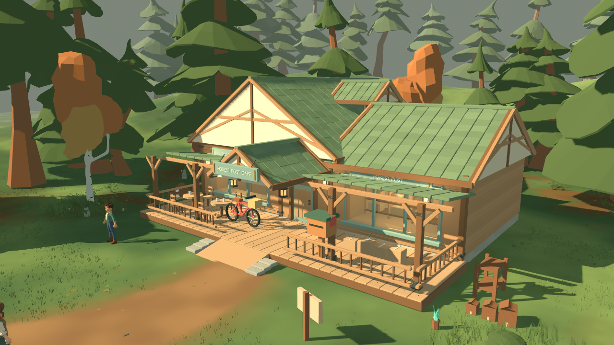 | 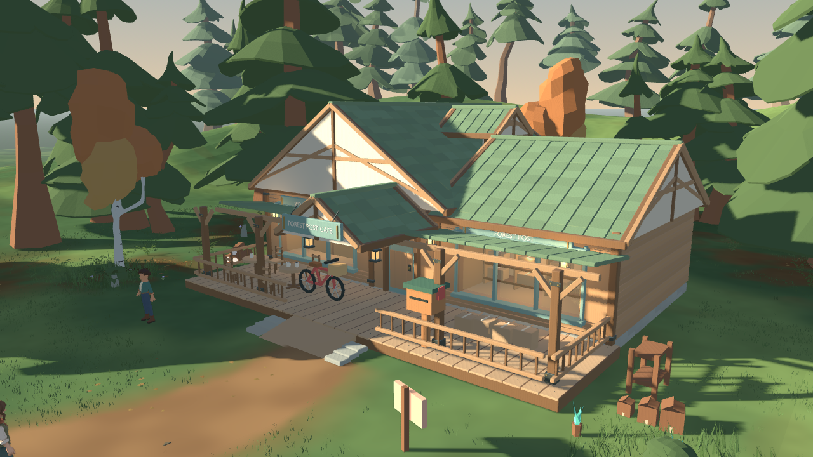 | 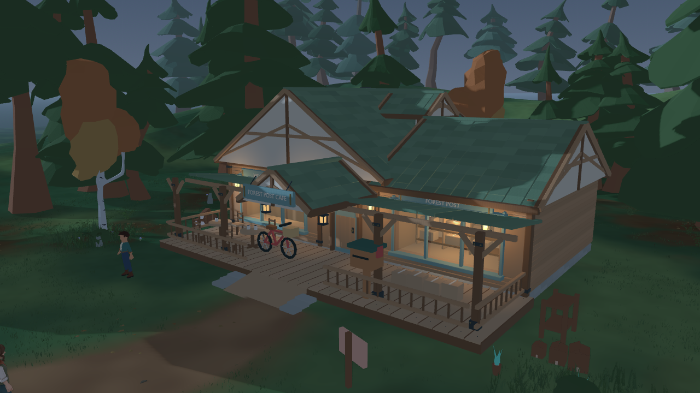 |
| Forest clearing | 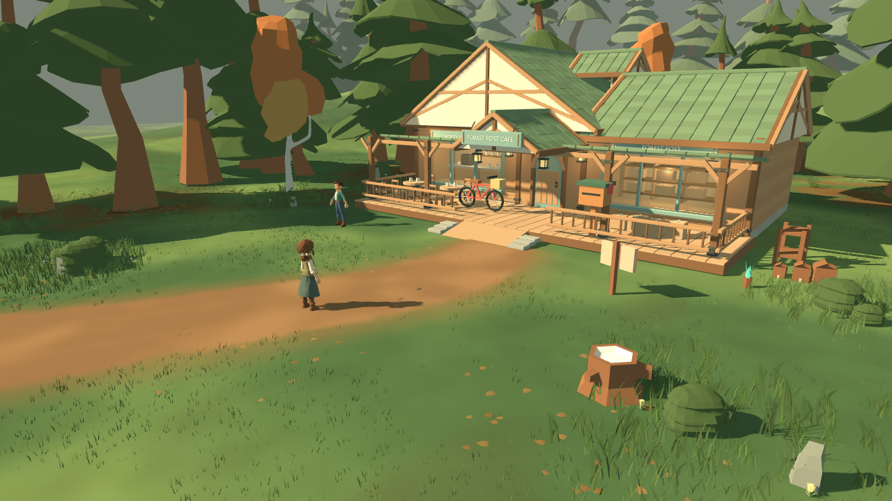 | 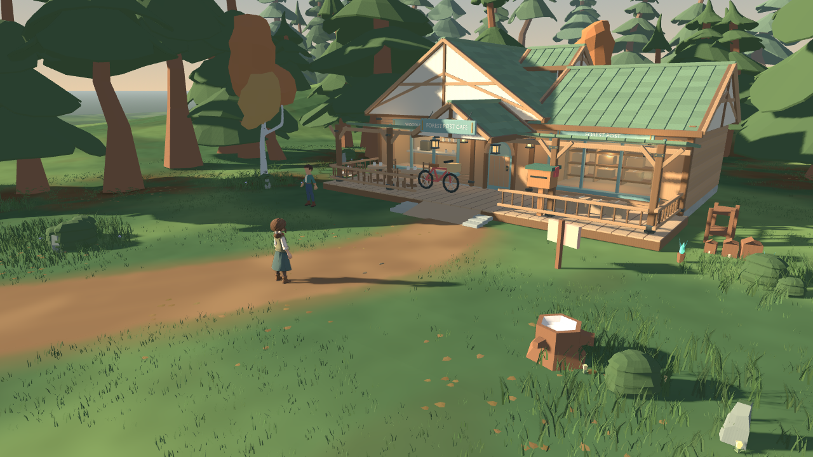 | 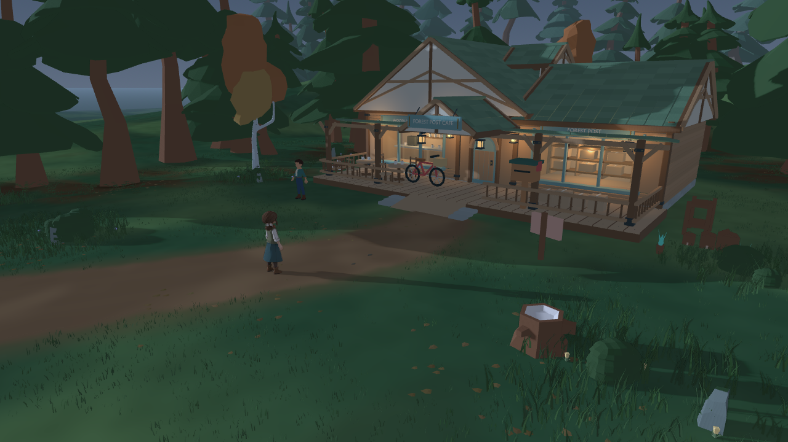 |
| Sky / horizon góc thấp | 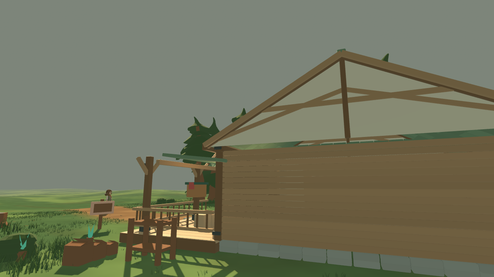 | 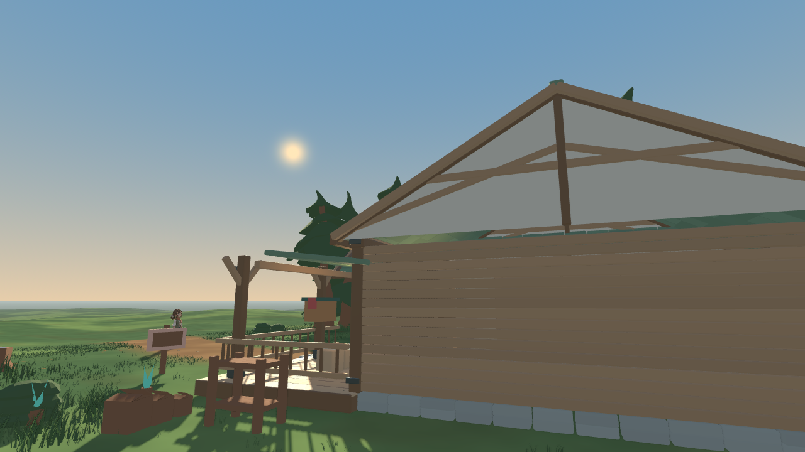 | 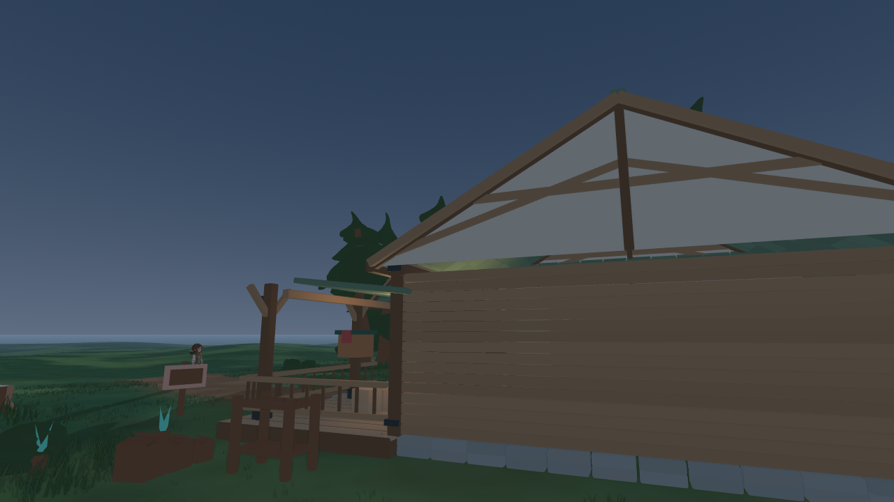 |
| Wide composition | 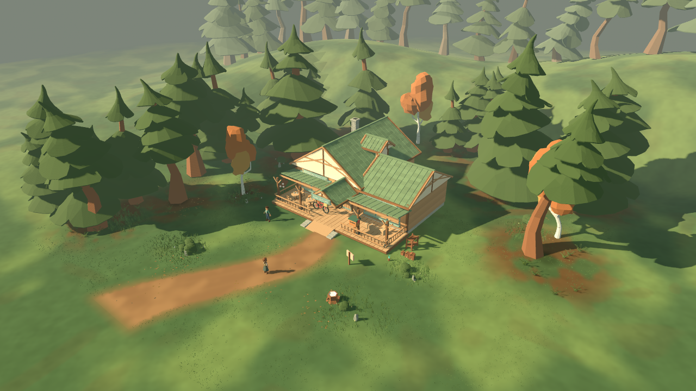 | 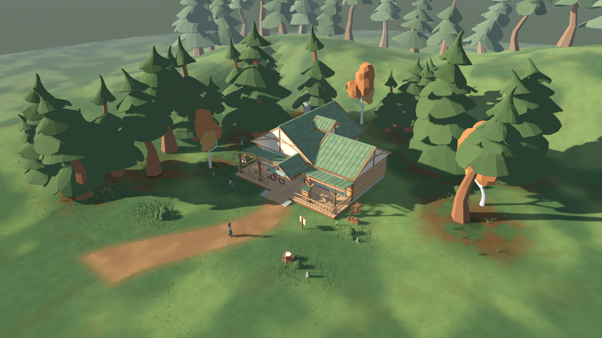 | 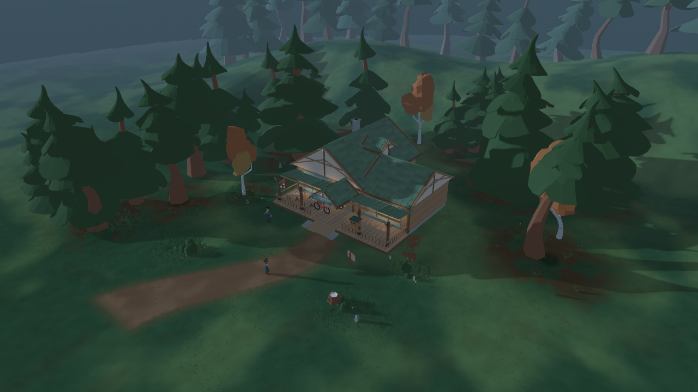 |

Actual Godot 4.6.3 viewport captures, 1280 × 720, Compatibility/OpenGL 4.5 on Mesa llvmpipe. Same cameras, geometry and source materials; actors/wind are frozen only in the capture process to make lighting A/B stable. Gameplay camera is the real unchanged camera; the other four poses are fixed review cameras. No image generation, paint-over or PNG color grading.

Baseline is reproduced with the exact PR09 lighting values, validated against the old sun/sky/fog/ambient settings. Source assets, shaders, scene geometry, tree placement, player/controller/camera, mailbox and café local lights are byte-unchanged. Only forest_hub.lighting() delegates to the static preset rig. Café SHA-256 remains `13d03ae08343f6052258b008f187602c47b9b2c7f115878e930fe9b2560f5ec3`.

## Presets / exact parameters

| Parameter | Baseline | Golden Hour | Blue Hour |
| --- | --- | --- | --- |
| Sun rotation | (-32,-44,0) | (-20,-52,0) | (-12,-62,0) |
| Sun color / energy | #FFD0A1 / .82 | #FFE0B2 / 1.08 | #B6CCF0 / .20 |
| Ambient color / energy | #A8B5AC / .85 | #B7C8DF / .62 | #9BAED1 / .50 |
| Sky top | #789794 | #6099C7 | #243D67 |
| Sky horizon | #DDCCAD | #F2D6AF | #8FA2C1 |
| Sky energy | .65 | 1.0 | .70 |
| Fog range | 38–155 m | 55–180 m | 50–170 m |
| Fog sky affect | 1.0 | .12 | .22 |
| Sun angular distance | 0° | .6° | 0° |
| Shadow blur / distance | 2 / 100 m | 2.5 / 85 m | 2.5 / 85 m |

All profiles retain SSAO enabled, radius .55, intensity .65, power 1.1. Four shadow cascades, existing 4096 atlas/filter quality 2, bias .09 / normal bias 1.1. Cascade blend is enabled for the two new profiles. Exposure stays 1.0; no extra bloom, GI or volumetric effects. [Full resource/effective parameter dump](parameters.json).

Golden uses the actual DirectionalLight3D in the ProceduralSkyMaterial for sun position/size/glow; no separate fake sun mesh. Blue disables visible sun contribution and uses weak cool directional fill. Existing café lantern/window lighting is not boosted or replaced: its prominence comes from the darker/cooler surroundings.

Launch static presets, no time simulation:

```sh
godot --path . -- --lighting=golden_hour
godot --path . -- --lighting=blue_hour
godot --path . -- --lighting=baseline
```

## Sun-direction trials

| Trial | Sun rotation, energy, ambient | Gameplay |
| --- | --- | --- |
| Side | (-22,-62,0), 1.10, .58 | 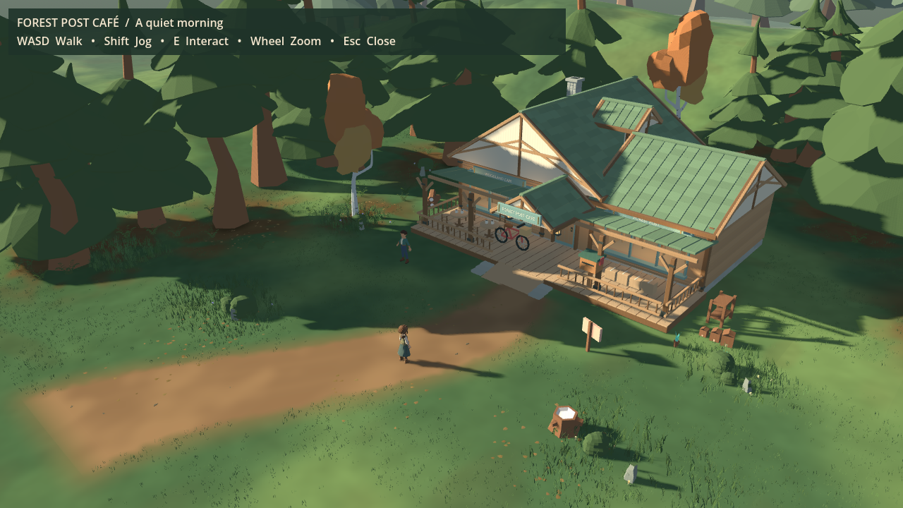 |
| Low | (-16,-72,0), 1.20, .60 | 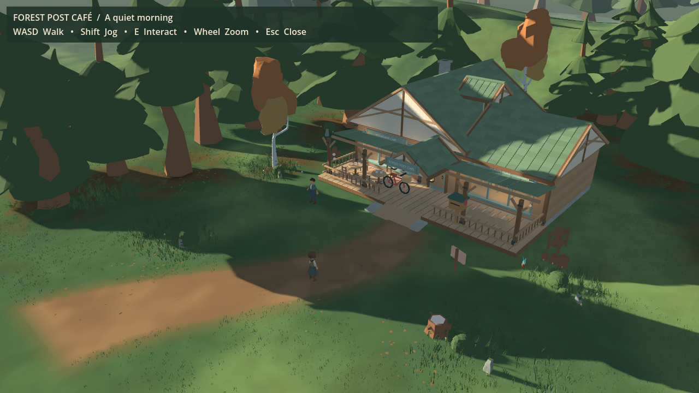 |
| Front | (-26,-32,0), 1.00, .52 | 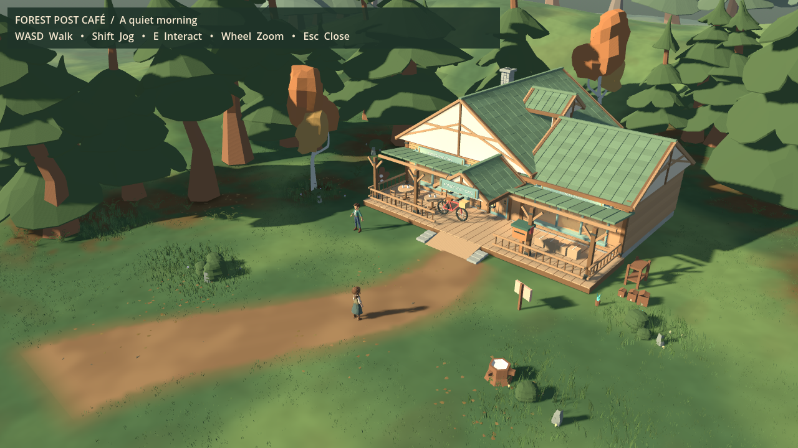 |

The low-angle trial hides the entrance/player in a broad shadow; the frontal trial is readable but too even. Final Golden takes an intermediate angle and lifts the cool fill color. Trials use initial ambient #A7BDD5 and sky #6E9DC2 / energy .8; final Golden uses the parameters above. Each trial folder also contains exterior/clearing views. Reproduce with `--candidate=side|low|front --quick` in capture_lighting.gd.

## Validation / limits

Passed: 13 gameplay smoke, 11 Map 01 scope, 12 floor scope, 18 display integration, 16 lighting preset checks. Blue Hour also passed smoke/display integration. Lighting tests check retained SSAO, baseline reproduction, independent rig reapplication and preservation of café local lights. Scope validators confirm all protected original assets/code/settings unchanged.

[Wall-frame comparison](software-wall-frame-cost.json): median of 12 frames on this **software llvmpipe host**, fixed scene/camera/wind: baseline 1010.37 ms, Golden 1022.98 ms, Blue 983.15 ms. Outliers around 2 s; these are not hardware GPU timings or Windows FPS evidence. Per-camera draw calls/primitives in each capture.json include shadow passes and change with sun orientation/cascade coverage.

Renderer remains Compatibility. No new Vulkan/Forward+ claim; the previous Vulkan probe failed. No baked indirect GI added. Shadow blur/angular sun settings are not a claim of PCSS area shadows in Compatibility.

Remaining: fixed low-poly canopies still cast broad shadow shapes, some Blue Hour forest/NPC regions are dark, sky is a clean cloudless gradient, and café lamp strength remains limited to the accepted original system. **Visual review is pending; automated checks do not establish premium quality.**

[Full Vietnamese report](https://github.com/VietCodeBug/forest-post-cafe/blob/2c901267359475fafc5c82db0722d068ba9f4b80/docs/sky-sun-atmosphere-review.md).

Capture: `DISPLAY=:99 godot --audio-driver Dummy --path . --script tools/capture_lighting.gd -- --preset=golden_hour --output=/tmp/light-delivery-golden` (use baseline/blue_hour for the other columns). Cameras and freeze controls are defined in the committed tool.
