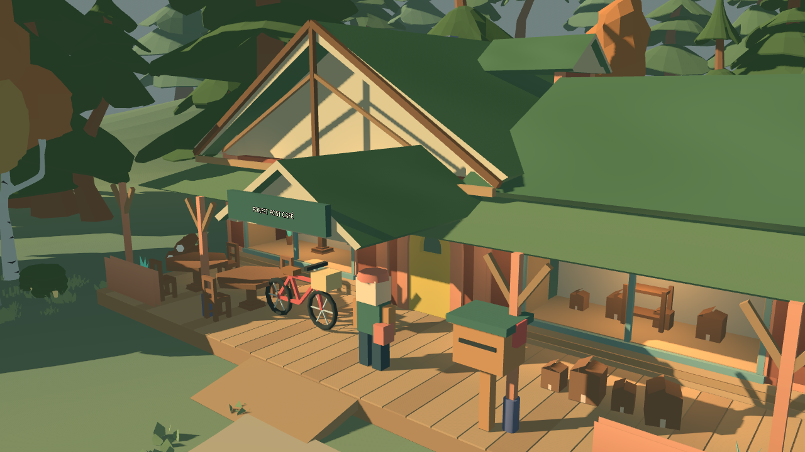
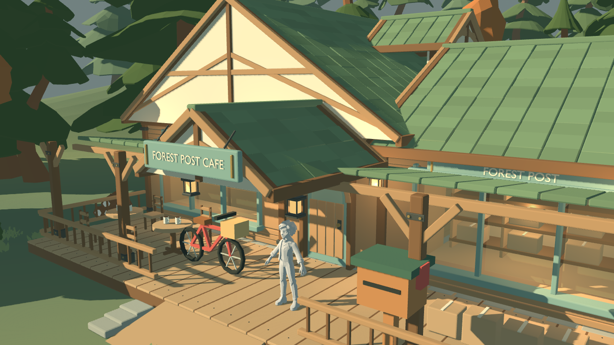
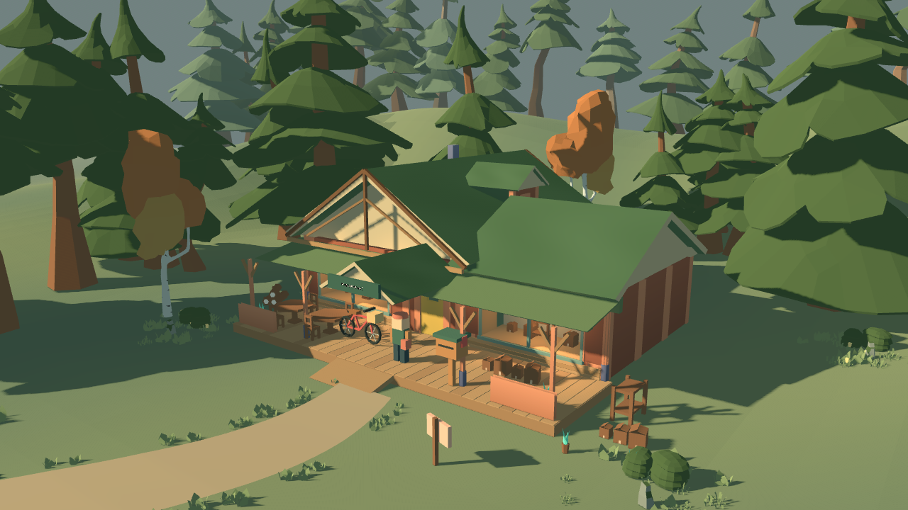
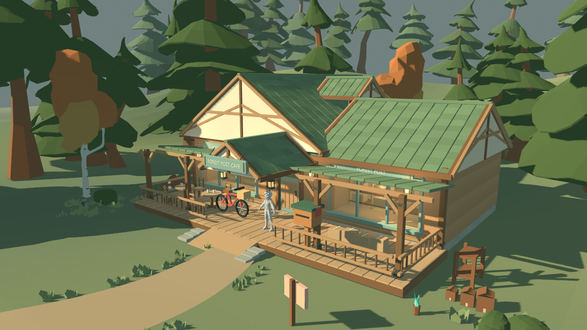
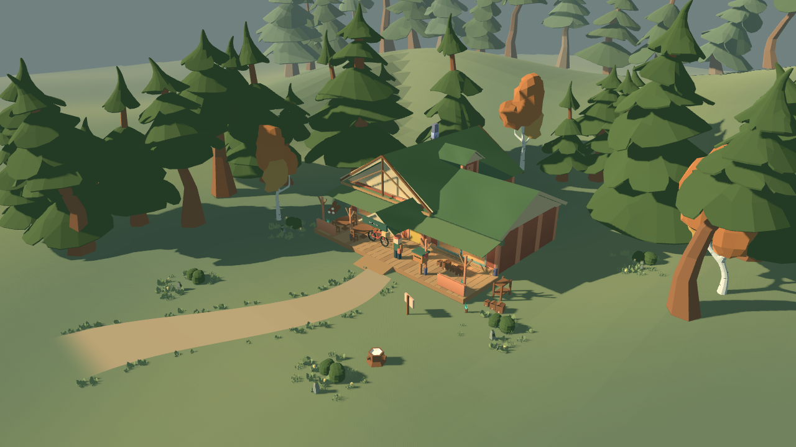
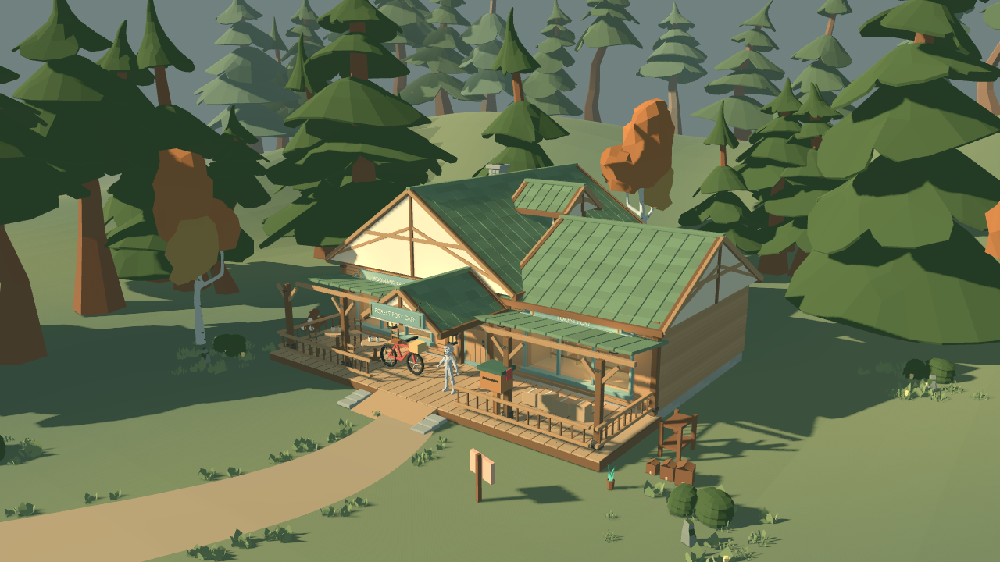
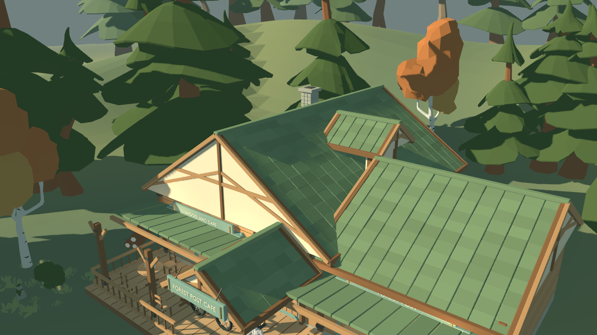

# V05 — Hero building, architecture review

Code: `c3adaabbad695a854eaa6a8c5238e0d601d1883a` on `feature/v05-hero-building` (based on V04 `aa5f7181f9d29abbbfb6791fe2070a6895112eff`).
Before images: unchanged V04 captures from preview commit `e1c93ad6b62310374bc6567a1328346097f567db`.

Five after screenshots captured directly from Godot 4.6.3, 1280 × 720, OpenGL Compatibility, Mesa llvmpipe on Linux. Command: `DISPLAY=:99 godot --audio-driver Dummy --path . --script tools/capture.gd -- --output=/tmp/v05-hero-final`. No AI images or paint-over. First camera is actual gameplay; the other four are architecture review angles. Before/after review camera positions differ, so these are qualitative art comparisons, not pixel regression tests.

## Before / after

| View | V04 before | V05 after |
| --- | --- | --- |
| Gameplay |  |  |
| Architecture |  |  |
| Human scale |  |  |
| Exterior |  |  |

## Roof detail

Nguồn Blender chỉnh sửa được nằm trong code branch dưới `art_source/hero_cafe_v05`. Nhân vật là model người dùng tự sở hữu, 52 xương, chưa có animation; tay nghỉ là pose tĩnh. Chỉ rebuild quán, giữ nguyên Map 01 và tương tác. Chưa có duyệt mỹ thuật từ người dùng, chưa tuyên bố premium hoàn tất.

Forward+ probe failed because VK_KHR_xlib_surface was unavailable and Godot fell back to Compatibility. These screenshots do not demonstrate Forward+, SSAO, GI or Windows performance. Geometry/PBR parameter materials authored in Blender; no texture baking. Source reference night image was unavailable; this is a text-guided interpretation.

[Full Vietnamese report](https://github.com/VietCodeBug/forest-post-cafe/blob/c3adaabbad695a854eaa6a8c5238e0d601d1883a/docs/v05-hero-building-review.md).
