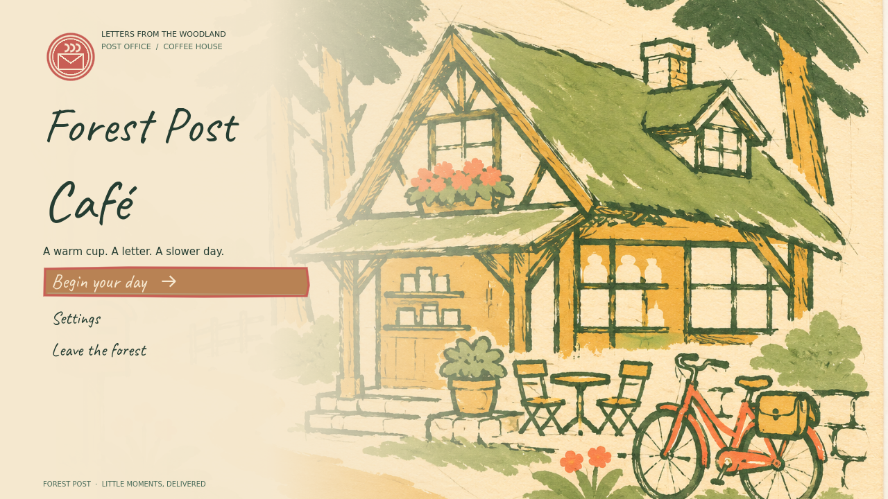
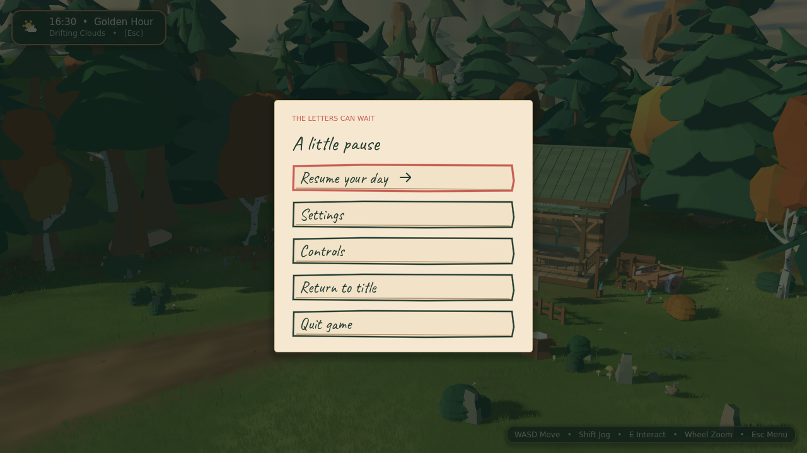
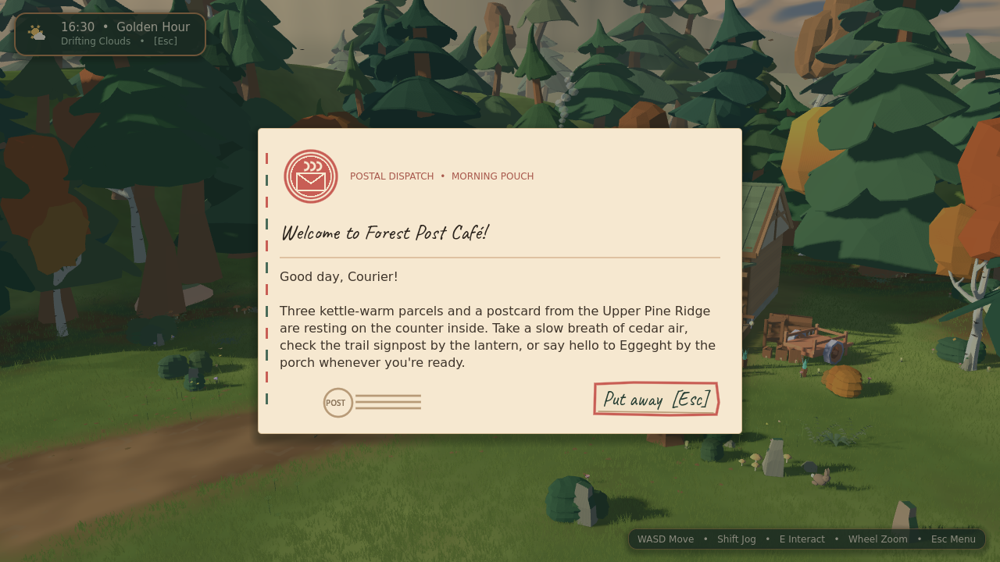

# V12 — Forest Post: menu ký họa

Code bàn giao: `b9d63d4929f8076e35398b647a49c04e6ad6d6f0` · [PR #10 chưa merge](https://github.com/VietCodeBug/forest-post-cafe/pull/10).

**Thời tiết tự động. Menu chính thức không có nút đổi giờ/mưa.** Atmosphere Studio chỉ là công cụ test qua `--atmosphere-debug`, không có trong ảnh menu chính thức này.

## Main menu

Nền trên là tranh UI phong cách nét mực/gouache, không phải ảnh Map 01. Chữ Caveat và nút viền mực tự vẽ thay cho bảng điều khiển cũ. Vào chơi vẫn là thế giới 3D hiện có; nhà/cỏ không đổi.

## Menu nghỉ và thư

## Toàn bộ màn hình

| Màn hình | 720p | 1080p |
|---|---|---|
| Main menu | [Xem](after/720p/01-main-menu.png) | [Xem](after/1080p/01-main-menu.png) |
| Focus / hover | [Xem](after/720p/02-main-focus-hover.png) | [Xem](after/1080p/02-main-focus-hover.png) |
| Audio | [Xem](after/720p/03-settings-audio.png) | [Xem](after/1080p/03-settings-audio.png) |
| Graphics | [Xem](after/720p/04-settings-graphics.png) | [Xem](after/1080p/04-settings-graphics.png) |
| Accessibility | [Xem](after/720p/05-accessibility.png) | [Xem](after/1080p/05-accessibility.png) |
| Pause | [Xem](after/720p/06-pause.png) | [Xem](after/1080p/06-pause.png) |
| Controls | [Xem](after/720p/07-controls.png) | [Xem](after/1080p/07-controls.png) |
| Mở phong bì | [Xem](after/720p/08-envelope-opening.png) | [Xem](after/1080p/08-envelope-opening.png) |
| Đọc thư | [Xem](after/720p/09-letter.png) | [Xem](after/1080p/09-letter.png) |
| Hội thoại | [Xem](after/720p/10-dialogue.png) | [Xem](after/1080p/10-dialogue.png) |
| Thông báo | [Xem](after/720p/11-notification.png) | [Xem](after/1080p/11-notification.png) |

## Đối chiếu V11

[V11 main menu](before-v11/menu.png) · [V11 menu chỉnh thời tiết cũ](before-v11/weather-atlas.png). Các ảnh V11 là baseline lịch sử; bảng chỉnh thời tiết ấy không nằm trong UI chính thức V12.

## Nguồn và kiểm tra

Ảnh chụp trực tiếp từ Godot 4.6.3 Compatibility trên Linux/Mesa llvmpipe, không phải ảnh game được ImageGen dựng. Tranh trong UI do ImageGen tạo theo phong cách ký họa, không nhận là họa sĩ vẽ tay thật. Prompt/hash/license font nằm trong source. Chụp từ working tree V12; code cuối bổ sung fallback tiếng Việt và dọn license/tài liệu, bố cục tiếng Anh trong ảnh không đổi. SHA-256/dimensions: captures.json.

Sáu bộ test: smoke, scope, weather, V10 integration, V11 habitats, V12 UI; log trong checks. Tab/Enter, Esc, chặn Studio ở chế độ thường, khóa/mở di chuyển và giới hạn bố cục đã được kiểm tra. Validator khóa tài nguyên pass. Không xem test pass là duyệt mỹ thuật; chưa benchmark Windows GPU. Hai texture leak lúc thoát còn từ baseline. Settings chỉ áp dụng trong phiên.

[Báo cáo tiếng Việt](https://github.com/VietCodeBug/forest-post-cafe/blob/b9d63d4929f8076e35398b647a49c04e6ad6d6f0/docs/v12-ui-identity.md) · [Design system](https://github.com/VietCodeBug/forest-post-cafe/blob/b9d63d4929f8076e35398b647a49c04e6ad6d6f0/docs/ui-design-system.md).
