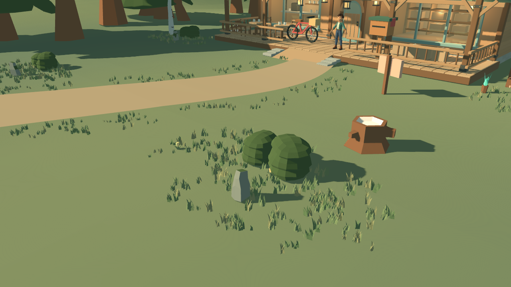
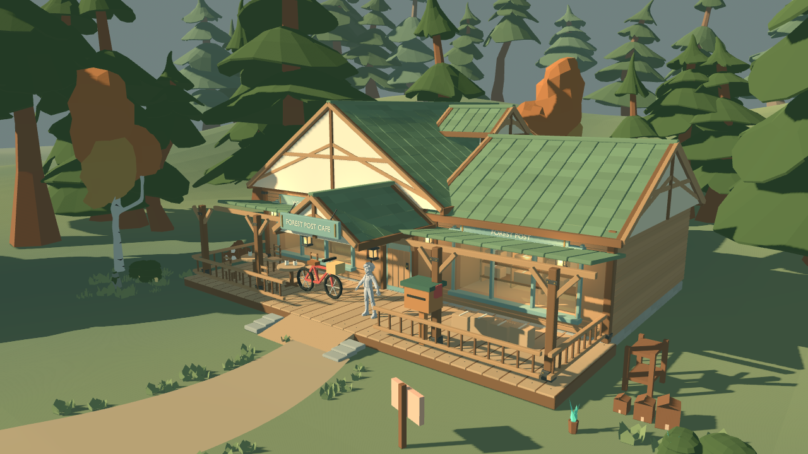

# V06 — Grass and character colors

Code: `e7844db23c3a7a10f1bfe5228eeaed9fbf9fe5cc` on `feature/v06-grass-character-color`, based on V05 `c3adaabbad695a854eaa6a8c5238e0d601d1883a`.
All seven after PNGs are actual Godot viewport captures, Godot 4.6.3 / OpenGL Compatibility / Mesa llvmpipe / Linux / 1280 × 720. No AI imagery or paint-over. Actual gameplay camera in image 01; review angles in the other images. Capture: `DISPLAY=:99 godot --audio-driver Dummy --path . --script tools/capture.gd -- --output=/tmp/v06-final-review`.

## Nhân vật có màu

Chín material: da ấm, tóc nâu, áo xanh rêu, áo kem, quần xanh sẫm, giày/đồ da nâu, đế tối và đồng. Giữ GLB gốc người dùng, 52 xương, số tam giác và controller. Chưa có animation mới.

## Cỏ mới

Thay cỏ lá bản to bằng ba mẫu lá mảnh cong 35/45/30 tam giác. Mảng cỏ thấp 9–25 cm, mật độ giảm ở mép, màu dịu và các khoảng ngắt ven đường. Cỏ dùng MultiMesh, không có collision hay bóng riêng. Căn nhà V05 giữ nguyên.

## Before / after

| View | V05 before | V06 after |
| --- | --- | --- |
| Gameplay, same camera |  |  |
| Porch palette, same camera |  |  |
| Human scale |  |  |

## Other review angles

Before images copied unchanged from `preview/ver-05-hero-building` commit `99795bee104aa05005e1d53f070183a98eeaa6bf`. V01–V05 retained. No Windows hardware benchmark is implied. House approved by user feedback; grass/color review pending. [Vietnamese report](https://github.com/VietCodeBug/forest-post-cafe/blob/e7844db23c3a7a10f1bfe5228eeaed9fbf9fe5cc/docs/v06-grass-character-color.md).
