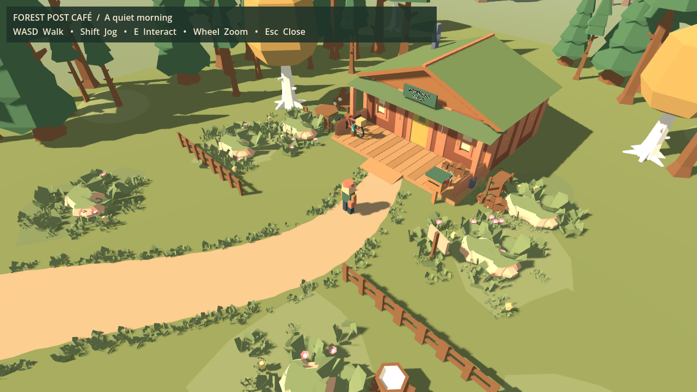
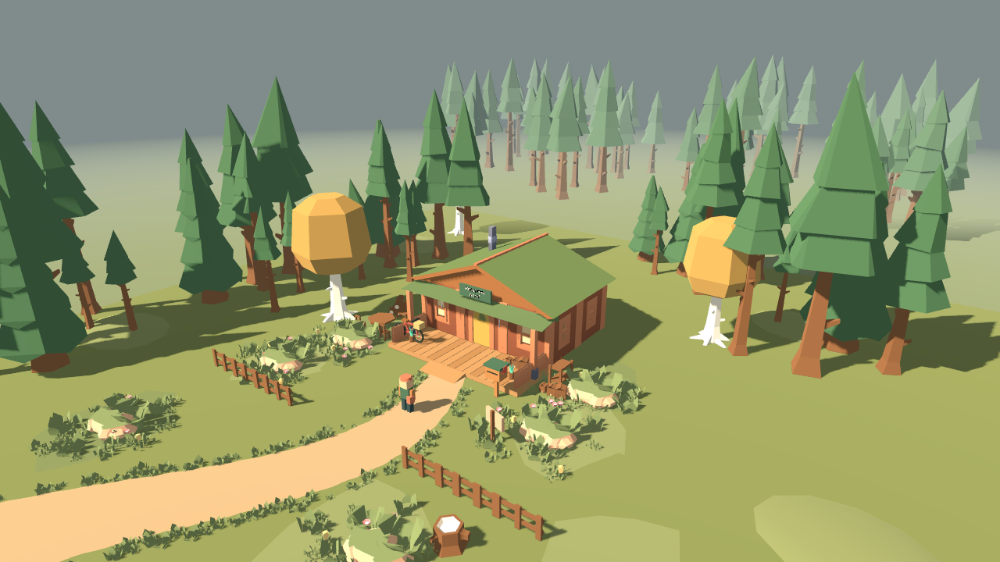
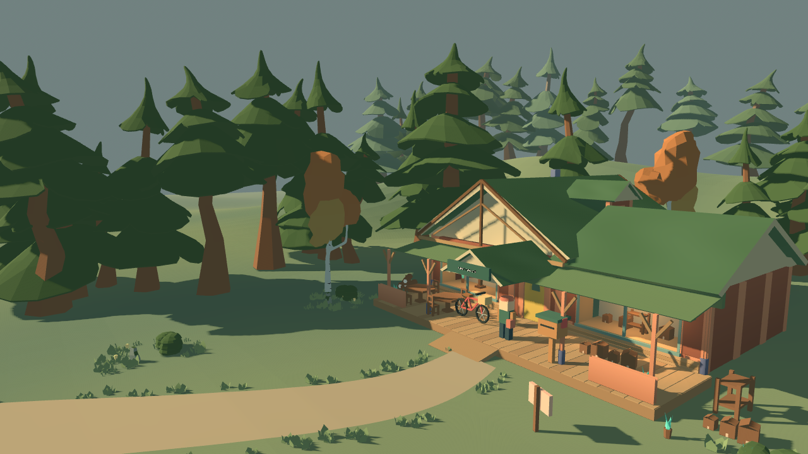

# V04 — Map 01 art review (not visually approved)

After code: [aa5f7181f9d29abbbfb6791fe2070a6895112eff](https://github.com/VietCodeBug/forest-post-cafe/tree/aa5f7181f9d29abbbfb6791fe2070a6895112eff)
Before code: [33b493baefc82b6a05086eabd8b7308670ca6267](https://github.com/VietCodeBug/forest-post-cafe/tree/33b493baefc82b6a05086eabd8b7308670ca6267)

Only the existing Map 01 was edited. Playable bounds remain 48 × 48 m. No Map 02,
new playable region or new gameplay system. Original preview branches are unchanged.

Actual Godot 4.6.3 / OpenGL Compatibility / Mesa llvmpipe captures, 1280×720.
01 is the live gameplay camera with UI. 02 shows the player at the entrance. 03–05
use separate cinematic presets. No concept art, image generation or paint-over.
Before and after camera settings differ, so this is an art/framing review rather
than a pixel comparison.

**Visual status: premium target not yet met; user approval pending.** Roof/wood
surfaces, contact shading, some props and meadow composition still need refinement.
Technical pass does not imply visual approval. Do not start Map 02 or extra systems
before user art approval. Read the full Vietnamese report in
[docs/map01-v04-art-review.md](https://github.com/VietCodeBug/forest-post-cafe/blob/aa5f7181f9d29abbbfb6791fe2070a6895112eff/docs/map01-v04-art-review.md).

Technical evidence: source rosters verified; editor import and 120-frame startup
pass; 13 gameplay checks, 7 OpenGL asset/scale checks and 11 scope/conformance checks
pass. Windows native execution and hardware performance remain untested.

## Before / after

| View | Before V03 | After V04 |
| --- | --- | --- |
| Gameplay |  |  |
| Café scale |  |  |
| Wide |  |  |

## Architecture close-up

## Forest and lighting

