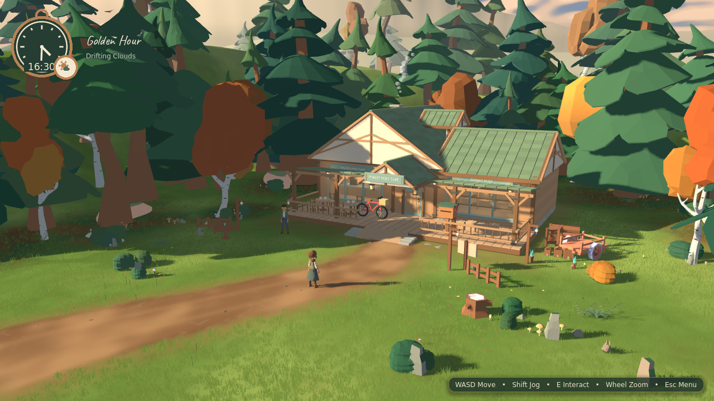
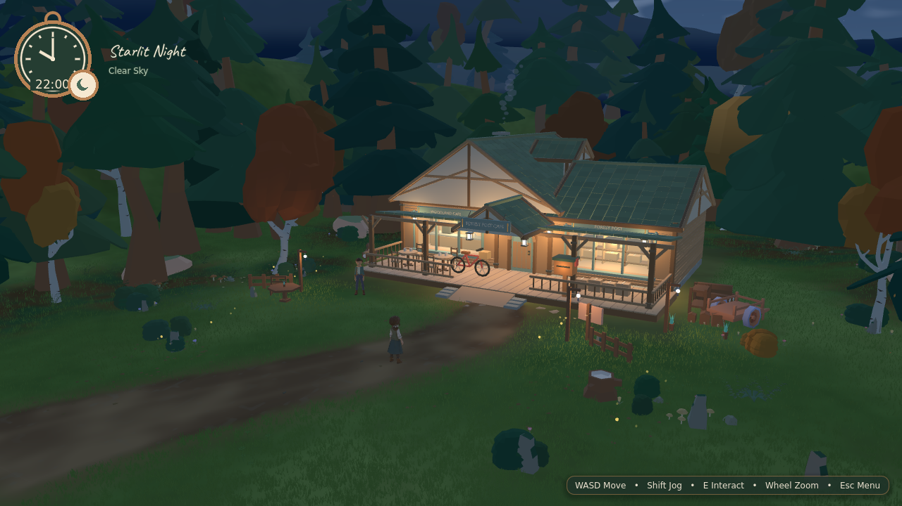
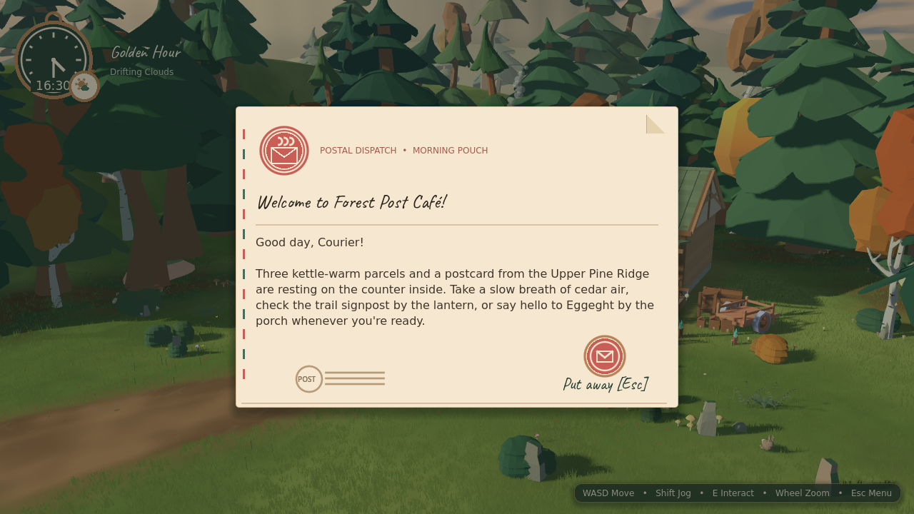

# Circular Postal UI — V12 follow-up

Code `7bb3c3a583c2823a79bcaf8a79a55485f4b6ea8a` · [PR #10 chưa merge](https://github.com/VietCodeBug/forest-post-cafe/pull/10). Số preview tiếp theo là V13; đây không phải bản mở rộng môi trường V13.

## Ảnh Godot thật

| Màn hình | 720p | 1080p |
|---|---|---|
| HUD sáng | [Xem](after/720p/01-day-hud.png) | [Xem](after/1080p/01-day-hud.png) |
| HUD tối | [Xem](after/720p/02-night-hud.png) | [Xem](after/1080p/02-night-hud.png) |
| Mở phong bì | [Xem](after/720p/03-envelope.png) | [Xem](after/1080p/03-envelope.png) |
| Thư / nút dấu sáp | [Xem](after/720p/04-letter-wax-seal.png) | [Xem](after/1080p/04-letter-wax-seal.png) |
| Đóng phong bì | [Xem](after/720p/05-closing-envelope.png) | [Xem](after/1080p/05-closing-envelope.png) |
| Main menu giữ nguyên | [Xem](after/720p/06-title.png) | [Xem](after/1080p/06-title.png) |
| Pause chính thức | [Xem](after/720p/07-pause.png) | [Xem](after/1080p/07-pause.png) |

[Thư V12 trước](before-v12/09-letter.png) · [Pause V12 trước](before-v12/06-pause.png). Đây là tham khảo UI, không phải A/B khóa pixel.

HUD bỏ nền chữ nhật, đồng hồ đọc giờ thật và badge thời tiết chỉ hiển thị. Nút cất thư là dấu sáp coral; có gấp phong bì khi đóng, góc giấy gấp, badge tương tác/notification tròn. Controls hint tự mờ sau vài giây. Giữ main menu ký họa, café/cỏ/map/gameplay; Studio chỉ debug, không thêm scheduler thời tiết.

23 UI + 13 smoke + 20 integration checks pass; validator khóa asset và diff checks pass. Godot 4.6.3 Compatibility Linux/Mesa llvmpipe, không benchmark Windows. Clock chỉ bị giữ trong script capture. Không dùng ảnh AI giả làm screenshot; tranh main menu vẫn là asset minh họa V12 với provenance đã công bố. Texture cleanup leaks từ baseline vẫn có; test pass không phải duyệt mỹ thuật. Kim/viền là vector code, chưa có artwork đồng hồ riêng hoặc texture grain/âm giấy thu thật.

[Báo cáo tiếng Việt](https://github.com/VietCodeBug/forest-post-cafe/blob/7bb3c3a583c2823a79bcaf8a79a55485f4b6ea8a/docs/circular-postal-ui.md).
