# Map 01 — V05 ground/environment only

Code: `82cfd4ed68627bcfdb428e10947c20f1b692b15b` on `feature/map01-ground-environment`.
Current baseline: `e5900df3f9a5df304df845521c3903e94b779649`. V04 comparison: `aa5f7181f9d29abbbfb6791fe2070a6895112eff`.

Quán được giữ nguyên: `cafe_kit.gd`, GLB/materials, kích thước và vị trí không đổi so baseline hiện tại. GLB SHA-256 vẫn `13d03ae08343f6052258b008f187602c47b9b2c7f115878e930fe9b2560f5ec3`. Không sửa player/camera/collision/mailbox, core path route/width hoặc bounds 48 × 48 m. Không thêm map/gameplay.

## Five matched Godot views

| Góc | V04 | Trước lượt này, cùng quán hiện tại | Ground/environment mới |
| --- | --- | --- | --- |
| Gameplay mặc định | 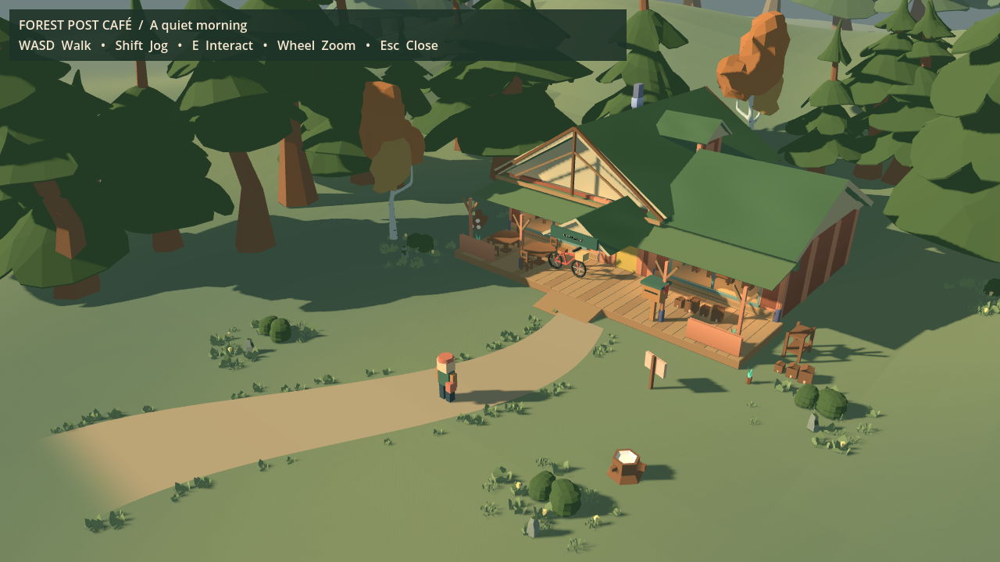 | 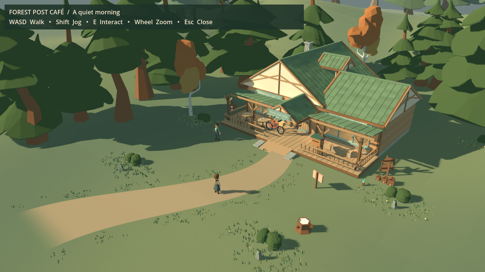 |  |
| Ground / grass cận | 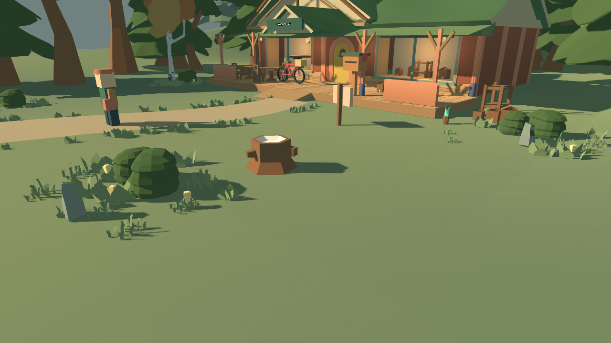 | 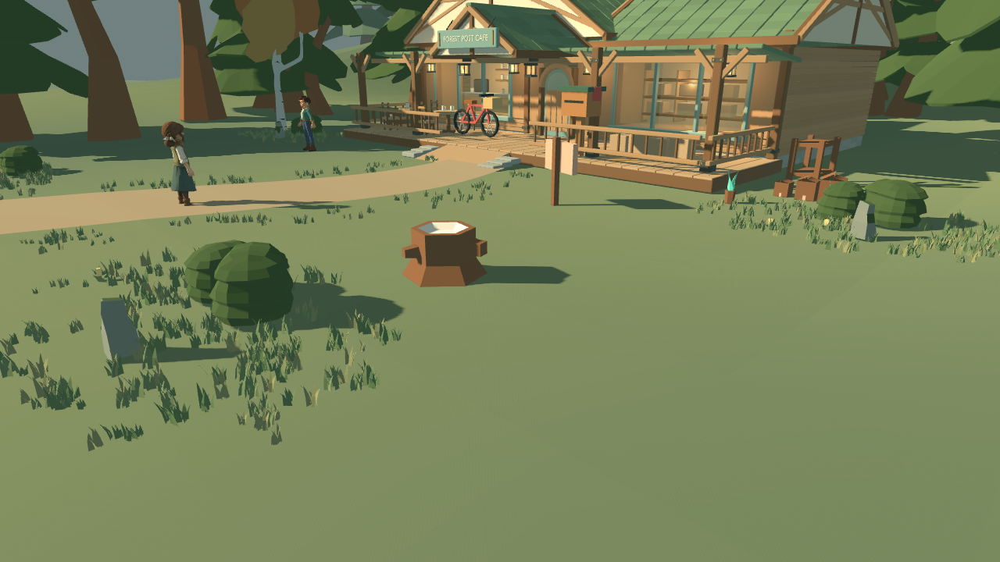 | 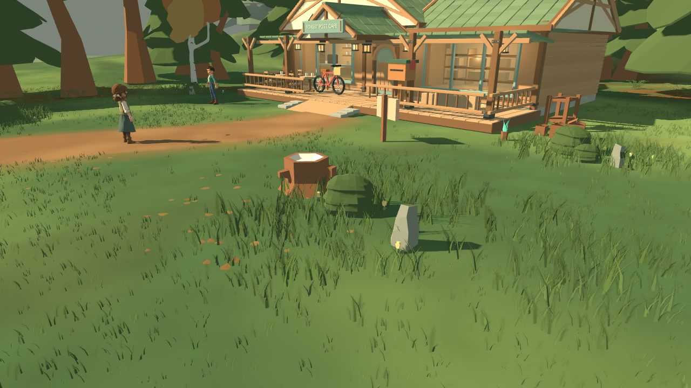 |
| Đường và chuyển tiếp | 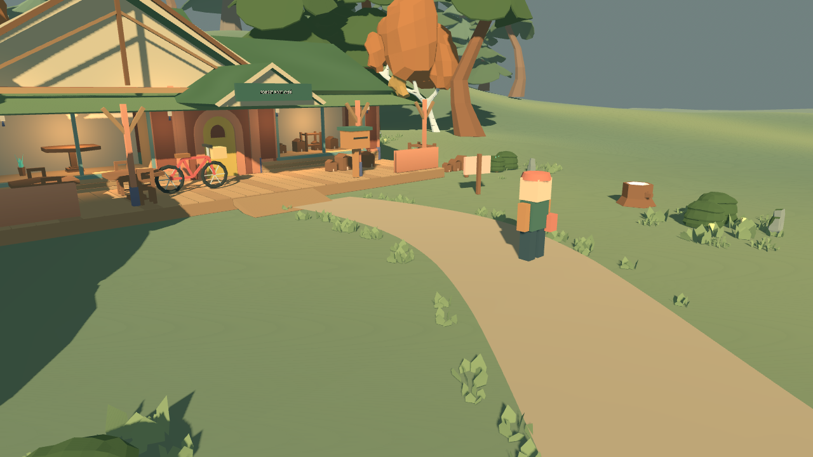 | 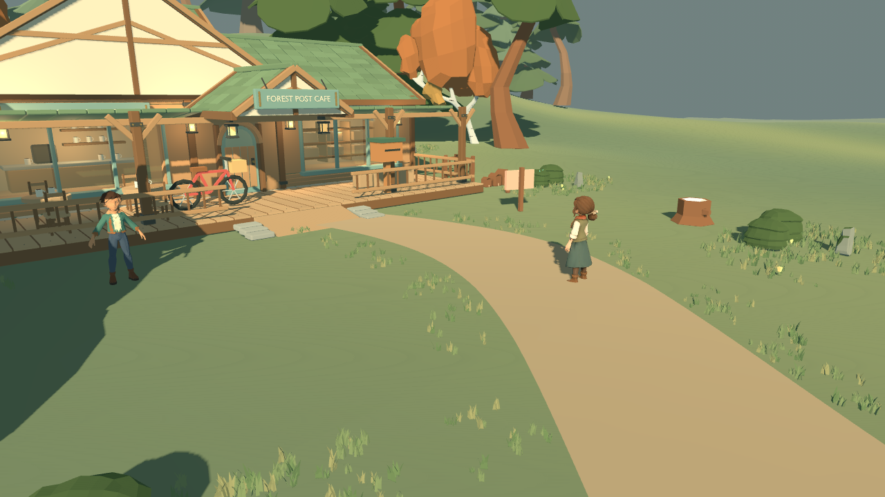 | 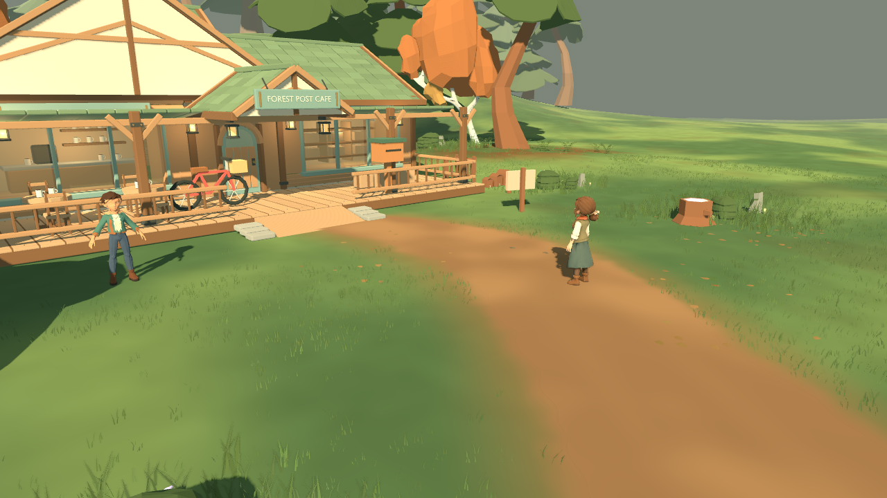 |
| Nền rừng dưới tán | 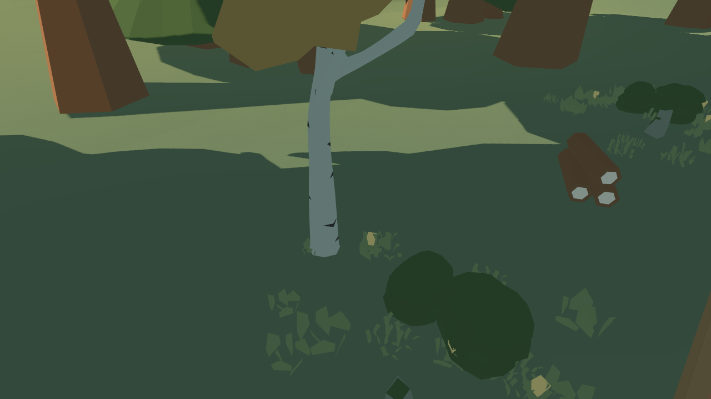 | 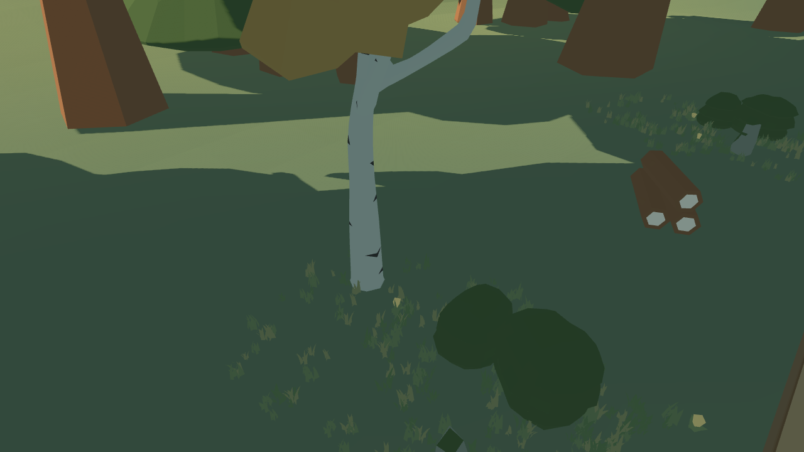 | 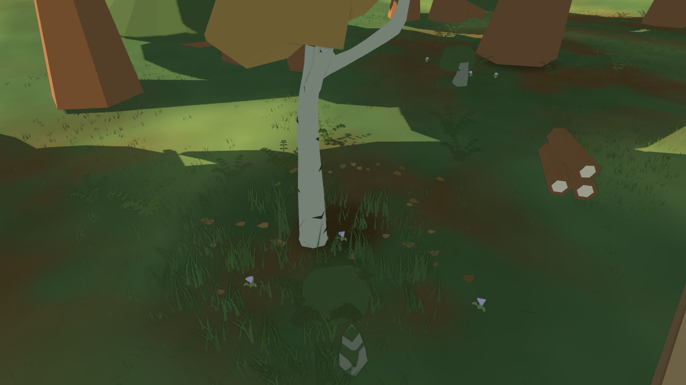 |
| Toàn cảnh Map 01 | 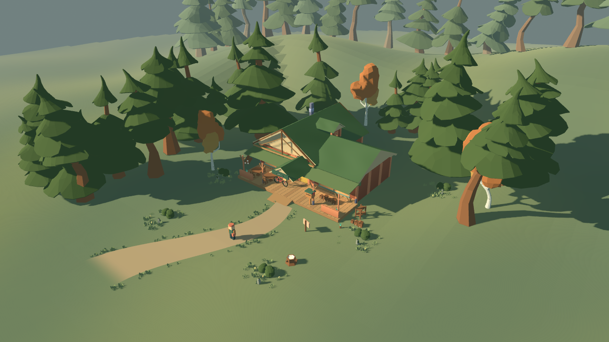 | 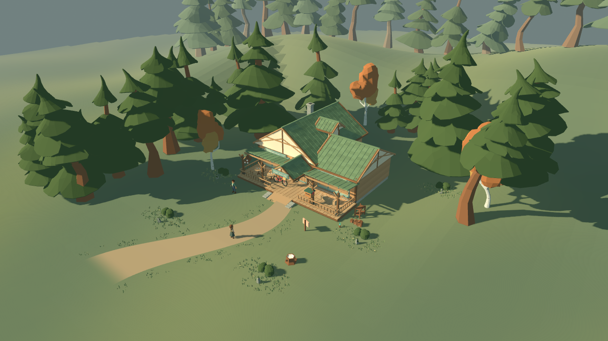 |  |

V04 trong Git có quán phiên bản cũ hơn quán hiện tại. Vì vậy có thêm cột baseline hiện tại để kiểm tra riêng việc giữ quán; chênh lệch kiến trúc V04→baseline đã xảy ra trước lượt này và không được tính là thay đổi ground pass. Hai bộ before được render lại từ git archive bằng cùng `capture_ground.gd`; không sửa source scene/asset trước khi chụp. Camera gameplay giữ nguyên, bốn camera còn lại là góc review cố định.

## Thay đổi / assets

Nền world-space đa tỉ lệ xanh/rêu/đất, cỏ ngắn liên tục và các cụm medium/tall, dương xỉ, lá rơi/cành tụ thành túi, hoa thưa, đá nhỏ chôn thấp. Đường vẫn route cũ, mesh visual áp sát terrain hơn, dải biên alpha irregular và đất đổi sắc nhẹ. Giữ cây Quaternius và vị trí/collider; dàn lại shrubs/forest floor thay vì thêm cây.

7 module Blender tự tạo (tổng 420 tam giác nguồn), khoảng 11 nghìn instance trong MultiMesh chunks 8 m. Không texture ngoài trong bộ mới. CC0 Quaternius/Kenney trước đó được tái sử dụng, source byte/manifest không đổi. Không dùng ảnh minh họa AI hoặc paint-over cho review này.

## AO and renderer evaluation

Godot **4.6 Compatibility supports SSAO**. Frozen camera, player and wind A/B:

| SSAO off | SSAO on (.55 radius / .65 intensity / 1.1 power) |
| --- | --- |
|  |  |

Giữ SSAO nhẹ sau khi thấy hiệu ứng tiếp xúc, không dùng độ chênh pixel làm chứng nhận chất lượng. [Actual log](ao-evaluation/ssao-log.txt). Ảnh 5 góc after dùng SSAO bật và gió nhẹ bình thường.

[Forward+ capability probe](ao-evaluation/forward-plus-probe.txt) thất bại do thiếu `VK_KHR_surface`, engine tự fallback OpenGL; không có hình/FPS Forward+ thành công. Probe diễn ra trong quá trình iterate, không dùng nó làm benchmark. Project vẫn Compatibility; không thêm GI bake hay SSIL/SDFGI/VoxelGI. LightmapGI runtime có thể dùng baked maps trong Compatibility nhưng chưa bake scene/UV2 ở lượt này.

## Capture and validation

Actual Godot 4.6.3 viewport, 1280 × 720, Compatibility/OpenGL 4.5, Mesa llvmpipe on Linux. Main after capture command: `DISPLAY=:99 godot --audio-driver Dummy --path . --script tools/capture_ground.gd -- --output=/tmp/ground-review-with-ssao`. AO repro: `tools/evaluate_ground_ssao.gd` (locks camera/player and disables wind within the probe process).

Passed editor import/boot, 13 gameplay smoke, 11 Map 01 scope, 18 display integration and 12 floor scope checks; protected café/gameplay bytes, terrain functions, tree placement and source manifests verified. No Windows GPU performance result is claimed.

Cỏ xa còn có thể alias; fern/bush silhouettes lặp, mép đường còn mềm ở góc thấp, chưa có baked indirect GI. **Visual approval is pending; passing tests does not establish premium quality.** [Vietnamese report](https://github.com/VietCodeBug/forest-post-cafe/blob/82cfd4ed68627bcfdb428e10947c20f1b692b15b/docs/map01-ground-environment-review.md).

Branch name follows the user's explicit `preview/ver-05-ground-environment` request; all older preview branches, including ver-05-hero-building and ver-07-samatha-player, remain intact.
