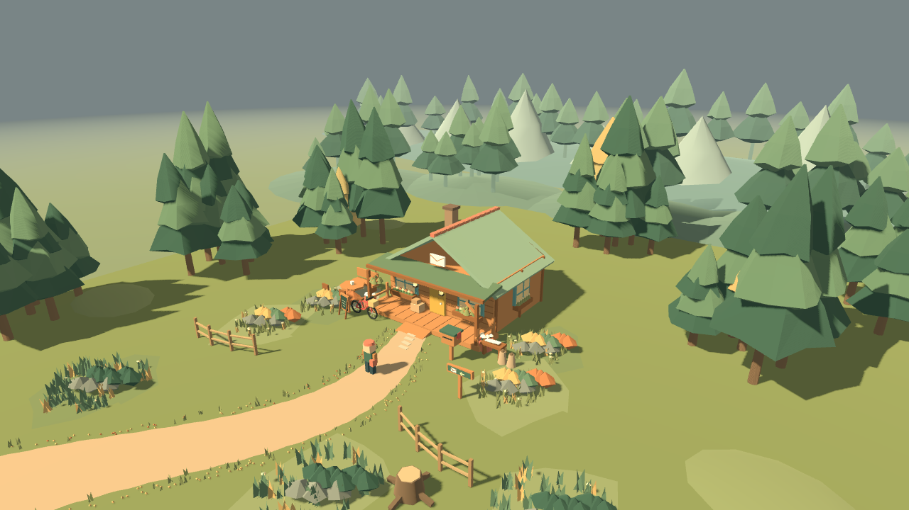
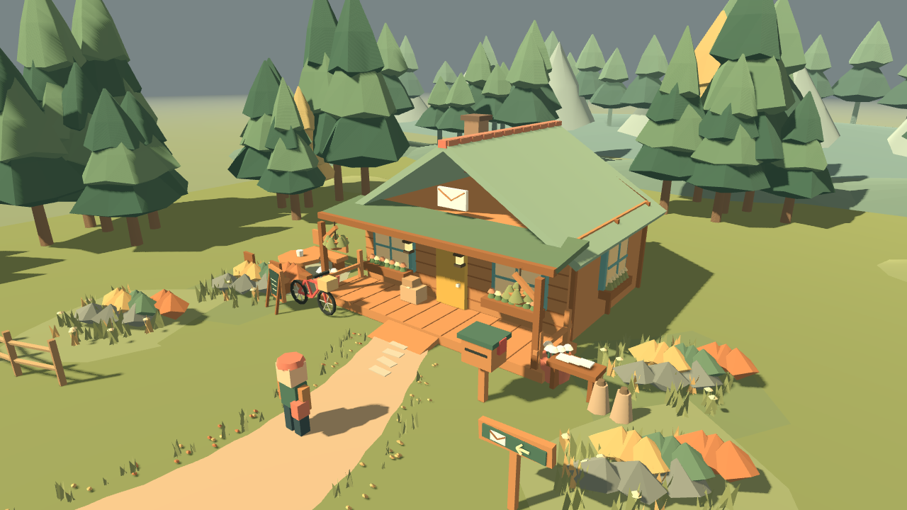

# ver-02-composition-depth — Composition and depth

Code commit: [31c43cb558c5ccc84e55f743d2150a81e8d64b6c](https://github.com/VietCodeBug/forest-post-cafe/tree/31c43cb558c5ccc84e55f743d2150a81e8d64b6c)

Preview-only branch. No game source or merge target. Preserve this version;
use the next version number for the next visual review session.

Captured in Godot 4.6.3, OpenGL Compatibility, Mesa llvmpipe/Xorg dummy.
1280×720 PNGs from the actual renderer. No image-generation or paint-over.
The first view uses the gameplay camera/UI; views 2 and 3 are fixed review cameras.
Windows native behavior and hardware performance are not established by these images.

