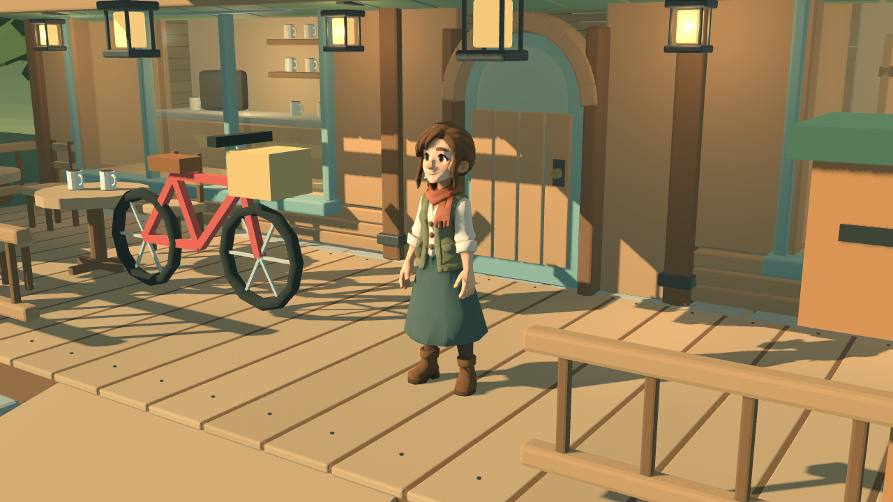
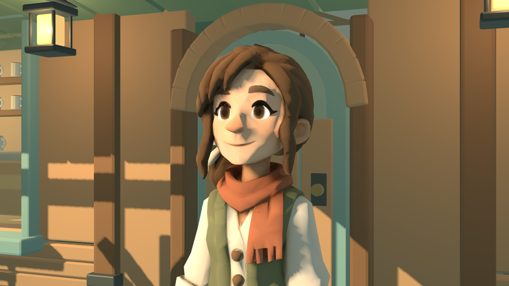
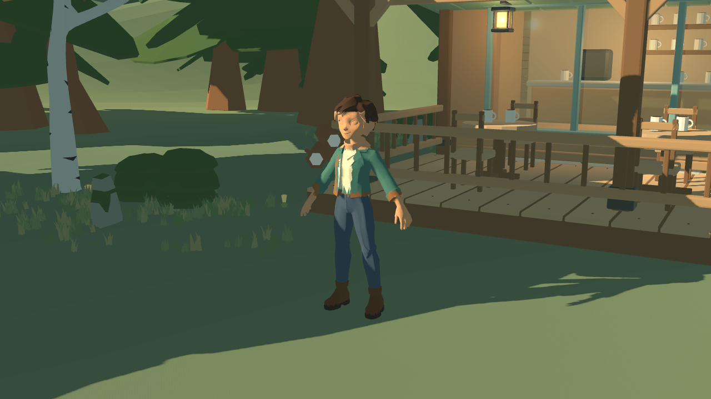
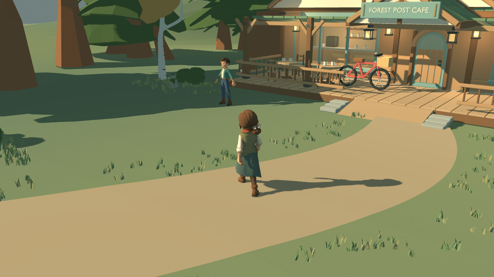
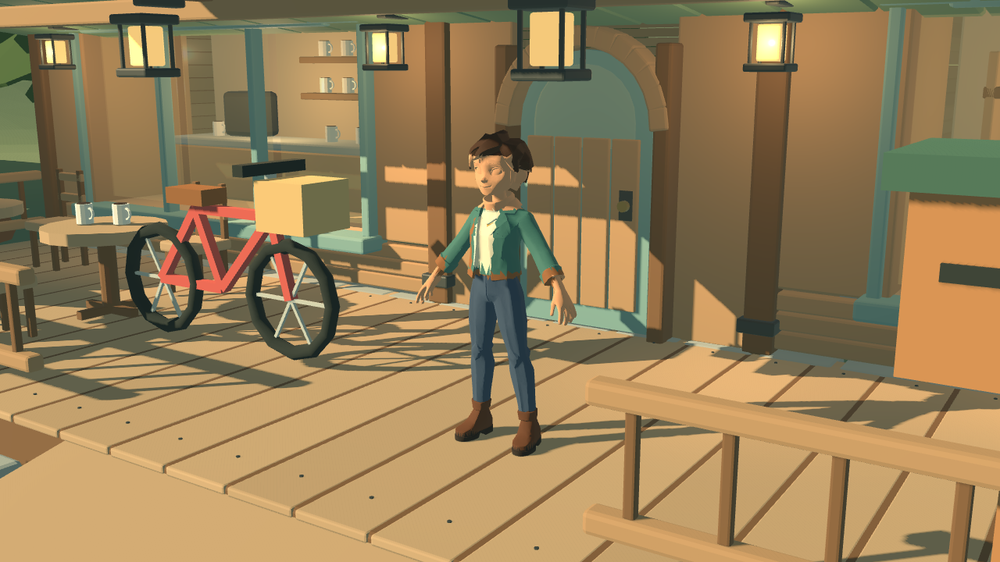

# V07 — Samatha player, lowered idle arms

Code: `2960ead726adf9c036633637dd172162c4162de1` on `feature/v07-character-roles`, based on V06 `e7844db23c3a7a10f1bfe5228eeaed9fbf9fe5cc`.
Five actual Godot 4.6.3 viewport captures, 1280 × 720, Compatibility / Mesa llvmpipe / Linux. The first camera is gameplay; the others review original textures, idle, NPC and the supplied Walking clip. Existing hub lighting/materials are used, no paint-over or generated review images.

Command: `DISPLAY=:99 godot --audio-driver Dummy --path . --script tools/capture_characters.gd -- --output=/tmp/v07-samatha-idle-fixed`.

## Samatha has original colors; idle arms lowered

Giữ texture màu gốc của upload: không tô lại mặt. 66 xương, base color/normal/metallic-roughness PNG 4096² nhúng, ba clip Walking/Running/Casual_Walk. Không có idle clip: dùng pose đứng nghỉ tĩnh với hai tay hạ tự nhiên. Kiểm tra tay sau khi ngừng đi/chạy để tránh quay lại T-pose.

## Roles

- Samatha: người chơi tạm; WASD Walking, Shift Running.
- eggeght: nhân vật cũ chuyển thành NPC riêng cạnh lối vào, không nhận WASD.
- Joe: source npc1.glb hiện chỉ có material xám, không texture; không xuất hiện trong hub theo yêu cầu chỉ dùng model có màu.

## Gameplay comparison

| V06 player | V07 Samatha player |
| --- | --- |
|  |  |

Previous actor, now eggeght: 

Before images copied unchanged from preview/ver-06-grass-character-color (`9ca9781d9e30ced171eda22f8a1a8e06d90b7189`). V01–V06 retained. V05 house and V06 grass are unchanged. Source GLBs retain their exact uploaded SHA-256. Tests passed: 13 smoke, 11 Map 01 scope, 18 display integration including texture retention, role mapping, walk/run and lowered arms before/after movement. No Windows performance result or user art approval is implied.

[Full Vietnamese report](https://github.com/VietCodeBug/forest-post-cafe/blob/2960ead726adf9c036633637dd172162c4162de1/docs/v07-character-roles.md).
