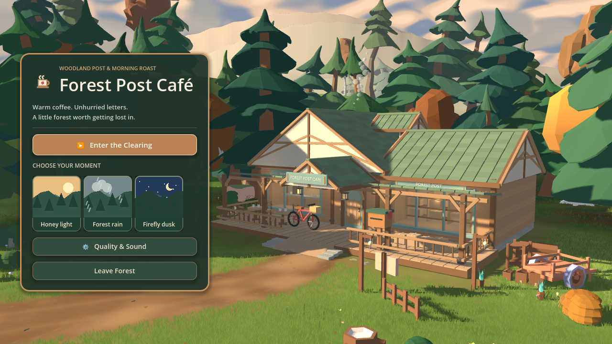
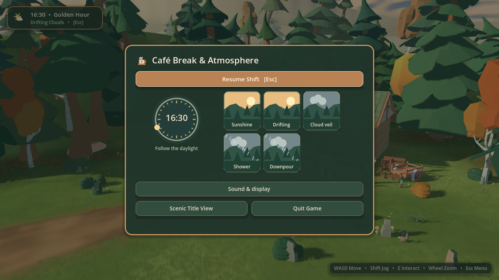
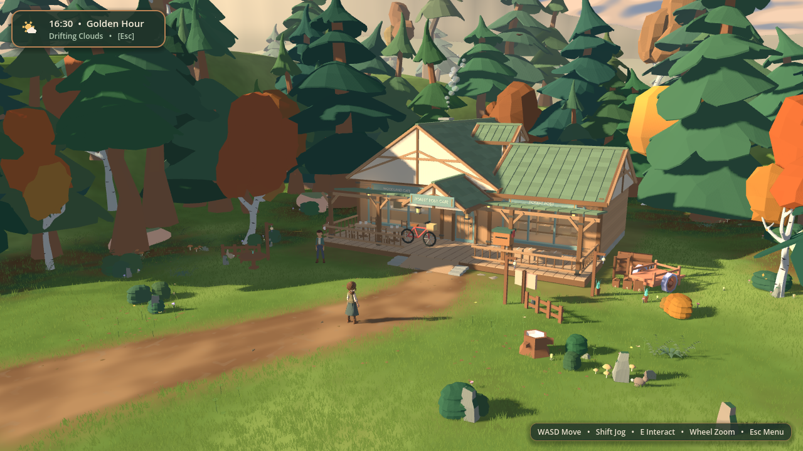
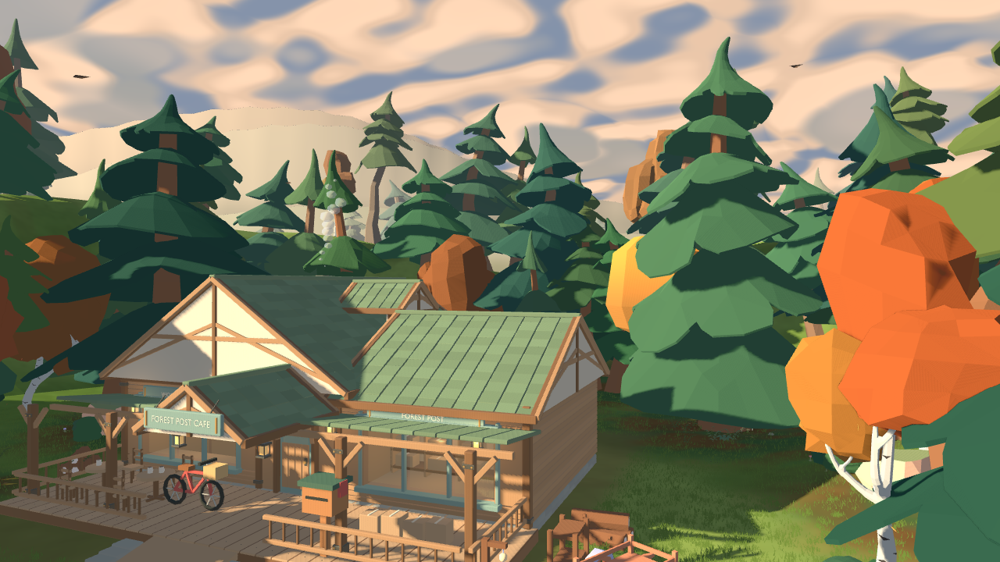
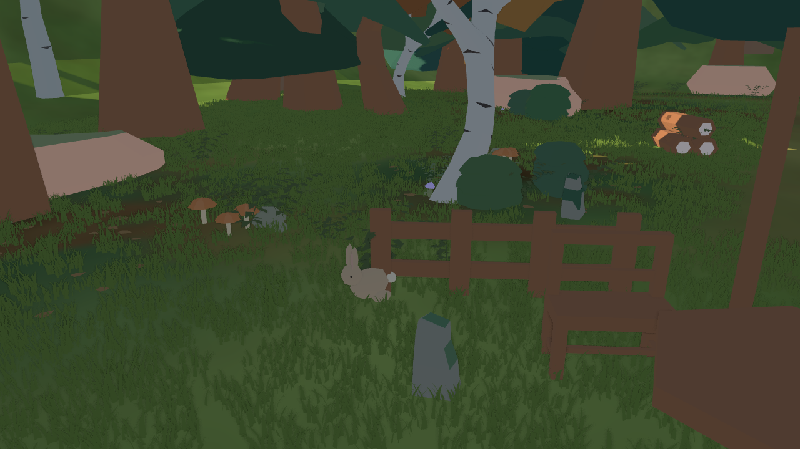
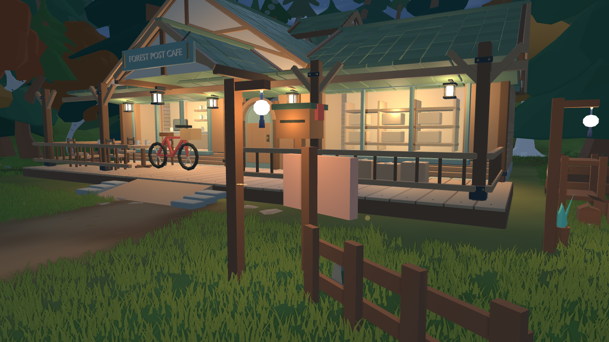
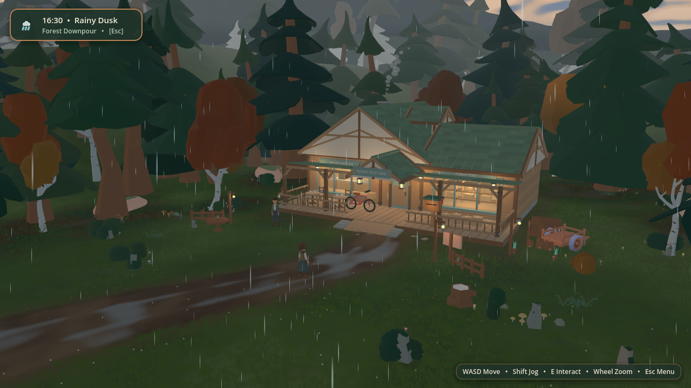

# Forest Post Café — V11

Code: `bfae2f9d75386f0499808c184d614d97e924dd80` ([PR #10](https://github.com/VietCodeBug/forest-post-cafe/pull/10)), không merge.

## Ảnh render thật

Godot 4.6.3, Compatibility, Linux Xorg/Mesa llvmpipe, 1280×720. Không có ảnh AI. UI chụp từ commit trên; các góc môi trường chụp từ `0a6a5e08e3f0a2122f97045f18095832b42f5f4a`, chỉ khác sửa kích thước panel và tùy chọn capture.

`before-user-v10` giữ ảnh gốc do người dùng đưa lên preview V10, nguồn code3351c01; thông số máy/renderer của ảnh gốc chưa xác minh độc lập. Đây là tham khảo bố cục, không phải phép đo pixel A/B chuẩn hóa.

## Đã làm

Postcard thời tiết chuyển động, đồng hồ tròn tương tác, menu gọn hơn; ba tầng hậu cảnh rõ hơn; ba thỏ, tám bướm đêm và các cụm dương xỉ/lá rộng. Mưa lớn giảm nắng và tắt bóng nắng cứng. Cỏ đã duyệt, café và gameplay giữ nguyên.

Sáu bộ test/85 assertion pass; log trong checks. Headless pass không phải duyệt mỹ thuật. Chưa benchmark WindowsGPU.

## Còn hạn chế

Núi/mây vẫn đơn giản, chưa đạt cảm giác hùng vĩ hoàn chỉnh. Thỏ thủ tục chưa rig/AI; bướm đêm nhỏ. Đường ướt vẫn còn các vệt phản sáng dễ thấy, chưa có puddle chất lượng cao. Hai texture leak lúc thoát Godot vẫn còn như baseline. Không tuyên bố premium/wow đã đạt.

[Báo cáo tiếng Việt](https://github.com/VietCodeBug/forest-post-cafe/blob/bfae2f9d75386f0499808c184d614d97e924dd80/docs/v11-atmosphere-habitats.md).
