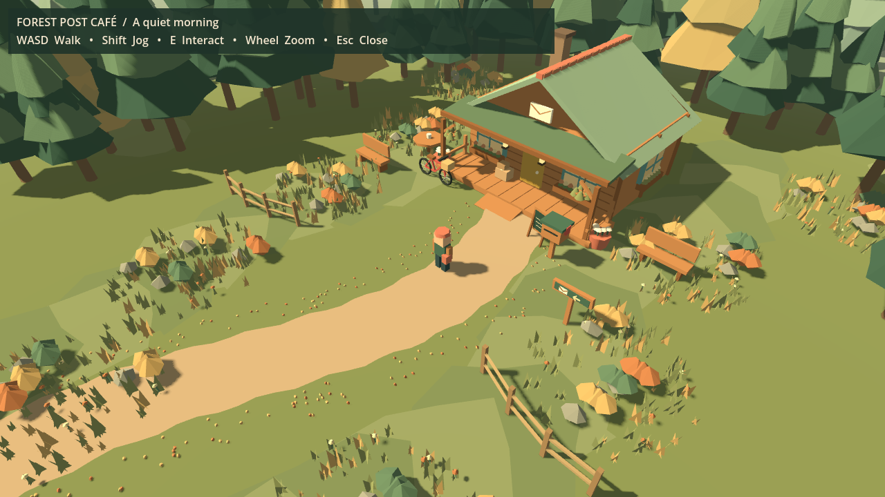
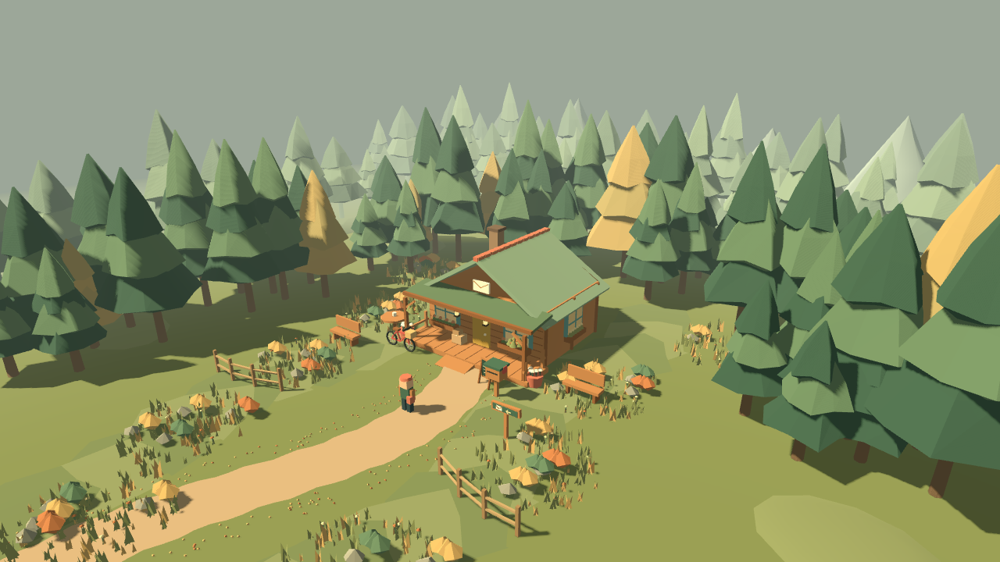
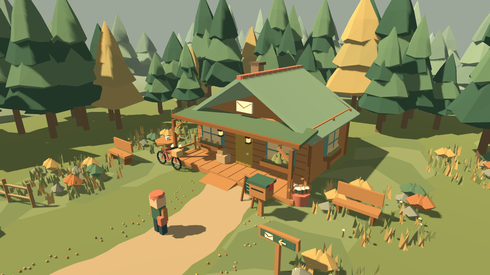

# Early Autumn Cozy Forest — nâng cấp hình ảnh

## Thay đổi

- Thay thông thấp bằng bộ cây procedural có 3 kích cỡ (cao khoảng 6–13 m) và 3
  silhouette: spruce thon nhiều tầng, fir tán rộng và pine hơi lệch thân/tán.
  56 cây gần chia thành 7 cụm quanh khoảng trống café; 46 cây xa tạo lớp rừng nền.
- Giữ phần lớn thông xanh, điểm cây vàng, bụi lá cam/vàng, hoa kem, cỏ ấm và lá rụng
  dọc lề đường. Bố cục được seed cố định, không rải đều cây trên toàn map.
- Thay đường bằng ribbon liên tục; thêm mảng cỏ không đều, đá faceted, vạt hoa,
  bụi cây, đồi thấp có collision, hàng rào dẫn mắt và cảnh nền che mép map.
- Café có mái hiên/cột/giằng, ống khói, cửa sổ bên hông, flower box, giỏ cây,
  đèn treo, bảng menu, kiện thư và biểu tượng phong bì. Giữ mái gable xanh,
  tường gỗ, cửa mustard, viền teal, xe đạp coral và vị trí hộp thư.
- Giảm nắng cháy, cân ambient, bóng đổ và haze theo khoảng cách; bật MSAA 4x.
  Rừng xa lạnh/nhạt hơn, café và đường giữ sắc ấm.

## Tệp và mở rộng theo mùa

`woodland.gd` tạo cây/cỏ/đá/bụi cây theo cụm, dùng MultiMesh theo mesh/màu để tái sử
  dụng hình học. `forest_palette.gd` và `assets/palettes/early_autumn.tres` tách
  bảng màu khỏi layout. `forest_hub.gd` giữ phần dựng cảnh, ánh sáng và chi tiết quán.
  `shapes.gd` dùng lại material matte; material cần emission được duplicate riêng.

Có thể tạo palette mùa khác và truyền vào woodland mà không đổi controller hoặc
  tương tác. Đây là nền tảng dữ liệu mỹ thuật, **chưa có hệ thống chuyển mùa**;
  màu props, hoa chậu, thời tiết và một số accent vẫn cần art pass riêng cho mùa mới.

## Ảnh thực tế trong Godot

Ảnh PNG 1280×720 từ Godot 4.6.3 / OpenGL Compatibility / Mesa llvmpipe:







Tái tạo bằng display có renderer thật (không dùng --headless):

```sh
godot --path . --audio-driver Dummy --script tools/capture.gd -- --output=/tmp/forest-captures
```

Góc 01 giữ nguyên follow camera và UI khi chơi; góc 02/03 chỉ phục vụ review mỹ thuật,
  tạm ẩn UI và đặt camera cố định trong script capture, không thay camera gameplay.

## Kiểm tra và giới hạn

- Godot headless editor import và startup 120 frame: đạt.
- 13 kiểm tra gameplay hiện có: đạt, gồm di chuyển/dừng, nền/tường, khoảng tương tác,
  E mở thư, Esc đóng, khóa di chuyển trong panel, camera follow và giới hạn zoom.
- Đã render và xem cả ba góc; sửa winding/normal, ánh sáng gắt và các mặt cỏ trùng
  độ sâu trong quá trình review. Xorg dummy không hỗ trợ V-Sync, có cảnh báo này.
- Không sửa script controller, follow camera, interaction hoặc UI. Cây có collision
  thân; cỏ/hoa/lá là trang trí. Ranh giới chơi cũ vẫn giữ, mesh tường biên được ẩn.
- Chưa kiểm thử native Windows hoặc đo FPS trên máy người chơi. Geometry/material
  nhẹ và instancing là lựa chọn triển khai, không phải số liệu benchmark.
