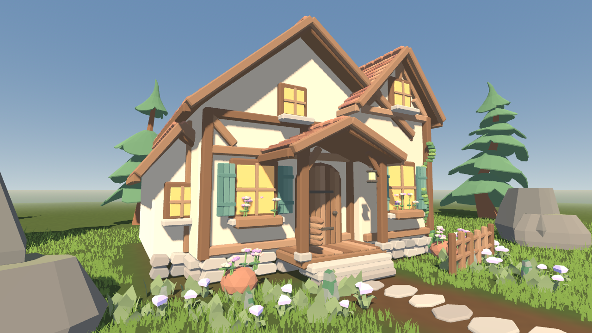
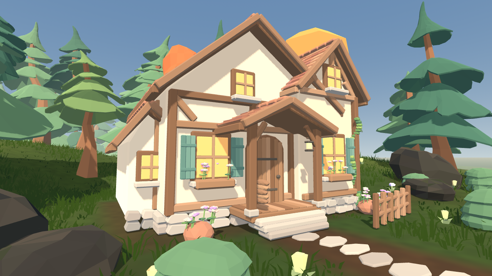
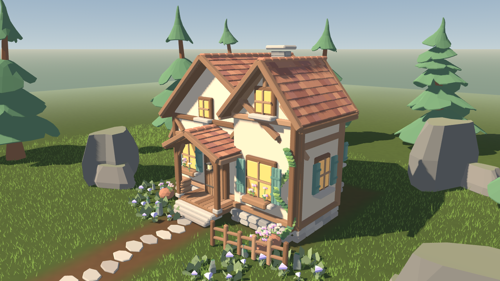
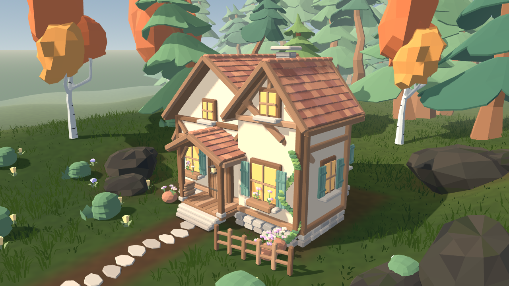

# A1 House Yard · Forest clearing rework

**PENDING_CREATOR_APPROVAL.** Baseline thị giác và hiệu năng là bản bị trả lại d755986. Cottage GLB và Blender trùng byte với bản đó. Cảnh chỉnh là preview độc lập của House Gate.

| Camera cố định | Trước | Sau |
| --- | --- | --- |
| Tầm mắt |  |  |
| 3/4 |  |  |
| Mặt trước | [Trước](../review-a1-house-yard/after/front.png) | [Sau](front.png) |
| Mặt bên | [Trước](../review-a1-house-yard/after/side.png) | [Sau](side.png) |

[Cận cỏ và mép đường](verge.png) · [Chân đá](boulder-foot.png) · [Nhìn từ rừng về nhà](forest-overlook.png) · [Đi bộ từ đường rừng, vòng bên nhà](walk.mp4)

## Cảnh quan và nguồn asset

- Nền sân giờ là một mesh địa hình có collider trùng bề mặt. Móng, hiên và đoạn phiến lát gốc vẫn nằm ở cao độ thiết kế. Lối đất tiếp tục uốn ra rừng. Gò thấp đỡ các cụm đá, tăng lên thành sườn đất ở đằng sau nhà.
- Cỏ gồm **1.441 cụm ngắn, 3.596 cụm vừa, 319 cụm cao**, tổng 5.356 so với 8.932 clump/hoa V2. Dải lá có đoạn giữa rộng, đầu cong, hướng và tỷ lệ thay đổi. Clump theo vùng, có khe đất thấp. Mask loại trước nhà, lối vào, rào, lõi đá và thân cây. Gió mềm theo trường world-space; cụm cỏ cùng vùng nghiêng cùng nhịp.
- Ba cụm dùng tám instance của bộ đá nguyên gốc dự án [Blender](../../../art_source/a1_clearing/boulders.blend) và [script dựng](../../../art_source/a1_clearing/build_boulders.py). [Ledge](../../../assets/a1_house_gate/clearing_ledge.glb), [Erratic](../../../assets/a1_house_gate/clearing_erratic.glb), [Slab](../../../assets/a1_house_gate/clearing_slab.glb) gồm biến thiên granite và rêu theo mặt, một vật liệu mỗi mesh. Đá đặt chìm theo sampler và có proxy hộp xoay. Cây/cây bụi tái sử dụng [Kenney](../../../assets/vendor/kenney/README.md) và [Quaternius](../../../assets/vendor/quaternius/README.md).
- Tiền cảnh có bụi và hoa theo điểm, hàng cây chính ở trung cảnh thay chiều cao, tán và khoảng cách. Rặng sau dùng cây batch và haze. Preview dùng ambient dịu hơn và hạ opacity bóng; thông số ánh sáng khác baseline vì đây là phần được yêu cầu sửa. Camera, kích thước viewport và renderer khi đo giữ nguyên.

## Hiệu năng và kiểm thử

Godot 4.6.3 Compatibility, Mesa llvmpipe, 1280 × 720. Chờ 4 frame và đo trung bình 12 frame. Draw calls lấy từ viewport.

| Góc | d755986 (ms / FPS / draw calls) | Cảnh mới (ms / FPS / draw calls) |
| --- | ---: | ---: |
| Front | 609,4 / 1,64 / 698 | 583,1 / 1,71 / 335 |
| Side | 652,9 / 1,53 / 570 | 545,2 / 1,83 / 306 |
| 3/4 | 541,3 / 1,85 / 499 | 546,2 / 1,83 / 256 |
| Eye-level | 690,7 / 1,45 / 628 | 605,4 / 1,65 / 325 |

108 batch cỏ theo ô 6 m và lớp. Có 102–108 batch được bật theo khoảng cách ở bốn góc trước frustum culling; góc từ rừng bật 87. Mỗi batch vẽ đúng một LOD, với hysteresis 12–13 m và cull 30–31 m. Mesh LOD xa dùng ba hoặc bốn tam giác mỗi clump. Cỏ không đổ bóng, cây trung cảnh chỉ nhóm chính đổ bóng và cây hậu cảnh dùng MultiMesh không đổ bóng. Shader gió dùng hai pha sóng và tránh fragment discard; đất/rêu quanh đá tính trọng số contact ở đỉnh. Cỏ chia sẻ một material. Draw calls giảm mạnh nhưng máy dựng phần mềm vẫn chậm hơn sân trống gốc. Chưa có GPU đích để duyệt hiệu năng; chưa đánh dấu PASS.

Import GLB và scene trong Godot thành công. Test tự động kiểm tra y mặt đất khớp collider, vùng cỏ bị loại, cả ba cụm đá có collision, không bật hai LOD chung một batch và nhân vật đi từ sân lên hiên. Cảnh quay dùng Camera3D của người chơi và move_and_slide trên tuyến lối mòn tới hông nhà.

## File sửa

- scripts/environment/a1_house_gate.gd và scripts/environment/a1_clearing.gd
- shaders/a1_house_yard.gdshader và shaders/a1_clearing_grass.gdshader
- art_source/a1_clearing/ và assets/a1_house_gate/clearing_*.glb
- tools/capture_a1_house_gate.gd, tools/capture_a1_clearing_walk.gd và tests/a1_house_yard_test.gd
