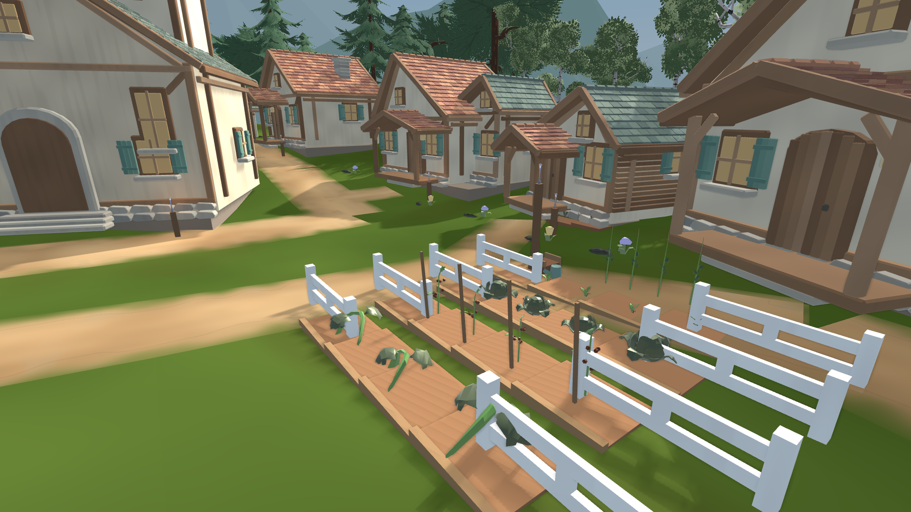

# A1 V5 · So sánh trong Godot

Commit chạy cảnh `9c17ba6b96c735085042089bcf1b0fcf19d125a2`. [Ghi chú triển khai](https://github.com/VietCodeBug/a-place-to-belong/blob/9c17ba6b96c735085042089bcf1b0fcf19d125a2/docs/environment/A1_V5_COZY_POLISH.md).

| Mùa hè, trời quang, 15:09 | Trước · V4 | Sau · V5 |
| --- | --- | --- |
| Nhà A | [V4](https://github.com/VietCodeBug/a-place-to-belong/blob/preview/a1-nature-v4/docs/environment/review-a1-nature-v4/01-nha-a.png) | [V5](01-nha-a.png) |
| Sân Nhà A | [V4](https://github.com/VietCodeBug/a-place-to-belong/blob/preview/a1-nature-v4/docs/environment/review-a1-nature-v4/02-san-nha-a.png) | [V5](02-san-nha-a.png) |
| Rừng đầu | [V4](https://github.com/VietCodeBug/a-place-to-belong/blob/preview/a1-nature-v4/docs/environment/review-a1-nature-v4/03-rung-khoi-dau.png) | [V5](03-rung-khoi-dau.png) |
| Đường rừng | [V4](https://github.com/VietCodeBug/a-place-to-belong/blob/preview/a1-nature-v4/docs/environment/review-a1-nature-v4/04-duong-rung.png) | [V5](04-duong-rung.png) |
| Bờ sông | [V4](https://github.com/VietCodeBug/a-place-to-belong/blob/preview/a1-nature-v4/docs/environment/review-a1-nature-v4/05-bo-song.png) | [V5](05-bo-song.png) |
| Đường vào làng | [V4](https://github.com/VietCodeBug/a-place-to-belong/blob/preview/a1-nature-v4/docs/environment/review-a1-nature-v4/06-vao-lang.png) | [V5](06-vao-lang.png) |
| Đường làng | [V4](https://github.com/VietCodeBug/a-place-to-belong/blob/preview/a1-nature-v4/docs/environment/review-a1-nature-v4/07-duong-lang.png) | [V5](07-duong-lang.png) |
| Vườn rau | [V4](https://github.com/VietCodeBug/a-place-to-belong/blob/preview/a1-nature-v4/docs/environment/review-a1-nature-v4/08-vuon-rau.png) | [V5](08-vuon-rau.png) |
| Cận hoa | [V4](https://github.com/VietCodeBug/a-place-to-belong/blob/preview/a1-nature-v4/docs/environment/review-a1-nature-v4/10-can-hoa.png) | [V5](10-can-hoa.png) |
| Sân thủ công | [V4](https://github.com/VietCodeBug/a-place-to-belong/blob/preview/a1-nature-v4/docs/environment/review-a1-nature-v4/15-san-thu-cong.png) | [V5](15-san-thu-cong.png) |

24 ảnh native Full HD. [Rừng khi mưa](mua-duong.png) · [Vườn khi mưa](mua-vuon.png) · [Nhà A mùa đông](dong-nha-a.png) · [Nhà A từ chỗ Thomas](nha-a-tu-thomas.png) · [Nhánh Thomas](thomas-noi-duong-lang.png). Vườn đồng góc qua [xuân](mua-xuan.png), [hè](mua-he.png), [thu](mua-thu.png) và [đông](mua-dong.png).

[Video Nhà A → cuối làng → Nhà A](di-va-ve.mp4) dùng camera và chuyển động gameplay thật. Khung 704 × 396, lấy mẫu 3 khung/giây mô phỏng và phát nhanh khoảng 1,9 lần.

| Hiệu năng | V4 · f6f2a26 | V5 |
| --- | --- | --- |
| Cửa làng | 1439.8 ms · 2,105 draw calls · 1,575,923 tam giác | 1296.0 ms · 2,094 draw calls · 1,499,803 tam giác |
| Dưới tán rừng | 2180.5 ms · 2,250 draw calls · 1,623,314 tam giác | 2043.3 ms · 2,268 draw calls · 1,596,904 tam giác |

Godot 4.6.3 Compatibility, 1152 × 648, Mesa llvmpipe CPU và LP_NUM_THREADS=4. Trung bình 20 khung sau 7 khung làm nóng. Mốc V4 lấy từ lần review trước, với cùng cấu hình nhưng tải nền cloud có thể khác. Cần phép đo trên GPU đích để đánh giá khi chơi.

Test va chạm và mùa chạy qua, smoke test và weather cycle đều 0 lỗi. Các ảnh dành cho duyệt hình ảnh.
