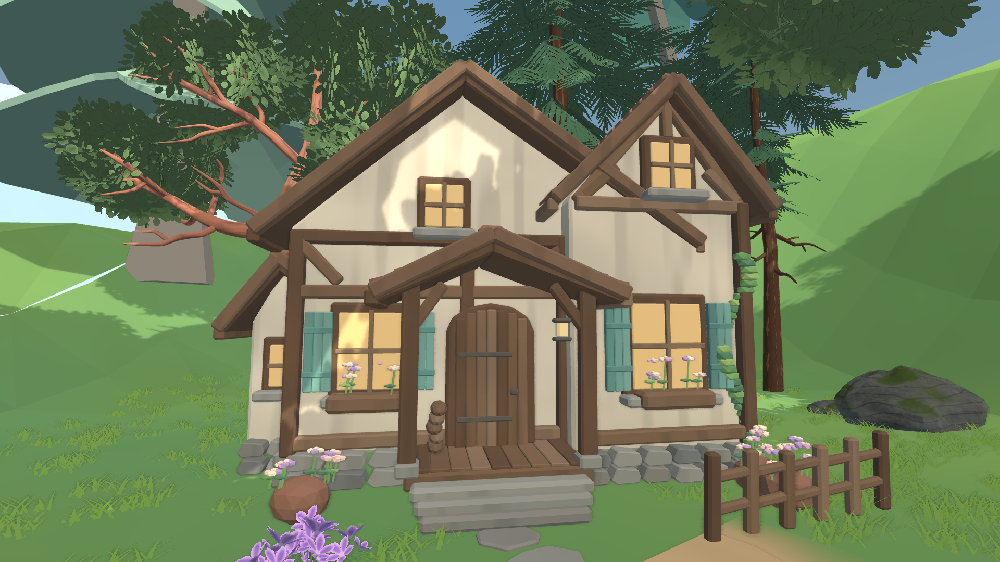

# Từ Nhà A tới Làng A

Ảnh Full HD chụp trực tiếp trong Godot ở commit .

- [Hoa và cỏ cạnh hiên](hoa-ven-hien.png)
- [Rời Nhà A theo đường mòn](roi-nha-a.png)
- [Khúc đường giữa rừng](giua-rung.png)
- [Đến bìa rừng sau cầu](bia-rung.png)
- [Đến cửa làng](vao-lang.png)

Tuyến thử đã đi từ Nhà A qua mốc Thomas và cầu tới cuối làng rồi quay về. Bốn ngõ làng đi qua được trong bài kiểm tra. [Ghi chú địa hình và bố cục](https://github.com/VietCodeBug/a-place-to-belong/blob/4b73071e388d5f0a284bebdb0aad74e79f39e878/docs/environment/A1_DEEP_WOODS_ROUTE.md)
