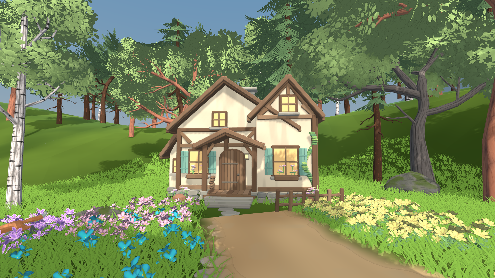

# Nhà A và tuyến rừng đến làng

Ảnh chụp trực tiếp từ Godot 4.6.3 Compatibility, Mesa llvmpipe. Chín khung review 1920 × 1080 dùng camera đặt theo tuyến. Ảnh góc chơi 1280 × 720 dùng camera và HUD mặc định. Commit game [9cf0f45](https://github.com/VietCodeBug/a-place-to-belong/commit/9cf0f45397e8f25aad6cf626bb0f3bd4d41bb14d) nằm trong [PR nháp #13](https://github.com/VietCodeBug/a-place-to-belong/pull/13).

## Nhà A

- [Góc chơi lúc xuất hiện trước Nhà A](goc-choi.png)
- [Cỏ và cụm hoa cạnh bậc hiên](hoa-ven-hien.png)
- [Cáo nhỏ ngoài sân](cao-ven-nha.png)
- [Nhà A mùa đông từ cùng camera](nha-a-dong.png)

## Đi về làng

Tuyến từ Nhà A tới cửa làng dài khoảng 510 m. Lượt đi–về trong Godot đi qua nhánh Thomas, cầu, lối bìa rừng và bốn đường nhánh ở làng.

1. [Đường rời Nhà A](duong-roi-nha-a.png)
2. [Khúc cua qua đồi rừng](doi-rung.png)
3. [Hươu trong khoảng rừng giữa đường](huou-trong-rung.png)
4. [Lối qua bìa rừng](bia-rung.png)
5. [Tới cửa làng A](vao-lang.png)

Ảnh chụp dùng phần mềm dựng hình, hiệu năng trên GPU đích chưa được đo.
