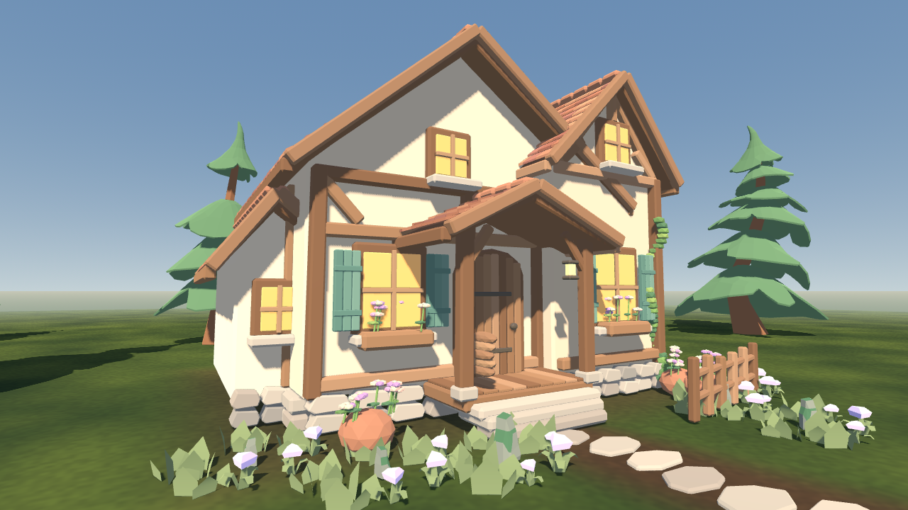
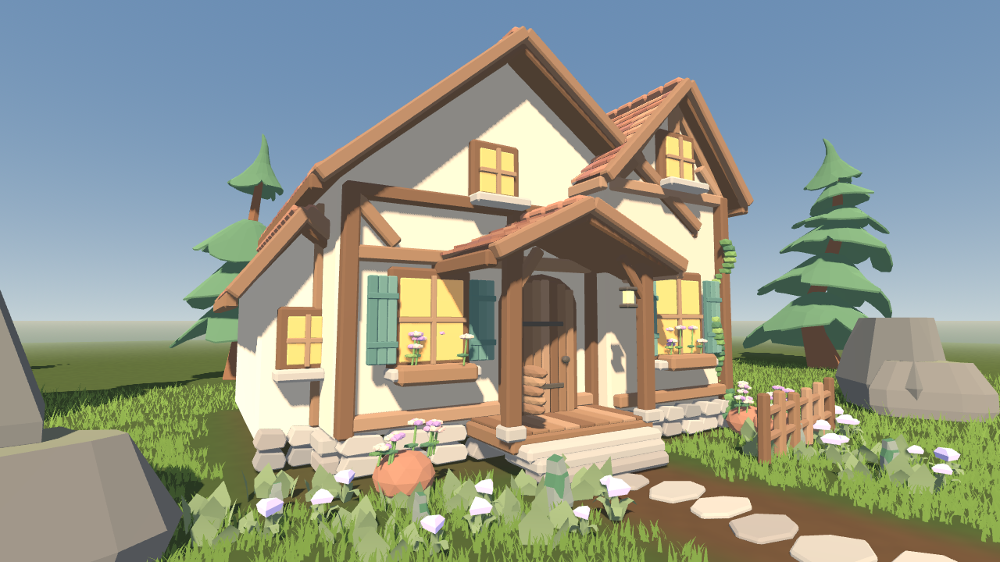
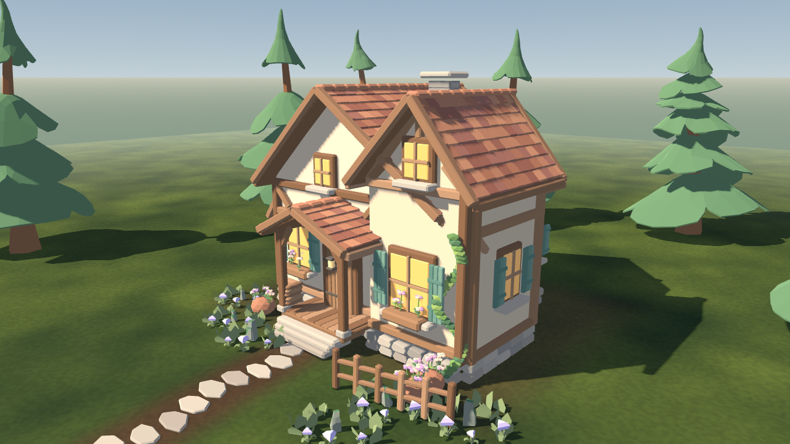
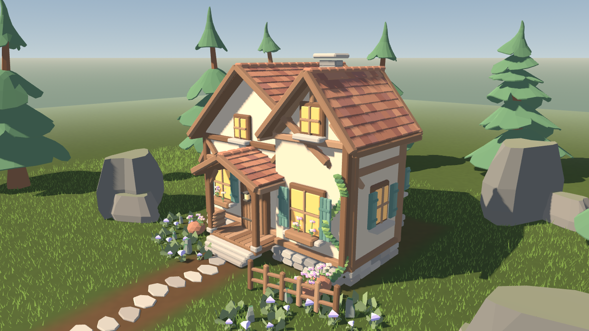

# A1 House Gate · Cỏ, nền và đá tảng

**PENDING_CREATOR_APPROVAL** · [Issue #12](https://github.com/VietCodeBug/a-place-to-belong/issues/12)

Ảnh thật từ Godot 4.6.3 Compatibility, 1280 × 720. Cặp ảnh dùng cùng camera và ánh sáng. GLB và Blender của nhà khớp byte với baseline cc8280f.

| Góc | Trước | Sau |
| --- | --- | --- |
| Tầm mắt |  |  |
| 3/4 |  |  |
| Mặt trước | [Trước](before/front.png) | [Sau](after/front.png) |
| Mặt bên | [Trước](before/side.png) | [Sau](after/side.png) |

[Thảm cỏ ở mép đường](detail/verge.png) · [Chân đá](detail/boulder-foot.png) · [Bậc hiên](detail/porch.png)

## P0–P4

| Mốc | Kết quả kỹ thuật |
| --- | --- |
| P0 | Chụp và đo bản gốc trước khi đổi sân. Bản gốc có 42 cụm dựa trên GLB cỏ/lá/hoa quanh sáu điểm trang trí, sáu đá rêu nhỏ và 0 cụm đá tảng. |
| P1 | Dùng DenseMeadow của rừng với sampler sân phẳng, mask RGBA riêng, gió và LOD. Chừa vùng vỏ nhà, hiên và lối đi. LOD cuối dùng chunk 6 m, chuyển từ 6 đến 11,5 m và giới hạn 36 m. [Ảnh kiểm tra trước bước nền](stages/p1-grass.png). |
| P2 | Nền xanh ấm, tương phản noise thấp, mép đất mềm khớp hướng phiến lát. [Ảnh trước khi đặt đá](stages/p2-ground.png). |
| P3 | 8 viên ở 3 cụm bất đối xứng. Đá chính cao khoảng 2,14 m, 1,73 m và 2,70 m trên đất. Tái sử dụng Kenney Nature Kit rock_largeA / rock_largeB; giữ proxy hộp không scaling và mask lõi để cỏ phủ tới chân đá. |
| P4 | Test kiểm tra mask, các lớp cỏ, collision của cả ba cụm, khoảng đi vòng, lối vào và mô phỏng nhân vật đi từ sân lên hiên. Visual và hiệu năng trên GPU đích còn chờ duyệt. |

Số instance logic của bản cuối: 8.052 carpet, 853 main, 19 accent, 7 hoa trắng, 1 hoa tím. Tổng 8.932 clump/hoa; renderer dùng hai mesh LOD cho các lớp cỏ. Material, mesh và preset gốc của Map 01 được tái sử dụng; tinh chỉnh đặt trên bản sao preset của scene này. Asset đá có sẵn theo [ghi chú giấy phép Kenney](../../../assets/vendor/kenney/README.md).

## Số đo

Godot Compatibility/Mesa llvmpipe, 1280 × 720. Mỗi mẫu chờ 4 khung rồi đo trung bình 12 khung. Draw calls là bộ đếm viewport, cùng cách đo cả hai bản.

| Góc | Trước (ms / FPS / draw calls) | Sau (ms / FPS / draw calls) |
| --- | ---: | ---: |
| Front | 336,0 / 2,98 / 521 | 609,4 / 1,64 / 698 |
| Side | 377,9 / 2,65 / 394 | 652,9 / 1,53 / 570 |
| 3/4 | 307,0 / 3,26 / 338 | 541,3 / 1,85 / 499 |
| Eye-level | 372,3 / 2,69 / 440 | 690,7 / 1,45 / 628 |

LOD sớm hơn và mask giảm mật độ ở rìa đã đưa góc front từ 759,7 ms ở P2 về 609,4 ms ở bản giao. Chi phí vẫn tăng đáng kể so với sân trống trên renderer phần mềm. Chưa có kết luận hiệu năng GPU đích.

Chạy scene bằng **godot --path . res://scenes/environment/a1_house_gate.tscn**. Chụp bốn góc bằng **godot --path . --script tools/capture_a1_house_gate.gd**, đặt biến môi trường **A1_REVIEW_DIR** tới thư mục có sẵn nếu cần ghi ảnh nơi khác; **A1_REVIEW_DETAIL=1** chọn ba góc cận. Test riêng bằng **godot --headless --path . --script tests/a1_house_yard_test.gd**.

Kiểm tra mở editor headless có cache trong cùng bản xuất baseline: 6,321 s trước và 5,580 s sau khi thay hai file preview, không có lỗi import. Đây là thời gian quét/khởi động có cache. Bộ test DenseMeadow gốc trên display và test sân A1 đều qua.
