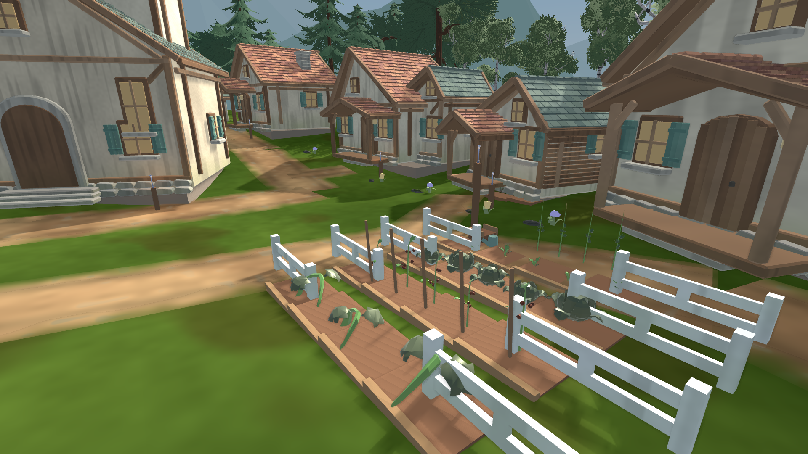

# A1 Nature & Garden V4 · Preview Godot

Mã nguồn chạy ảnh và video ở commit `f6f2a269271fd7af872809452326766991ebc178`. [Kiểm tra từng vùng A1](https://github.com/VietCodeBug/a-place-to-belong/blob/f6f2a269271fd7af872809452326766991ebc178/docs/environment/A1_FULL_REGION_AUDIT.md) · [Danh mục hoa, rau và giấy phép](https://github.com/VietCodeBug/a-place-to-belong/blob/f6f2a269271fd7af872809452326766991ebc178/docs/environment/A1_FLOWER_CROP_CATALOG.md)

- [Nhà A](01-nha-a.png) · [Sân nhà](02-san-nha-a.png) · [Rừng đầu](03-rung-khoi-dau.png) · [Đường rừng](04-duong-rung.png)
- [Bờ sông](05-bo-song.png) · [Vào làng](06-vao-lang.png) · [Đường làng](07-duong-lang.png)
- [Vườn rau](08-vuon-rau.png) · [Cận luống](09-can-luong.png) · [Cận hoa](10-can-hoa.png) · [Gò thật](11-go-dat.png)
- [Ra rừng](12-ra-rung.png) · [Điểm ngắm](13-diem-ngam.png) · [Quán rừng](14-quan-rung.png) · [Sân thủ công](15-san-thu-cong.png)
- Cùng camera và ánh sáng tại vườn qua [xuân](mua-xuan.png), [hè](mua-he.png), [thu](mua-thu.png) và [đông](mua-dong.png)

19 ảnh PNG native Full HD từ Godot Compatibility. [Video Nhà A → cuối làng → Nhà A](di-va-ve.mp4) dùng nhân vật và camera gameplay, 704 × 396, lấy mẫu 3 khung/giây mô phỏng và phát nhanh khoảng 1,9 lần. Chuyển từ xuân sang thu tại điểm quay lại.

## Hiệu năng

Cùng script benchmark, 1152 × 648, Godot 4.6.3 Compatibility trên Mesa llvmpipe CPU, LP_NUM_THREADS=4. Lấy trung bình 20 khung sau 7 khung làm nóng. Các lượt trên cloud có tải nền. GPU Windows vẫn cần đo riêng.

| Góc | Trước V4 · 45ebd1f | V4 |
| --- | --- | --- |
| Cửa làng | 1411.3 ms · 2,196 draw calls · 1,491,011 tam giác | 1439.8 ms · 2,105 draw calls · 1,575,923 tam giác |
| Dưới tán dọc rừng | 2329.8 ms · 2,298 draw calls · 1,507,622 tam giác | 2180.5 ms · 2,250 draw calls · 1,623,314 tam giác |

Tất cả ảnh là góc kiểm tra thực tế để duyệt. Xem audit để biết phạm vi, các giới hạn mùa và hạng mục còn lại.
