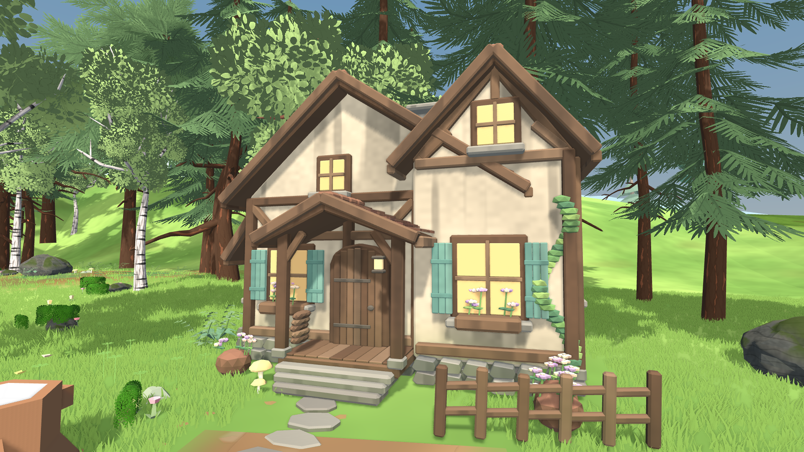

# Nhà A và Làng A · Chỉnh cảnh quan



| Hạng mục | Ảnh Full HD chụp trong Godot |
| --- | --- |
| Nhà A trong rừng | [Từ đường vào](nha-a-trong-rung.png) · [Từ góc sân](san-nha-a.png) |
| Làng A | [Toàn cảnh](toan-canh.png) · [Nhà thờ giữa làng](nha-tho.png) |
| Cảnh sát mặt đất | [Đá và thảm cỏ](da-va-co.png) · [Mặt đường khô](mat-duong.png) · [Mặt đường ướt](mat-duong-sau-mua.png) |
| Bảng màu theo mùa | [Xuân](mua-xuan.png) · [Hè](mua-he.png) · [Thu](mua-thu.png) · [Đông](mua-dong.png) |

Mùa mặc định chuyển sang xuân. Hai mùa xanh dùng bảng màu khác độ sáng. Mùa thu lấy vàng đất làm màu chính, giữ đỏ gạch ở số ít cụm phong và xanh trầm ở thông. Mùa đông cây rụng lá để trơ cành. Các nhóm cây bám vai dốc, ven rừng và cạnh sân, chừa khoảng nhìn ở đường và cửa. Nhà A có ba cụm cây mới và vùng chặn phủ cỏ ở hiên, chân nhà và nhánh vào.

Bụi xếp tầng quanh Nhà A được thay bằng model tán lá Quaternius CC0 trong [danh mục cây](../A1_TREE_ASSET_CATALOG.md). Hai model đá có vết vỡ ở mesh, được chôn một phần và thêm vân, lichen trong vật liệu. [Source Blender đá](../../../art_source/village_a/fieldstone.blend) · [Đá thấp](../../../assets/village_a/layered_ledge.glb) · [Đá tảng](../../../assets/village_a/split_boulder.glb)

Nhà thờ tháp chuông thay công trình ở mốc A06. Ba kiểu nhà bổ sung khác nhau về mái, mặt tiền và công năng ngoại thất. Nhà gỗ dùng lớp bạc màu và dấu ẩm, với gỗ và vữa cũ rõ hơn ở Nhà A. [Danh mục 21 công trình, 13 kiểu ngoại thất](../VILLAGE_A_MASTERPLAN.md)

Đường có năm chỗ trũng đi chung bề mặt va chạm, sâu tối đa 13 cm so với mẫu nền gốc, kèm viền sỏi và lớp nước vật liệu khi mưa. Dải sáng xung đột ở chân núi xuất phát từ vòng núi nền cũ cắt qua thung lũng. Mảng vòng cũ phía nam được bỏ để dùng sườn đồi và núi của A1.

```sh
godot --path . --audio-driver Dummy --script res://tools/capture_a1_polish.gd
godot --headless --path . --disable-render-loop --fixed-fps 60 --script res://tests/village_a_test.gd
```
