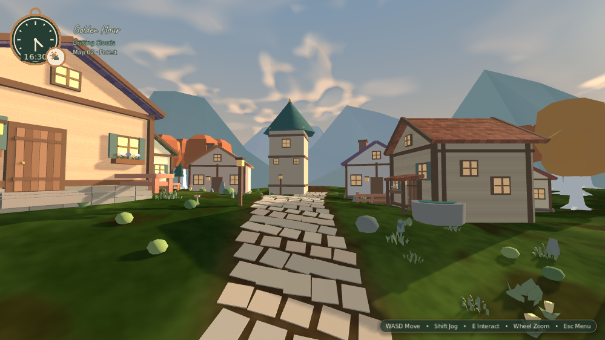
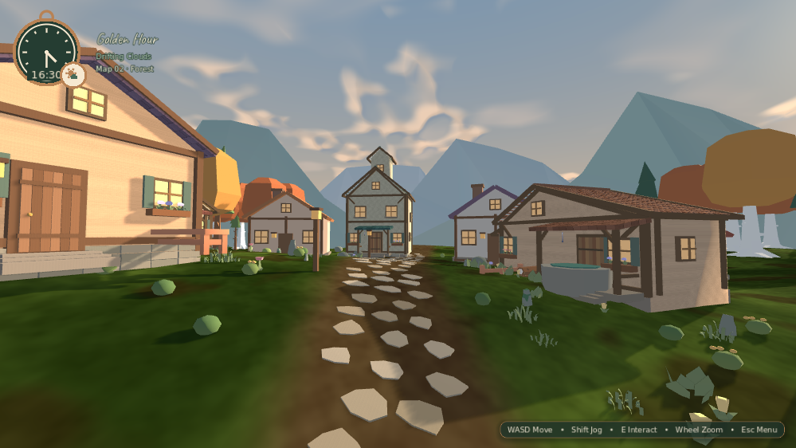
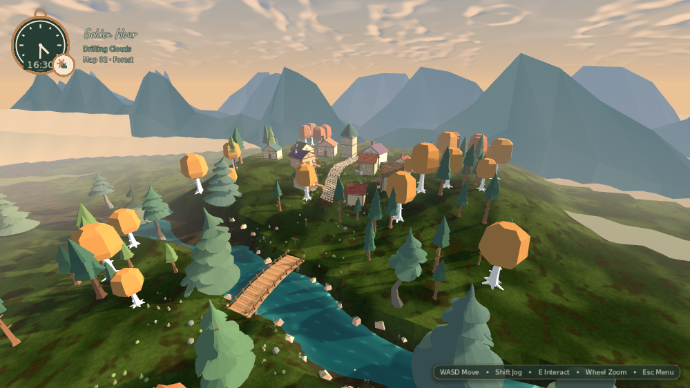
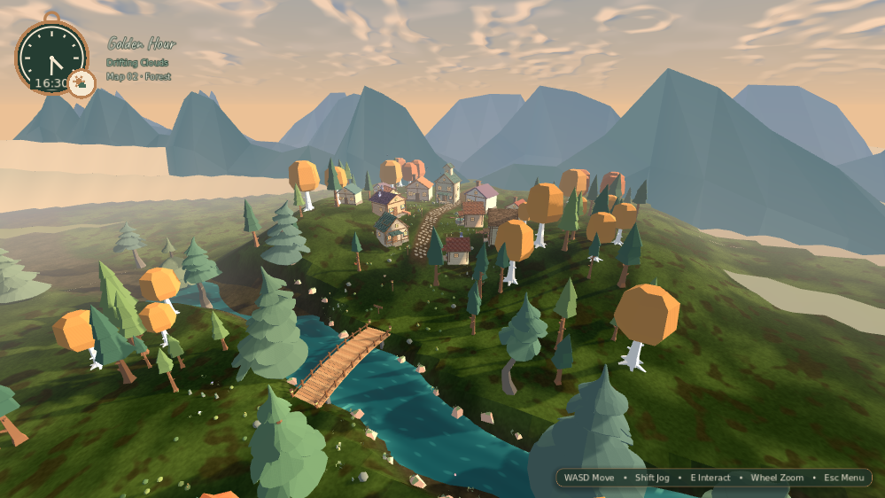

# A1 V2 · Sprint 1 · Village Street

Ảnh render trong Godot Compatibility. Các cặp trước/sau dùng cùng góc máy.

| Góc máy | Trước | Sau |
| --- | --- | --- |
| Đường làng |  |  |
| Toàn cảnh |  |  |

## Cận cảnh

- [Mặt tiền và mái](can-nha.png)
- [Đường đất và phiến đá](can-duong.png)

Phạm vi review là cụm nhà, vật liệu mái và mặt đường trong Sprint 1. Ảnh được chụp từ bản làm việc cục bộ trên nền `55b0252`; commit này chỉ chứa tư liệu ảnh.
