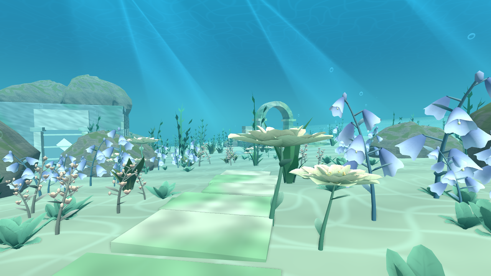
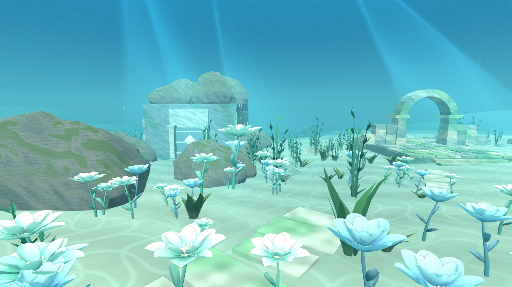
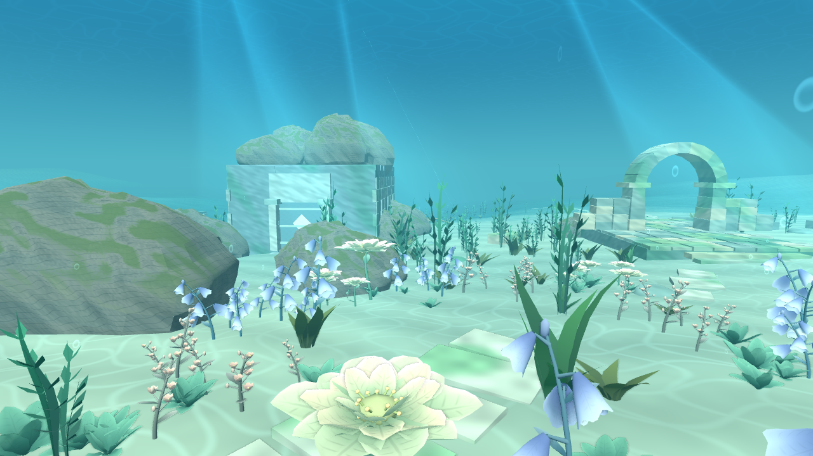
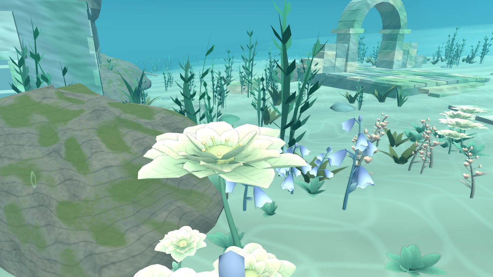
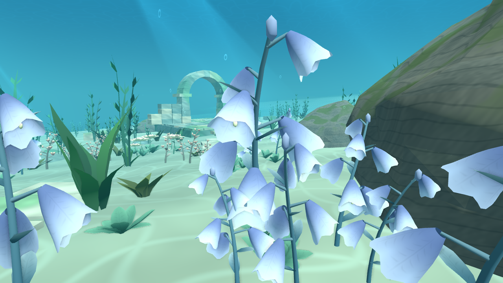
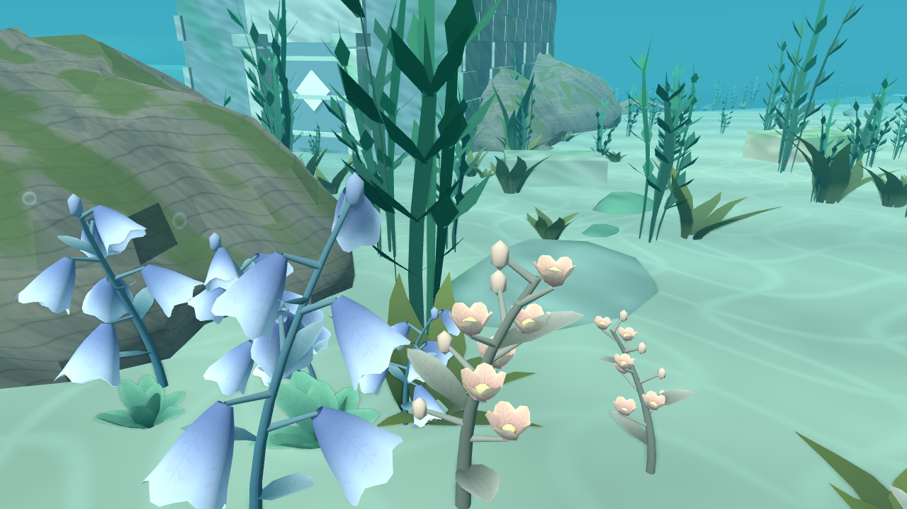

# Vườn ánh sáng · Ba dáng hoa và cụm lá thấp

Ảnh chụp trực tiếp trong Godot 4.6.3 Compatibility trên Linux/Mesa llvmpipe, 1280 × 720. Ảnh cùng góc dùng 13:30 trời quang. Bản trước `9d34e1c2155b390ff025b79dc964d50d2e2d8ec9`. Bản mới `0da6e8ec7faef839cfed2e92b0b6785c943fd2ee` trên nhánh `gpt`.

| Trước | Sau |
| --- | --- |
|  |  |

| Hoa ngà nhiều lớp | Chuông lam | Chùm nụ phớt hồng |
| --- | --- | --- |
|  |  |  |

[Ánh sáng trong vườn lúc 17:15](06-vuon-luc-chieu.png)

Các cụm được bố trí theo bờ đá, chừa đường bơi giữa vườn. 12 hoa ngà, 23 thân chuông lam, 19 thân hoa chùm và 35 cụm lá thấp gom theo bốn MultiMesh. Gân mảnh giảm theo khoảng cách. Hình học cánh cong, màu và chuyển động được kiểm trong Godot. Chưa đo FPS trên GPU Windows.

[PR nháp #16](https://github.com/VietCodeBug/a-place-to-belong/pull/16)
