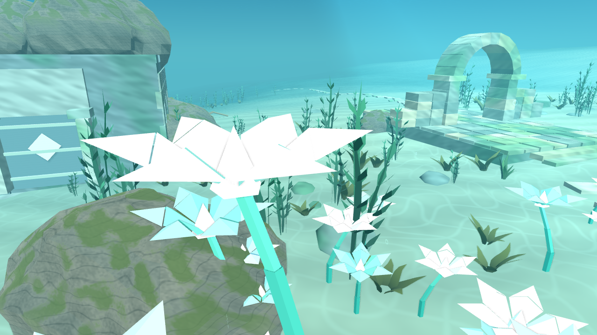
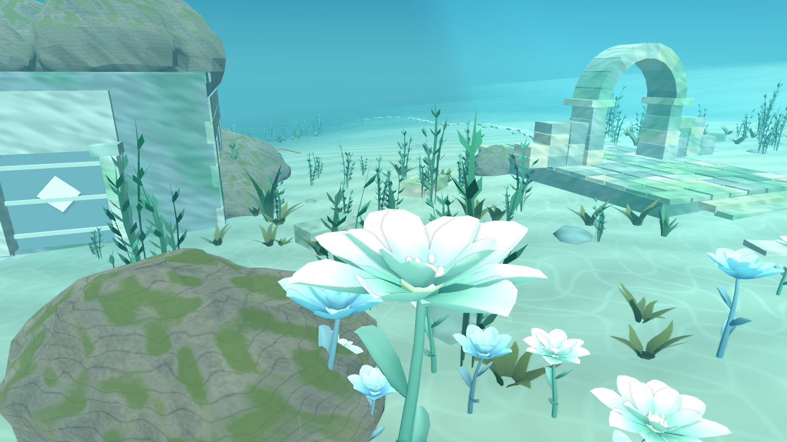
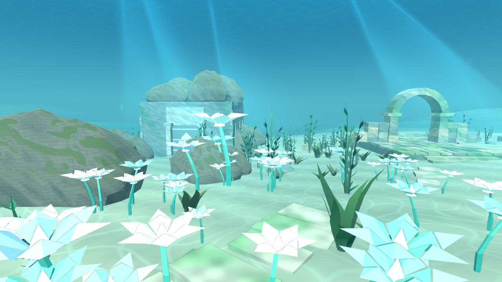
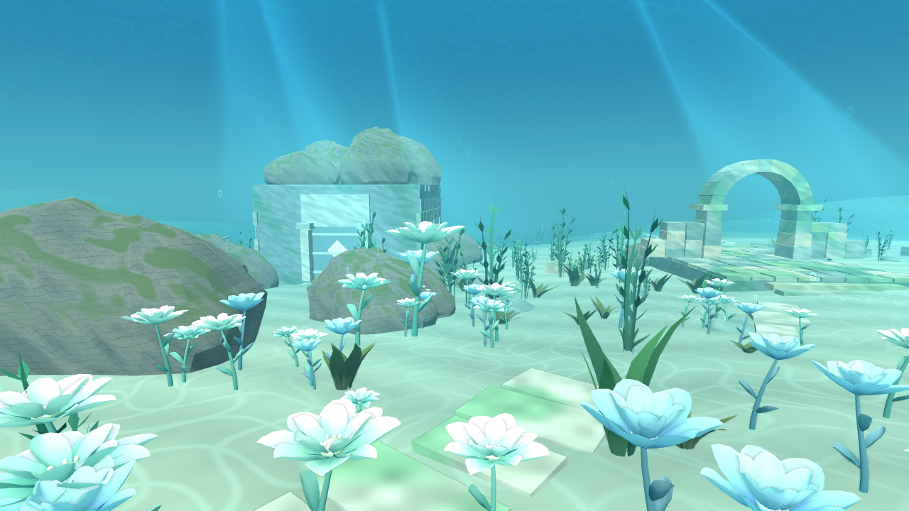
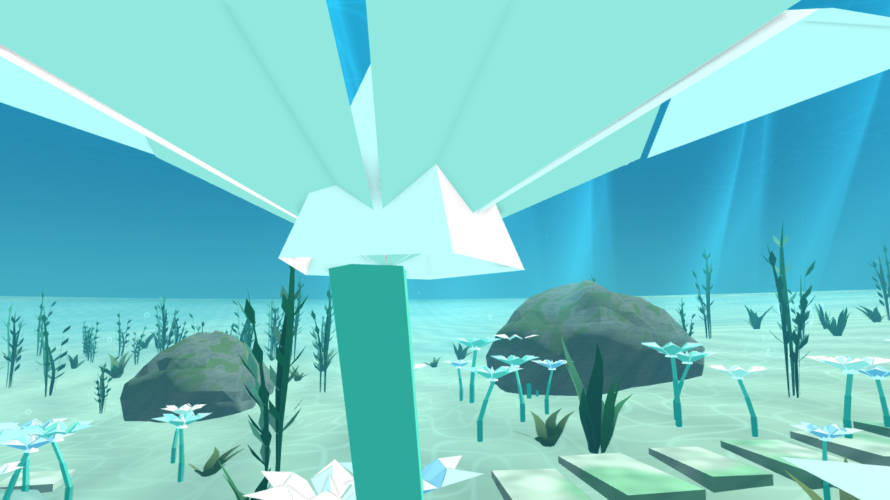
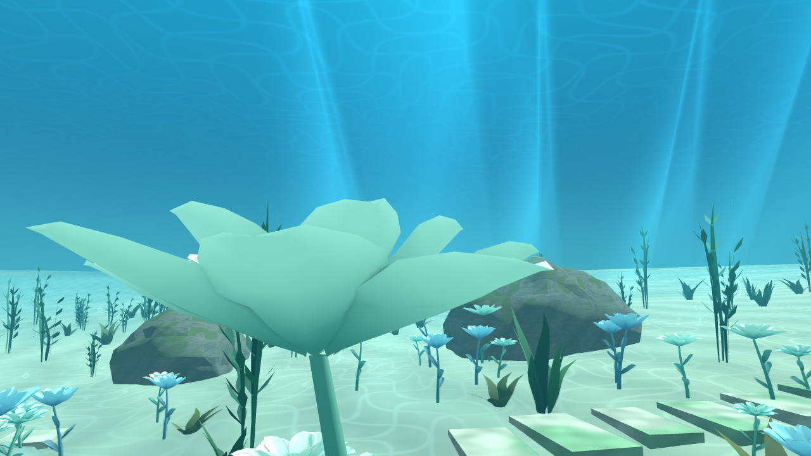

# Vườn ánh sáng · Cánh hoa cong

Ảnh chụp trực tiếp trong Godot 4.6.3 Compatibility trên Linux/Mesa llvmpipe, 1280 × 720. Ba cặp dùng cùng camera, lúc 13:30 trời quang trong game. Bản trước `37dac5a38e55cb12dd6ac5ab926eec63aee78414`. Bản mới `9d34e1c2155b390ff025b79dc964d50d2e2d8ec9` trên nhánh `gpt`.

| Trước | Sau |
| --- | --- |
|  |  |
|  |  |
|  |  |

Hai lớp cánh cong, nhụy tròn, cuống thon và lá nhỏ. Sắc sáng tập trung ở nhụy và mép, thân và cánh đung đưa theo pha riêng của từng bụi. Cả vườn dùng 46 bụi chia vào ba MultiMesh với một vật liệu chung. Ba mesh có 1.452, 1.452 và 1.516 tam giác và đã kiểm dữ liệu hình học trong Godot. Hai cảnh báo texture khi đóng Godot vẫn xuất hiện như bản trước.

[PR nháp #16](https://github.com/VietCodeBug/a-place-to-belong/pull/16)
