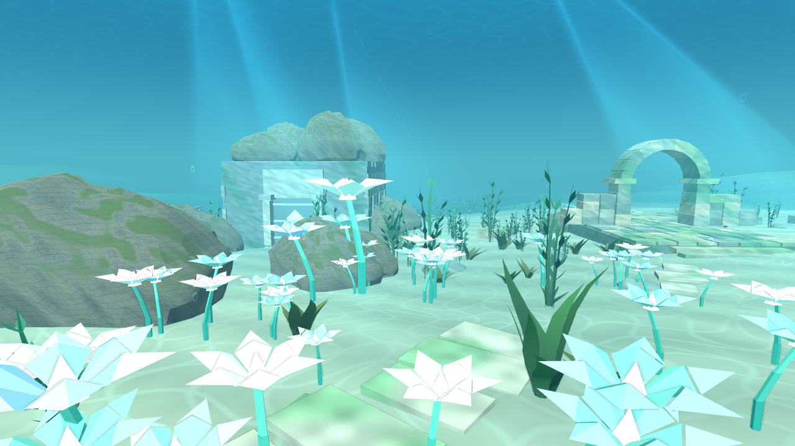
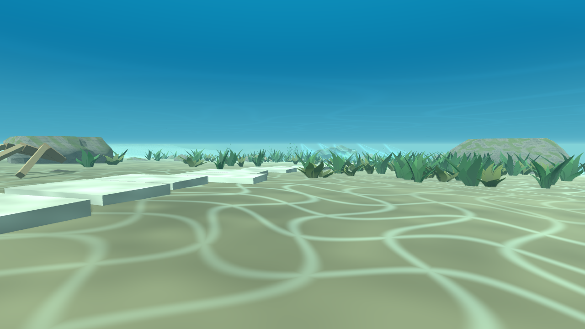
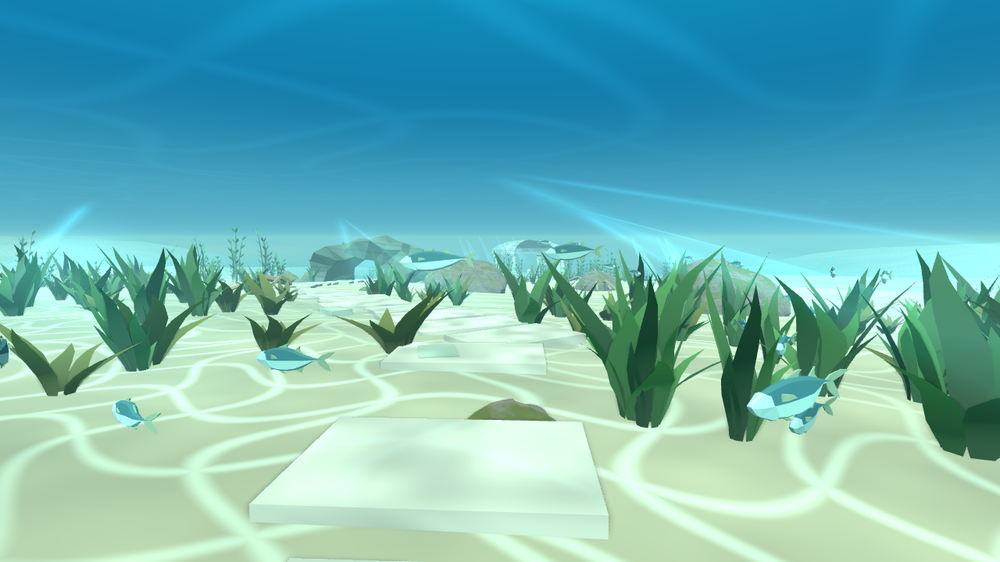
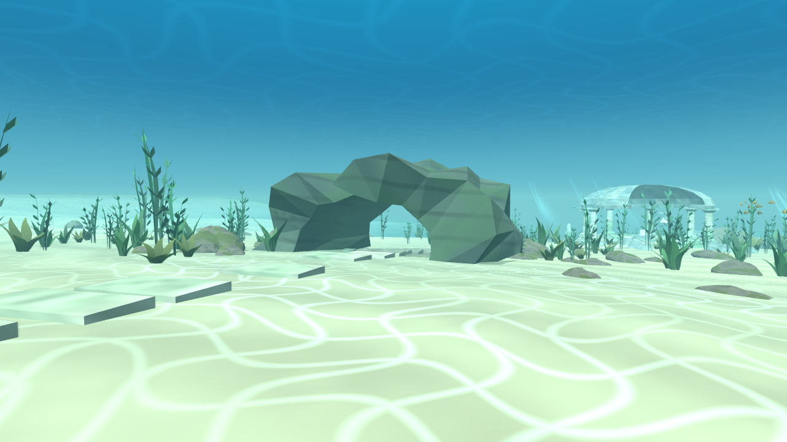
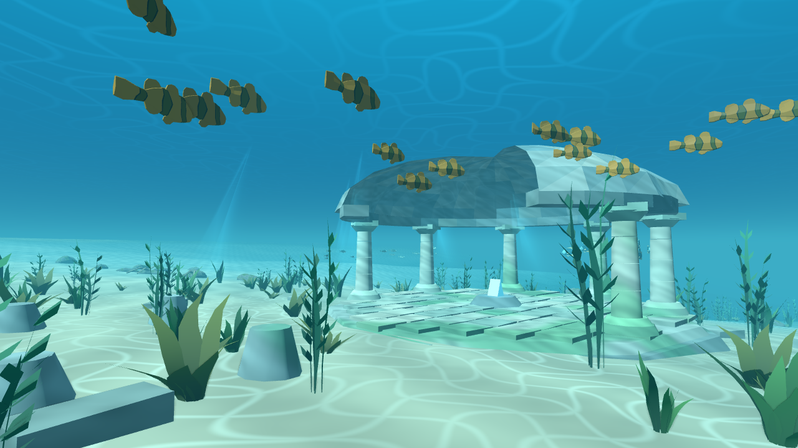
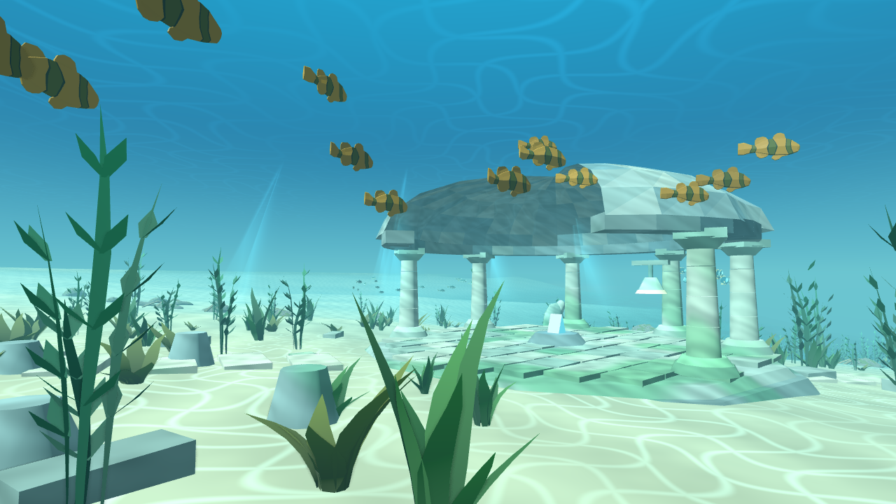
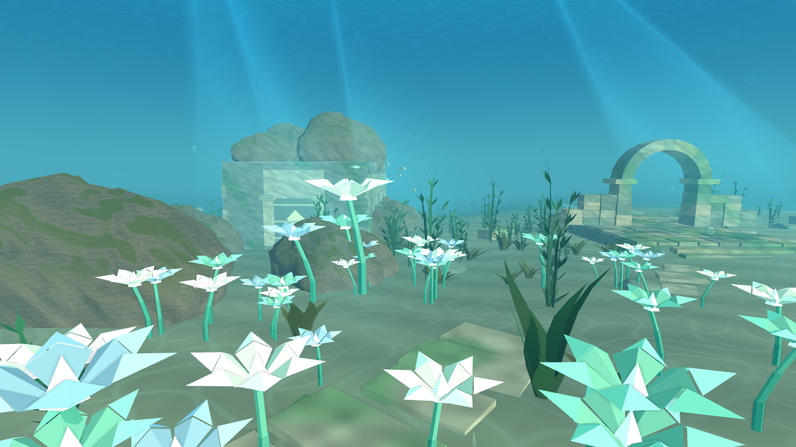
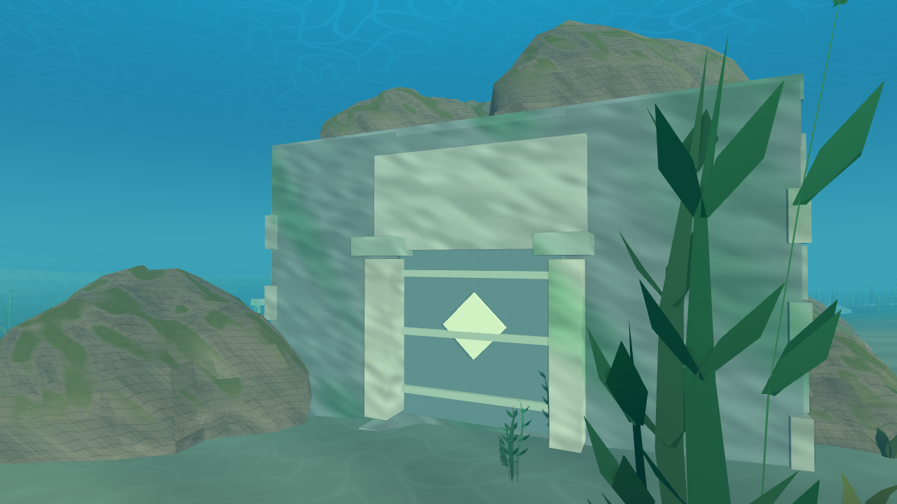
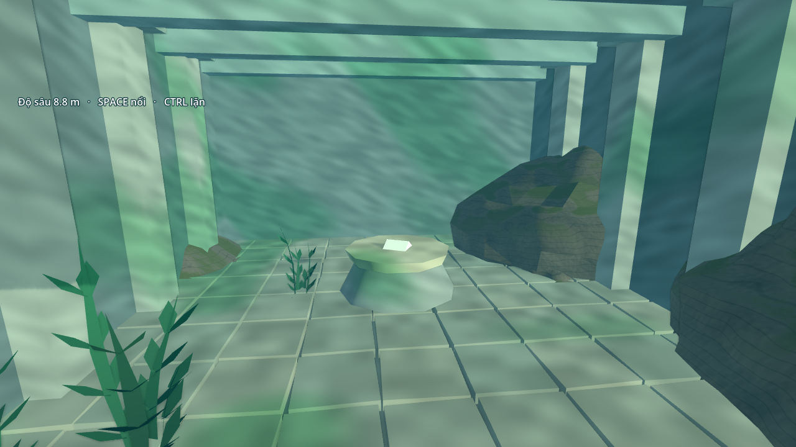

# A1 · Thế giới dưới hồ

Ảnh Godot 4.6.3 Compatibility, 1280 × 720, Mesa llvmpipe. Camera review tự do. Bản mới ở commit `37dac5a38e55cb12dd6ac5ab926eec63aee78414` trên nhánh `gpt`. Bản trước là `e2bd30b724f606e9bec5e92eb3b70ae5e7576dd9`.

## Tuyến bơi

| Lối xuống hồ | Đồng cỏ nước | Đường đá chìm |
| --- | --- | --- |
|  |  |  |

[Ảnh bản đồ M với tuyến chính và hai nhánh](09-ban-do-tuyen-boi.png)

## So cùng góc ở đình

| Bản trước | Bản Dream Lake |
| --- | --- |
|  |  |

## Vườn và phòng kín

| Vườn lúc 13:30 | Vườn lúc 17:00 |
| --- | --- |
|  |  |

| Cửa đá ban đầu | Phòng sau khi mở |
| --- | --- |
|  |  |

## Kiểm thử

`a1_superworld_test.gd` và `smoke_test.gd` đều qua. Đã kiểm mở cửa bằng E ở chuông, va chạm cửa trước khi mở, bơi vào và nhặt mảnh gốm, đàn cá ánh ngọc xuất hiện lúc 17:00 khi trời quang và biến mất khi mưa. Lượt headless đo chi phí streaming P95 4,38 ms, đỉnh 4,96 ms. Chưa đo FPS trên GPU Windows. Godot vẫn ghi hai cảnh báo texture khi thoát giống bản trước.

[Spec sáu khu và nguồn asset](https://github.com/VietCodeBug/a-place-to-belong/blob/gpt/docs/environment/UNDERLAKE_WORLD_V1.md) · [PR nháp #16](https://github.com/VietCodeBug/a-place-to-belong/pull/16)
