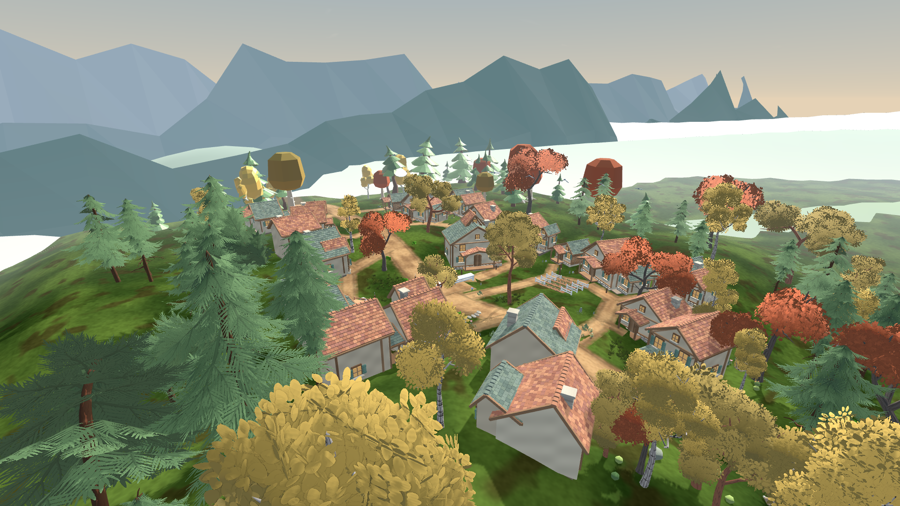

# Làng A V3 · Bản duyệt môi trường

Quy hoạch 21 công trình ngoại thất thử nghiệm, 10 kiểu kiến trúc. Các lô mới kết cụm ở cửa làng, cạnh vườn, quanh khu thủ công và phía sau sân chung. Tuyến đi bộ vẫn nối Nhà A qua rừng, cầu, làng và đường ra rừng. [Mặt bằng và danh sách lô](../VILLAGE_A_MASTERPLAN.md) · [Nguồn GLB, Blender và danh mục cây](../A1_TREE_ASSET_CATALOG.md)



| Góc chụp | V2 và V3 trong Godot |
| --- | --- |
| Toàn cảnh | [V2](truoc-toan-canh.png) · [V3](toan-canh.png) |
| Vào làng | [V2](truoc-vao-lang.png) · [V3](vao-lang.png) · [Camera gameplay](camera-nguoi-choi.png) |
| Đường làng và vườn | [V2](truoc-duong-va-vuon.png) · [V3](duong-va-vuon.png) · [Sân chung](san-chung.png) |
| Tuyến rừng | [Tầm mắt dưới tán](rung-nhieu-tang.png) · [Mái nhà hé qua rừng](mai-nha-qua-tan-cay.png) · [Từ Nhà A](tu-nha-a.png) |
| Mùa, cùng camera ở vườn | [Xuân](mua-xuan.png) · [Hè](mua-he.png) · [Thu](mua-thu.png) · [Đông](mua-dong.png) |
| Tree Gallery | [20 mẫu](cay-gallery.png) · [Tán lá](cay-can.png) · [Nhìn ngang](cay-ben.png) · [Thu](cay-thu.png) · [Đông](cay-dong.png) |
| Cùng hai vị trí cây, camera gần và xa | [Mesh mới](cay-lod-gan.png) · [Mesh cũ](cay-lod-xa.png) |

Ảnh chụp trực tiếp ở 1920 × 1080 với MSAA 2× trong Godot Compatibility. Baseline `7837d47` được render lại cùng thiết lập máy ảnh, trời quang lúc 15:09, thay vì phóng ảnh review cũ. Video ghi camera theo nhân vật dùng điều khiển đi bộ ở 960 × 540. [Đi từ rừng qua toàn bộ đường chính của làng](di-bo-qua-lang.mp4).

## Thực vật, đường và mùa

- Xuân xanh non, hè xanh đậm. Thu chuyển bạch dương và cây lá rộng sang vàng ấm, phong sang đỏ cam. Đông ẩn tán trên ba nhóm cây rụng lá, giữ thân và cành của chính model đó. Thông vẫn có tán. Vườn và lề đường đổi thảm thực vật theo mùa, với bờ tuyết có mesh ở mép đường và chân rào.
- Cây mới hiện trong tầm gần. Khi ra ngoài 78 m, cây dùng lại mesh thấp chi tiết của Kenney/Quaternius, không đổ bóng. Camera quay vào dưới 68 m thì hiện lại cây mới. Cây rụng lá giữ mesh cành gốc vào mùa đông, kể cả ở xa. Các cây dùng chung scene GLB, texture và vật liệu theo mùa.
- Lớp cỏ lề đường và tầng thấp dưới tán dùng GLB cỏ cùng bộ, gom MultiMesh theo dải và giới hạn tầm nhìn. Cụm cây và hoa né trục đi bộ, sân chung và footprint nhà. Đá chìm tập trung tại các ngã rẽ. Vệt bánh và vệt tối sát lề giúp đọc mép đường. Hậu cảnh sau làng có thêm sườn đồi nối chân các dãy núi.
- Các mẫu mới gồm nhà hai tầng mặt tiền hẹp, nhà mái lệch hai khối, nhà phụ mái thấp và nhà chữ L, dựng trong source Blender dùng chung bộ gỗ, ngói, đá và vữa.

## Kiểm thử và hiệu năng

Kiểm thử Godot lái nhân vật từ Nhà A qua cầu đến gần z=180, đi cả bốn ngõ, kiểm collider của 21 công trình và kiểm ngưỡng LOD hai chiều. Kiểm mùa đông xác nhận tán phong ẩn và bộ cành gốc vẫn giữ ở xa. Smoke test gameplay đạt 0 lỗi trên checkout sạch.

| Camera | V2 | V3 |
| --- | ---: | ---: |
| Cửa làng | 1034,7 ms · 1.711 draw calls · 773.873 tam giác | 1366,7 ms · 2.145 draw calls · 1.397.933 tam giác |
| Tuyến rừng | 686,1 ms · 2.513 draw calls · 737.452 tam giác | 2241,5 ms · 2.947 draw calls · 1.535.013 tam giác |

Benchmark dùng 1152 × 648, Godot 4.6.3, Compatibility, Mesa llvmpipe CPU. Cùng camera, cùng giờ và trời. Bỏ 7 frame đầu, đo 20 frame. Đây là số đo trên máy cloud có tải nền. V3 tăng frame time ở cả hai góc, đặc biệt dưới tán rừng. Mức tăng hình học và chi phí bóng xuyên tán vẫn cần tối ưu trước khi duyệt hiệu năng. Hiệu năng GPU đích, chuyển mùa theo thời gian trong gameplay, LOD trung gian và tuyết bồi riêng trên từng cành vẫn cần làm hoặc xác nhận. Vệt rãnh đường là vật liệu, chưa có hệ thoát nước. Tuyết mái dùng mặt hướng lên của shader. Các lớp mùa xuân và hè chia sẻ nhiều hình học tán. Bản này chờ duyệt mỹ thuật.

```sh
godot --path . res://scenes/world/forest_hub.tscn -- --no-title --a1-season=spring
godot --headless --path . --disable-render-loop --fixed-fps 60 --script res://tests/village_a_test.gd
godot --path . --audio-driver Dummy --script res://tools/capture_village_a.gd
godot --path . --audio-driver Dummy --script res://tools/capture_a1_tree_gallery.gd
godot --path . --audio-driver Dummy --fixed-fps 8 --script res://tools/capture_village_a_walk.gd
godot --path . --audio-driver Dummy --script res://tools/benchmark_village_a.gd
```
