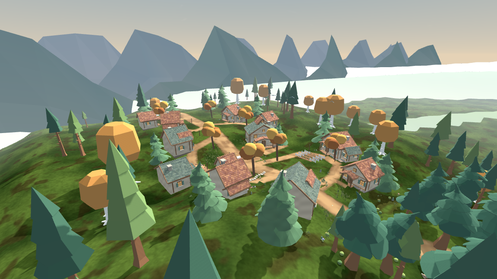

# Làng A trong Map 2

[Quy hoạch và bảng 11 công trình](../VILLAGE_A_MASTERPLAN.md) · [Video đi bộ vào làng, 15 giây](di-bo-vao-lang.mp4)



| Cảnh chụp trực tiếp trong Godot | Ảnh |
| --- | --- |
| Quy hoạch nhìn thẳng từ trên cao, có mã công trình | [Mặt bằng](quy-hoach.png) |
| Góc nhìn từ Nhà A | [Khoảng rừng khởi đầu](tu-nha-a.png) |
| Đường qua tán rừng trước khi mở ra cả làng | [Mái nhà qua tán cây](mai-nha-qua-tan-cay.png) |
| Cửa làng ở tầm mắt và camera người chơi | [Tầm mắt](vao-lang.png) · [Camera Map 2](camera-nguoi-choi.png) |
| Đường làng và vườn chung | [Đường và vườn](duong-va-vuon.png) |
| Cùng camera, giờ và thời tiết ở bốn mùa | [Xuân](mua-xuan.png) · [Hạ](mua-he.png) · [Thu](mua-thu.png) · [Đông](mua-dong.png) |

Đoạn phim sử dụng camera theo nhân vật của Map 2, bắt đầu trên đường rừng sau cầu ở z=94 và đi bộ bằng đầu vào của người chơi đến sân chung, kết thúc gần z=134.6. Lối ra tiếp tục tới bìa rừng ở z≈180, thuộc giới hạn Region A1 hiện tại.

## Chạy và kiểm tra

Mặc định là mùa thu. Dùng một trong bốn giá trị `spring`, `summer`, `autumn`, `winter` để mở Map 2 theo mùa. Mùa xuân có cụm hoa trên cây và cây non trong vườn. Mùa hè có tán xanh đầy hơn về mặt màu sắc, cùng hoa vàng. Mùa thu có tán vàng nâu và lá rụng. Mùa đông thay cây rụng lá bằng thân cành thưa, phủ tuyết lên mái, đường, cọc rào, cây kim và luống vườn.

```sh
godot --path . res://scenes/world/forest_hub.tscn -- --no-title --time=15.15 --a1-season=spring
godot --headless --path . --disable-render-loop --fixed-fps 60 --script res://tests/village_a_test.gd
godot --headless --path . --disable-render-loop --fixed-fps 60 --script res://tests/smoke_test.gd
godot --path . --audio-driver Dummy --script res://tools/capture_village_a.gd
godot --path . --audio-driver Dummy --fixed-fps 10 --script res://tools/capture_village_a_walk.gd
```

Bấm **M** để mở bản đồ khu vực. Khi đi tới sân chung, bản đồ hiện các nhánh đường và mặt bằng công trình. Video mã hóa H.264 từ 150 khung Godot.

Kiểm thử đã lái nhân vật từ Nhà A qua cầu đến gần z=180, đi hết bốn ngõ, kiểm tra collider thân của cả 11 công trình và xác minh mỗi mùa chỉ hiện đúng một nhóm cây và đạo cụ theo mùa. Smoke test kiểm chuyển động, va chạm café, hộp thư và camera, với 0 lỗi. Kiểm thử bao phủ ngoại thất và các tuyến đi bộ đã dựng.

## Hiệu năng

Godot 4.6.3, Compatibility OpenGL, Mesa llvmpipe CPU, 1152 × 648. Mỗi phép đo dùng camera cố định, thời điểm 15:09, trời quang, bảy frame làm nóng rồi lấy trung bình 20 frame. Baseline là `43ef889804674bc8370d3d9a298a851da2d9b456`. Trước khi có tuyến thung lũng và làng, camera ở tọa độ cửa làng nhìn vào cảnh thiếu đáng kể hình học, nên hai số đo phản ánh cả khối lượng cảnh mới.

| Góc đo | Baseline | Nhánh Làng A |
| --- | ---: | ---: |
| Cửa làng | 152.0 ms · 19 draw calls · 189,706 tam giác | 482.4 ms · 1,711 draw calls · 773,873 tam giác |
| Tuyến rừng kiểm tra | 218.9 ms · 59 draw calls · 537,776 tam giác | 385.5 ms · 2,513 draw calls · 737,452 tam giác |

Cỏ ven đường dùng bốn MultiMesh có giới hạn tầm nhìn 52 m và tắt đổ bóng. GLB gộp hình học theo vật liệu và các căn cùng họ dùng lại scene import. Vùng thung lũng giới hạn bóng nắng 48 m với hai cascade, giảm từ 2.869 xuống 1.711 draw calls ở các lượt đo triển khai góc cửa làng. Mesa dùng CPU. Hiện thiếu số đo trên GPU đích để chốt hiệu năng. Cả hai checkout đều báo hai texture OpenGL khi tiến trình thoát; các frame và ảnh ghi xong trước cảnh báo.

Chạy lại phép đo bằng `godot --path . --audio-driver Dummy --script res://tools/benchmark_village_a.gd`. Dùng đúng script này và trỏ `--path` vào checkout baseline để tái lập cặp đo.

## Mã và dữ liệu

- `scripts/world/village_a_layout.gd` và `village_a.gd` chứa quy hoạch, nhà, ngõ, vườn chung, sân sinh hoạt, sân thủ công, collider và lớp cảnh theo mùa.
- `scripts/world/forest_hub.gd`, `landscape.gd`, `a1_valley.gd` và `woodland.gd` nối Nhà A, rừng, cầu có mặt va chạm liên tục và làng trong Map 2.
- `scripts/player/follow_camera.gd`, `scripts/ui/a1_map.gd` và `scripts/interactions/interaction_controller.gd` điều chỉnh tầm nhìn vào làng và hiển thị đường sau khi khám phá.
- `scripts/environment/forest_weather.gd` và danh mục `shaders/` chứa chất liệu đường, nền, sông, nhà và điều chỉnh ánh sáng trời.
- Xem [danh mục GLB và source Blender](../VILLAGE_A_MASTERPLAN.md#nguồn-kiến-trúc). [Test tuyến đi bộ](../../../tests/village_a_test.gd) và [công cụ kiểm ảnh](../../../tools/capture_village_a.gd) dùng trực tiếp scene của game.
