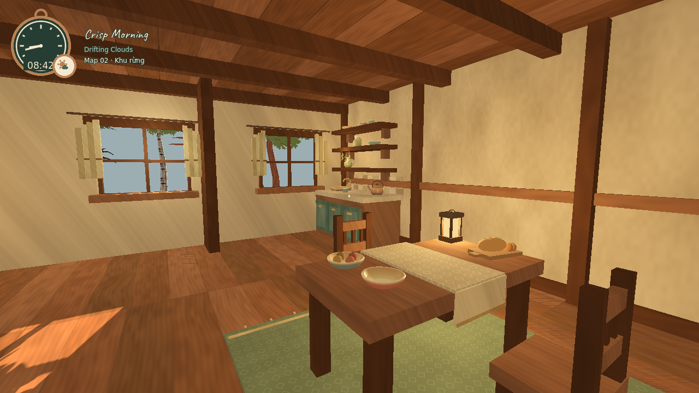

# Nhà A · Nội thất và đồ cầm tay

Ảnh chụp ở Godot 4.6.3 Compatibility từ [9fe422d](https://github.com/VietCodeBug/a-place-to-belong/commit/9fe422d8412fbedb072d8cd2de8fdd27a7cd25f4) trên [PR #15](https://github.com/VietCodeBug/a-place-to-belong/pull/15).

[Video nhặt sách, mang cốc và đặt lên mặt bếp](https://raw.githubusercontent.com/VietCodeBug/a-place-to-belong/refs/tags/preview/a1-house-a-interior-props/docs/world/review-a1-house-a-interior/cam-va-dat-do.mp4)

Các cảnh đi bộ dùng controller và thao tác E/R. Ảnh PNG 1280 × 720. Video 640 × 360 ở 12 FPS trong Godot trên Mesa, không kèm âm thanh.

- [Phòng ngủ](01-phong-ngu.png) · [Sách đang cầm](02-cam-sach.png)
- [Góc bếp](03-goc-bep.png) · [Cốc đang cầm](04-cam-coc.png) · [Cốc sau khi đặt lên bếp](05-coc-tren-bep.png)
- [Lò sưởi và tủ đồ](06-lo-suoi.png)
- [Log tuyến Chapter 01](kiem-thu-chapter01.txt) · [Log tiếp cận và nhặt vật dụng](kiem-thu-nhat-do.txt)

Nhìn vào một món đồ và nhấn **E** để nhặt. Nhấn **E** khi ngắm vào chỗ trống phù hợp trên bàn hoặc kệ để đặt. Nhấn **R** để đưa món đang cầm về chỗ vừa nhặt.
