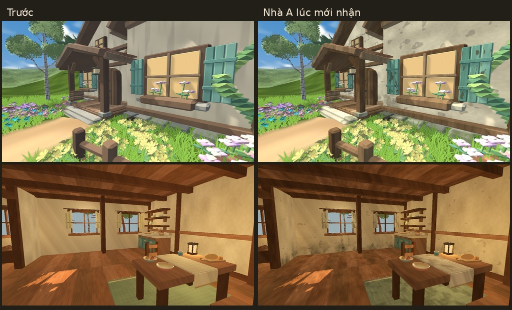

# Nhà A lúc mới nhận

Sàn gỗ có vệt mòn trên lối đi. Tủ bếp bạc sơn, chăn được vá và màu đá lò sẫm dần theo vệt khói. Tường ngoài có lớp vôi bong nhẹ, cửa chớp có chỗ lộ gỗ và chân tường có vệt ẩm cùng rêu.

Các ảnh là khung hình 1280 × 720 trong cảnh chơi thật của Godot 4.6.3 Compatibility. Hai bản dùng cùng vị trí và hướng camera, lúc 09:40 trời quang đã khóa giờ. Bản trước là `d36670ff000928cfbf2e1ff80efe76bee4e42421`. Bản sau là `5203c73bcfd67d0a1e38258824879531669c90c6`, commit trên [PR #15](https://github.com/VietCodeBug/a-place-to-belong/pull/15).

| Góc trong game | Trước | Sau |
| --- | --- | --- |
| Phòng chung | [Ảnh](truoc/01-phong-chung.png) | [Ảnh](01-phong-chung.png) |
| Phòng ngủ và chăn vá | [Ảnh](truoc/02-phong-ngu.png) | [Ảnh](02-phong-ngu.png) |
| Tủ và mặt bếp | [Ảnh](truoc/03-bep-go.png) | [Ảnh](03-bep-go.png) |
| Lò sưởi | [Ảnh](truoc/04-lo-suoi.png) | [Ảnh](04-lo-suoi.png) |
| Nhà trên đường vào từ rừng | [Ảnh](truoc/05-nha-trong-rung.png) | [Ảnh](05-nha-trong-rung.png) |
| Cửa chớp và chân tường | [Ảnh](truoc/06-cua-va-chan-tuong.png) | [Ảnh](06-cua-va-chan-tuong.png) |
| Hiên và mái | [Ảnh](truoc/07-hien-va-mai.png) | [Ảnh](07-hien-va-mai.png) |

Mức hao mòn `0.72` là diện mạo mặc định. Công cụ chụp cũng thử mức 0 để xem độ thay đổi có thể dùng khi làm tính năng sửa nhà sau này. [Phòng chung mức 0](muc-0/01-phong-chung.png) · [Ngoại thất mức 0](muc-0/05-nha-trong-rung.png)

Kiểm thử Chapter 01 bao gồm vào và ra cửa, nhặt và đặt đồ, kiểm mức hao mòn trên cả hai mặt nhà, đồng bộ tuyết theo mùa và cách ly vật liệu Làng A. [Log tuyến chơi](kiem-thu/chapter-01.log) · [Smoke test](kiem-thu/smoke.log)

Godot báo hai texture GL tồn tại khi tắt trong cả lần chụp trước và sau trên Mesa llvmpipe. [Log trước](kiem-thu/chup-truoc.log) · [Log sau](kiem-thu/chup-sau.log)
