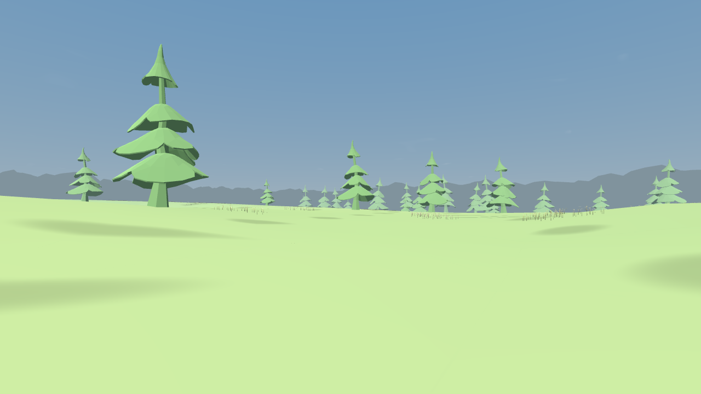
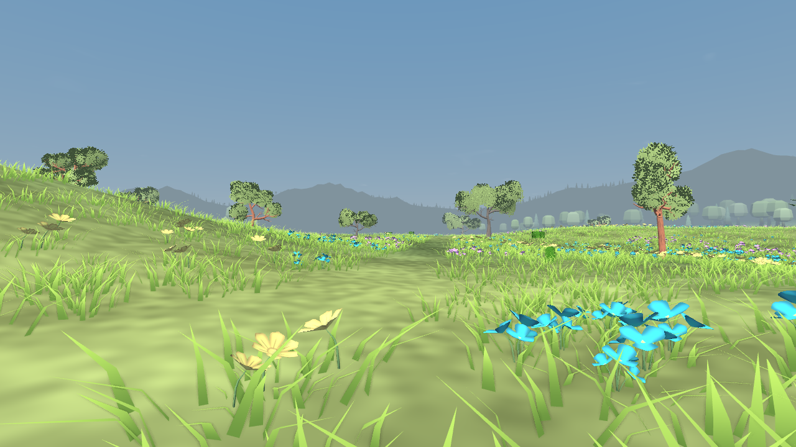
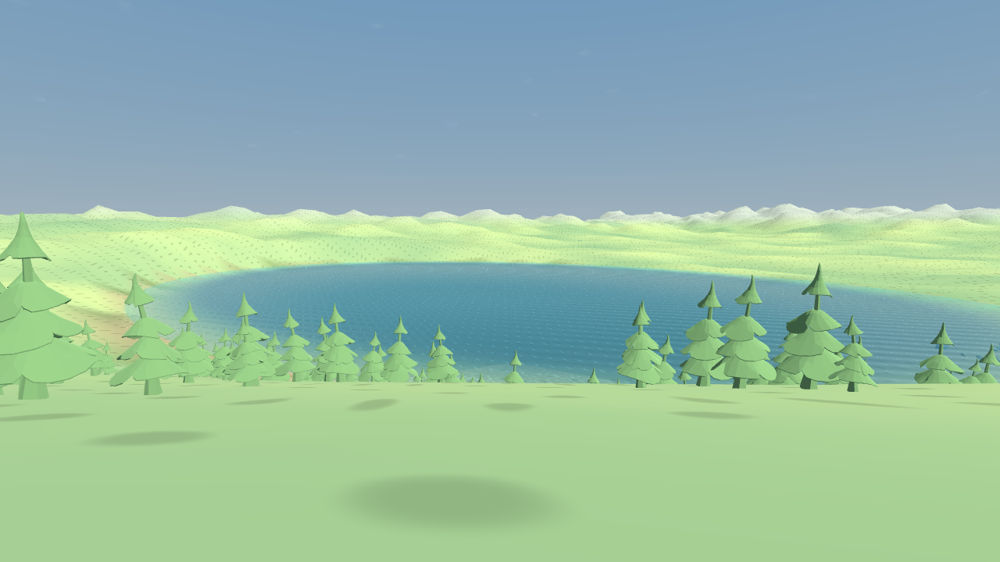
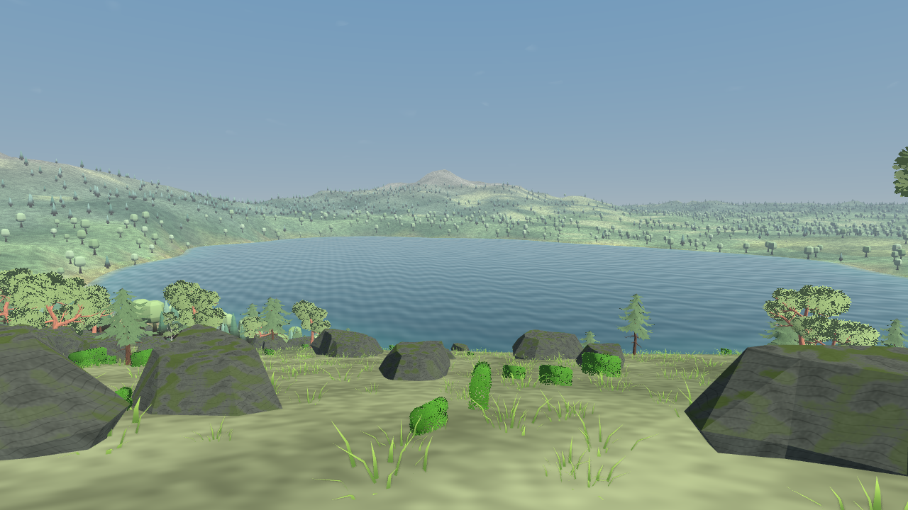
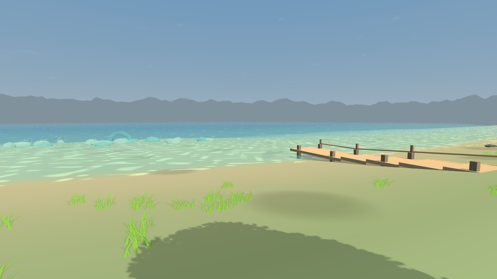
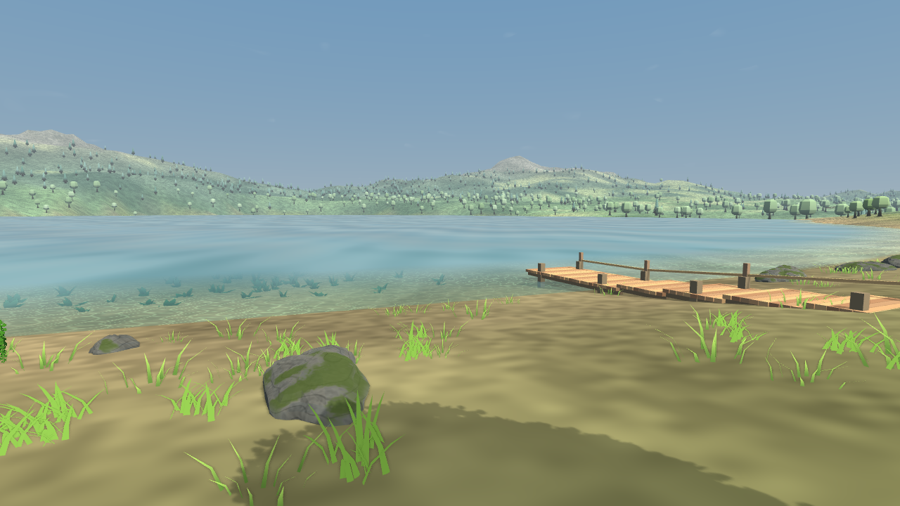
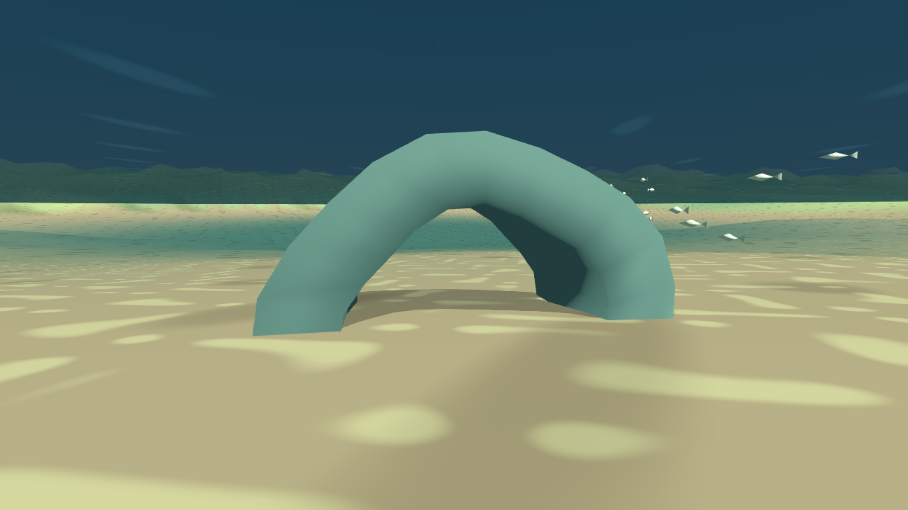
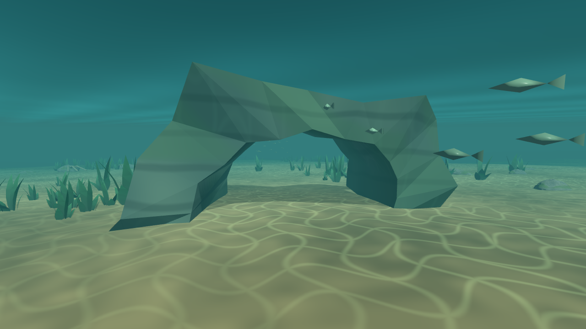

# A1 Superworld Phase 2 · Ảnh duyệt trong Godot

Ảnh 1280 × 720 trong Godot 4.6.3 Compatibility. Cặp so sánh dùng cùng vị trí X/Z, điểm ngắm trên mặt bằng, FOV và giờ. Tầm mắt tính từ terrain từng bản. Bản trước tại f6b0e32, bản sau tại [9396d41](https://github.com/VietCodeBug/a-place-to-belong/commit/9396d41d934a94fc6046a6f8e1d62d17ff721be0).

## Trước và sau

| Khu | Trước | Sau Phase 2 |
| --- | --- | --- |
| Đồng cỏ hoa |  |  |
| Cao nguyên |  |  |
| Bờ tây và bến gỗ |  |  |
| Dưới hồ |  |  |

## Góc bổ sung

- [Rừng cổ thụ](after/woodland.png)
- [Thung lũng sông và cầu gỗ](after/bridge.png)
- [Làng A](after/village.png)
- [Toàn cảnh A1 với sinh cảnh và vành núi](after/overview.png)
- [Bản đồ M, đường vòng và lớp collider](after/map.png)

[Báo cáo kỹ thuật, kết quả đo và các điểm còn thiếu](https://github.com/VietCodeBug/a-place-to-belong/blob/9396d41d934a94fc6046a6f8e1d62d17ff721be0/docs/world/A1_SUPERWORLD_PHASE2.md) · [PR nháp #14](https://github.com/VietCodeBug/a-place-to-belong/pull/14)
