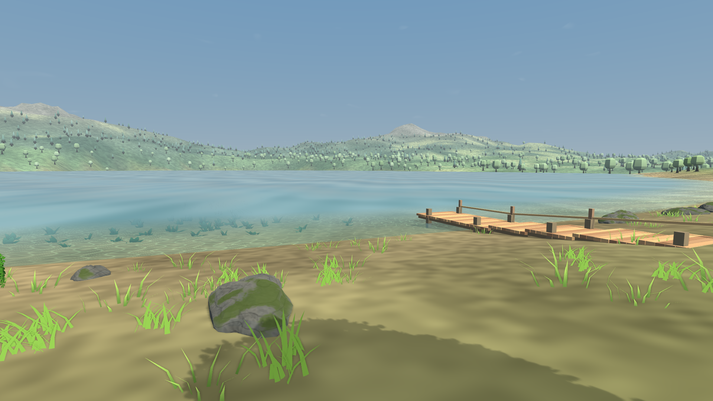
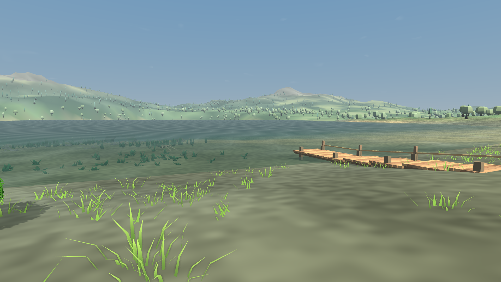
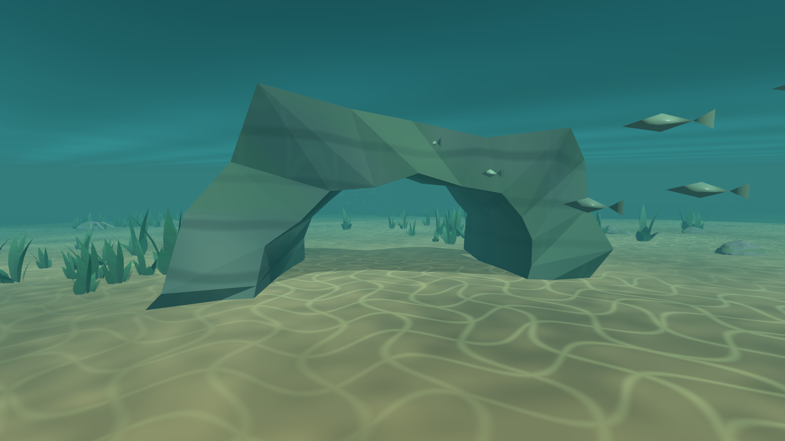
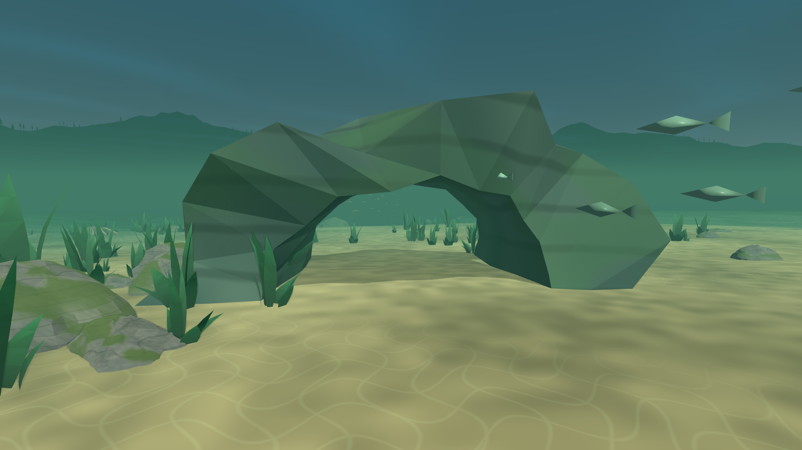
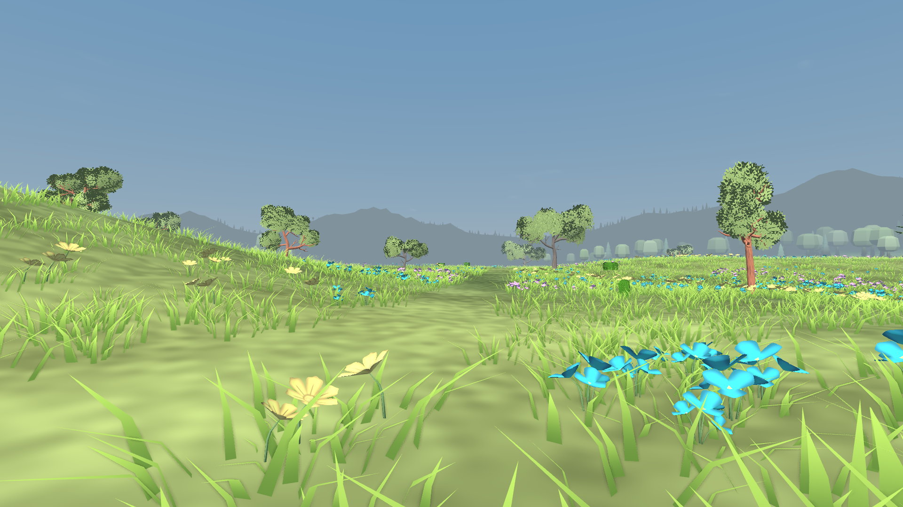
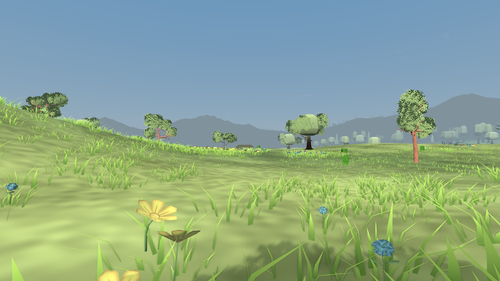
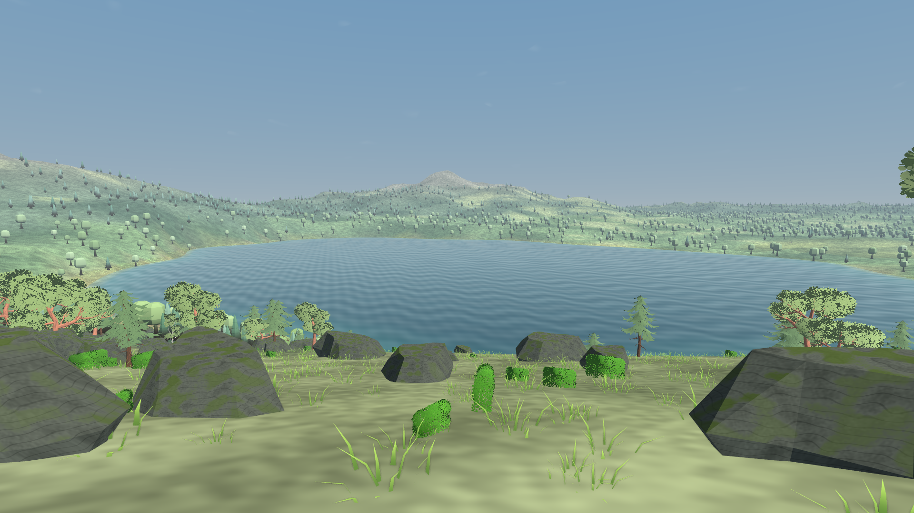
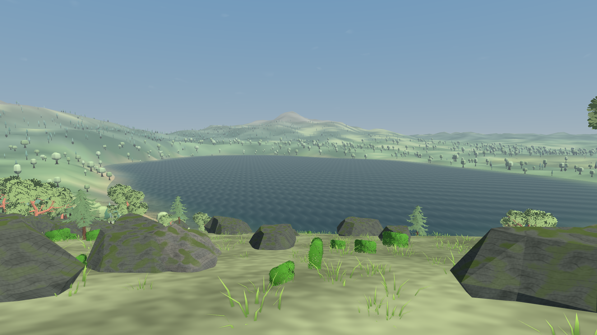

# A1 Superworld Phase 2.1 · Ảnh Godot Full HD

Godot 4.6.3 Compatibility, 1.920 × 1.080. Bốn cặp dùng cùng tọa độ XYZ, điểm ngắm, FOV 59° và giờ 14:39. Baseline tại [9396d41](https://github.com/VietCodeBug/a-place-to-belong/commit/9396d41), bản sau tại [03707c9](https://github.com/VietCodeBug/a-place-to-belong/commit/03707c92191a16de5471284103de1d8e36802b88). [Tọa độ cho bốn camera](camera-poses.json)

| Khu | Trước | Sau Phase 2.1 |
| --- | --- | --- |
| Bờ tây và bến gỗ |  |  |
| Vòm dưới lòng hồ |  |  |
| Đồng cỏ hoa |  |  |
| Cao nguyên |  |  |

## Góc bổ sung

- [Rặng cây ven hồ](after/shore-grove.png) và [bờ tiếp cận bến](after/shore-birches.png)
- [Ảnh tầng giữa](after/midwater.png) và [ảnh lòng hồ sâu](after/basin.png)
- [Rừng cổ thụ](after/woodland.png) và [thung lũng sông, cầu gỗ](after/bridge.png)
- [Làng A](after/village.png) và [toàn cảnh A1](after/overview.png)
- [Bản đồ M với lớp collider và độ sâu](after/map.png)

[Video từ Làng A đến hồ và quay lại](https://raw.githubusercontent.com/VietCodeBug/a-place-to-belong/refs/tags/preview/a1-superworld-phase21-video/docs/world/review-a1-superworld-phase21/lang-a-ho-va-quay-lai.mp4) · [Báo cáo Phase 2.1](https://github.com/VietCodeBug/a-place-to-belong/blob/03707c92191a16de5471284103de1d8e36802b88/docs/world/A1_SUPERWORLD_PHASE21.md) · [PR nháp #14](https://github.com/VietCodeBug/a-place-to-belong/pull/14)
