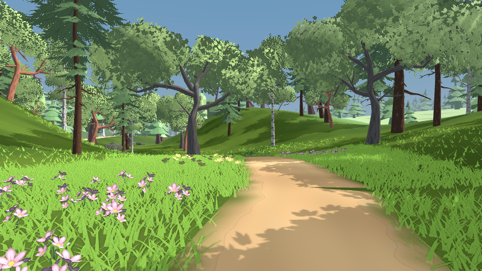
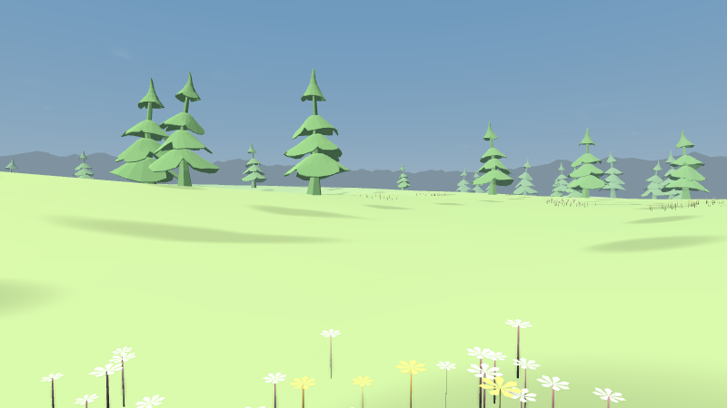
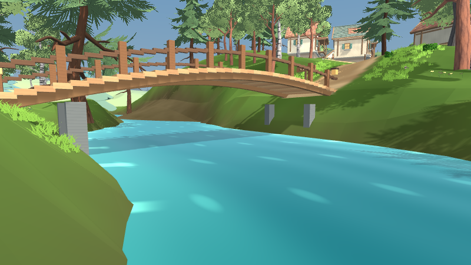
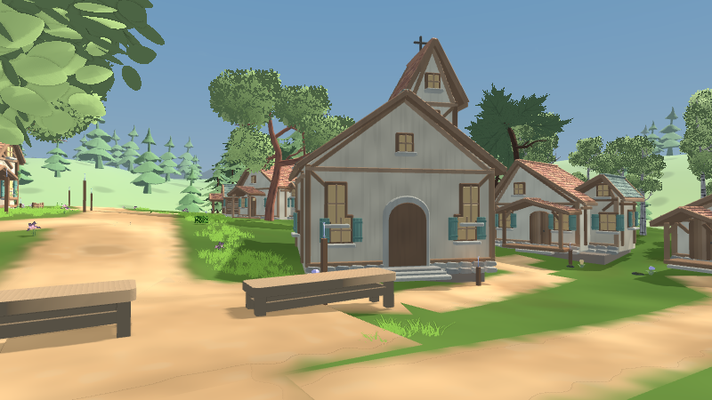
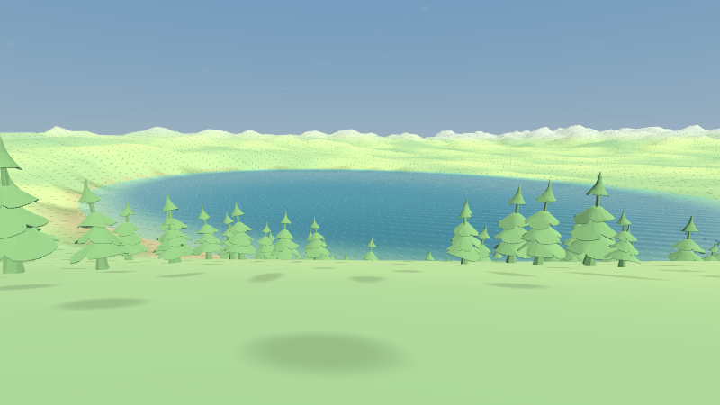
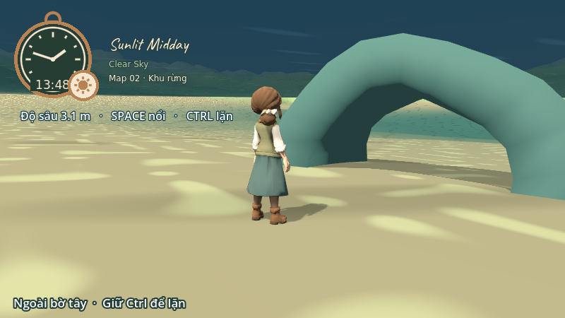
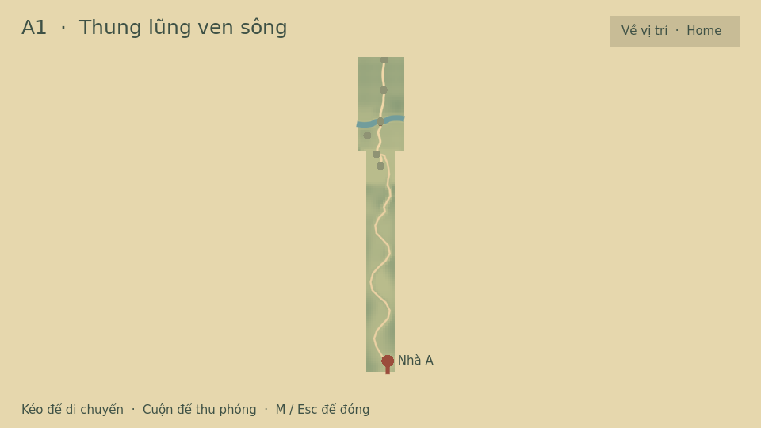
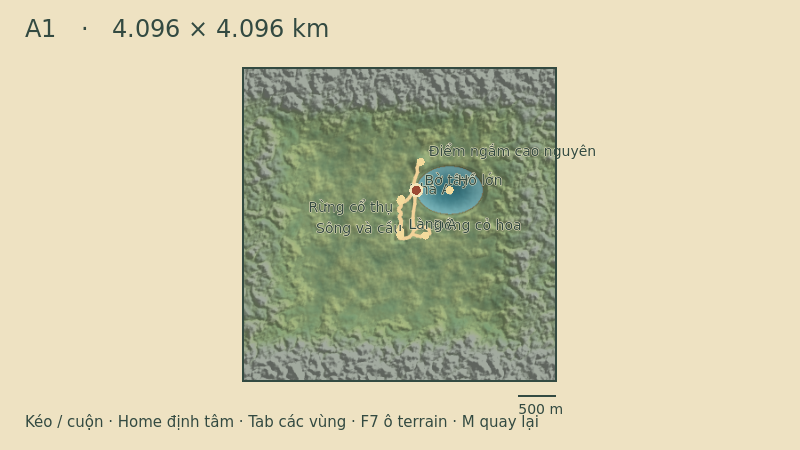

# A1 Superworld · Lát cắt Godot

[Video đi bộ, bơi, lặn và nổi lên](a1-walk-swim-dive.mp4) · [PR nháp #14](https://github.com/VietCodeBug/a-place-to-belong/pull/14) · [Báo cáo và cách chạy](https://github.com/VietCodeBug/a-place-to-belong/blob/f6b0e32ac6c2653fe40620440ef02dabfa7ec9ee/docs/world/A1_SUPERWORLD_SLICE.md)

Video quay từ camera gameplay góc ba trong Godot 4.6.3 Compatibility. Có các đoạn chuyển vị trí giữa Nhà A, bờ và gờ đá để rút ngắn thời lượng. Tốc độ chuyển động trong từng đoạn lấy theo mô phỏng Godot ở 16 hình/giây. Cấu hình quay giảm bóng và SSAO trên Mesa llvmpipe.

## Sáu khu trong game

| Rừng cổ thụ | Đồng cỏ hoa |
| --- | --- |
|  |  |
| **Sông và cầu** | **Làng A** |
|  |  |
| **Cao nguyên** | **Dưới lòng hồ** |
|  |  |

[Bến gỗ nhìn ra hồ](ben-go.png) · [Bơi trên mặt nước](boi.png) · [Nhà A từ camera chơi](nha-a.png) · [Toàn cảnh địa hình 3D](toan-canh-a1.png)

## Bản đồ trong game

| M trước mở rộng | M prototype |
| --- | --- |
|  |  |

[F7 · Mesh và collider đang nạp](chunk-duoi-ho.png) · [Tab · Registry B–I ở trạng thái dự trữ](registry.png)

Ảnh và video này được dựng từ cảnh Godot. Bộ hình concept sáu vùng là tài liệu định hướng bên ngoài runtime.
