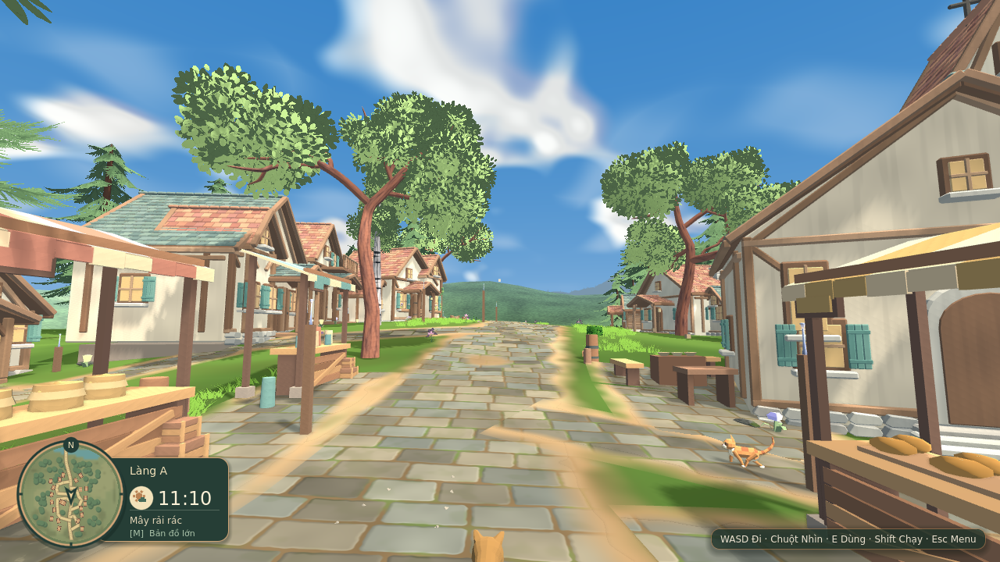

# Làng A · Các sạp và tuyến chó mèo

Ảnh 1280 × 720 chụp bằng Godot 4.6.3 Compatibility tại [d36670f](https://github.com/VietCodeBug/a-place-to-belong/commit/d36670ff000928cfbf2e1ff80efe76bee4e42421) trên [PR #15](https://github.com/VietCodeBug/a-place-to-belong/pull/15). So sánh cùng góc đường chính với [bản trước](https://github.com/VietCodeBug/a-place-to-belong/commit/b6aea9d0ed4d1b58304a3dd2e773dd3ee8a50b1e).

- [Đường chính trước khi dời bàn](truoc-loi-chinh.png) · [Đường chính sau khi dời bàn](01-loi-chinh.png)
- [Sạp nông sản và gốm](02-sap-nong-san-va-gom.png) · [Sạp bánh](03-sap-banh.png) · [Sân bên của Clara và Grace](04-san-ben.png)
- [Chó Shiba](05-cho-shiba.png) · [Mèo mướp](06-meo-gung.png)
- [Video chó mèo chạy trong game](https://raw.githubusercontent.com/VietCodeBug/a-place-to-belong/refs/tags/preview/a1-village-market-pets/docs/world/review-a1-village-market/cho-meo-chay-trong-lang.mp4)

Video 8 giây ở 640 × 360, 12 FPS và không kèm âm thanh. Có hai góc nhìn của A. Động vật tự chạy theo tuyến gameplay trong cả hai đoạn.

Kiểm thử đã đi qua đường chính, bốn ngõ, tuyến chó mèo và thao tác E dọn mâm tại sân bên. [Kiểm thử làng](kiem-thu-duong-lang.txt) · [Chapter 01](kiem-thu-chapter01.txt) · [Log video](godot-clip.txt)

Chó Shiba dùng GLB từ bộ [Ultimate Animated Animal Pack của Quaternius](https://quaternius.com/packs/ultimateanimatedanimals.html) theo CC0. [File Blender mèo mướp](https://github.com/VietCodeBug/a-place-to-belong/blob/d36670ff000928cfbf2e1ff80efe76bee4e42421/art_source/village_a/ginger_cat.blend)
