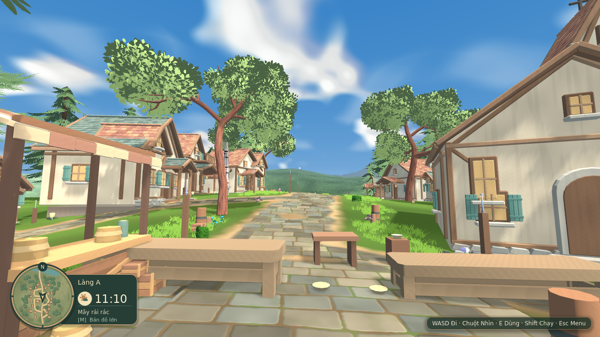

# Làng A · Đường lát và minimap

Godot 4.6.3 Compatibility, độ phân giải 1280 × 720. Bản sau chụp từ [b6aea9d](https://github.com/VietCodeBug/a-place-to-belong/commit/b6aea9d0ed4d1b58304a3dd2e773dd3ee8a50b1e) trên [PR #15](https://github.com/VietCodeBug/a-place-to-belong/pull/15). Ba góc đối chiếu dùng cùng vị trí, hướng nhìn, thời điểm và preset mây với [bản trước](https://github.com/VietCodeBug/a-place-to-belong/commit/9fe422d8412fbedb072d8cd2de8fdd27a7cd25f4).

| Góc | Trước | Sau |
| --- | --- | --- |
| Sân chung | [Ảnh](truoc/01-san-chung.png) | [Ảnh](01-san-chung.png) |
| Lối tới xưởng | [Ảnh](truoc/02-loi-xuong.png) | [Ảnh](02-loi-xuong.png) |
| Đường vào làng | [Ảnh](truoc/03-duong-vao.png) | [Ảnh](03-duong-vao.png) |

- [Cận quầy mái vải](06-quay-mai-vai.png)
- [Sân chung lúc có mưa](04-san-chung-mua.png) · [Sân chung vào mùa đông](07-san-chung-mua-dong.png)
- [Bản đồ M khi mở từ Làng A](05-ban-do-m.png)
- [Log chụp Godot](godot-canh-lang.txt) · [Kiểm minimap, thời tiết và bản đồ lớn](kiem-thu-a1.txt)

Mặt đường là lớp vật liệu bám theo địa hình gốc. Quầy, giá củi và ghế có collider. Thùng, giỏ và đồ bày ở hiên là trang trí. Minimap đọc vị trí và hướng nhìn của A. **M** mở hoặc đóng bản đồ lớn. Cuộn để thu phóng, kéo để xem xa, **Home** để về vị trí A.
