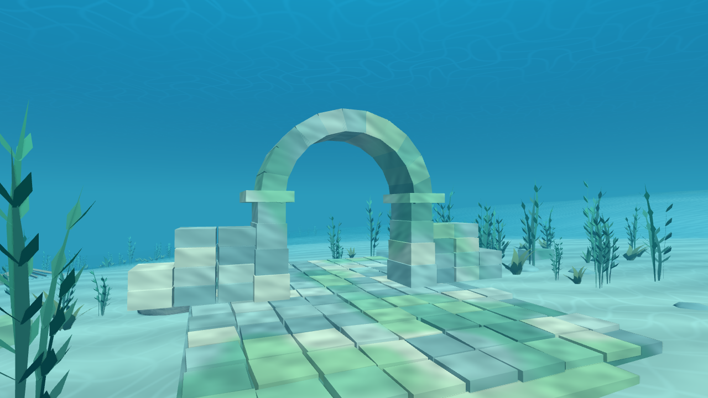
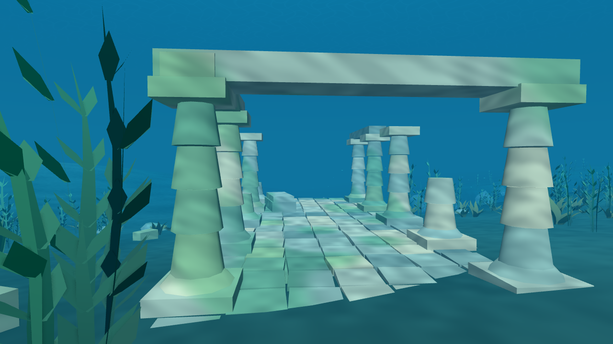
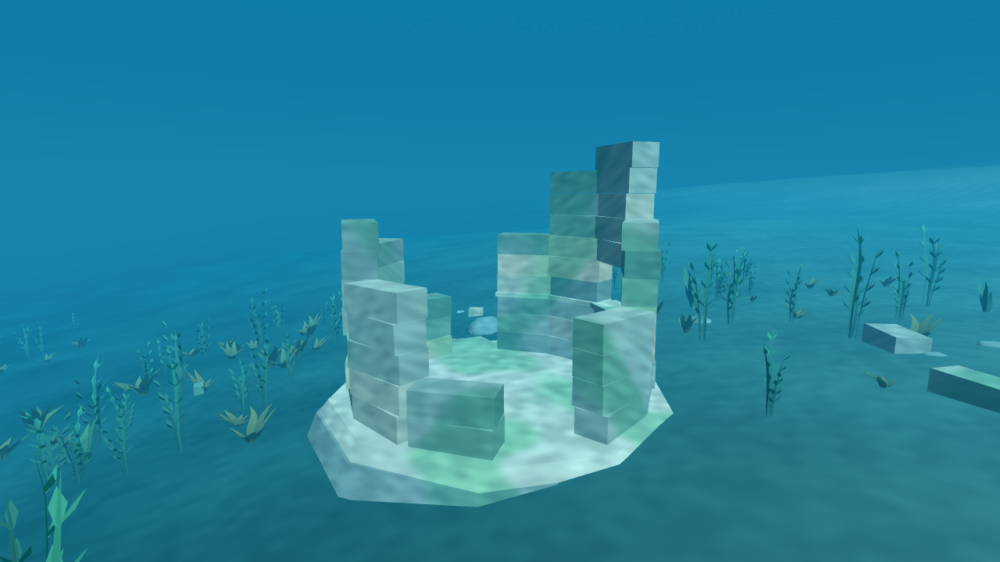
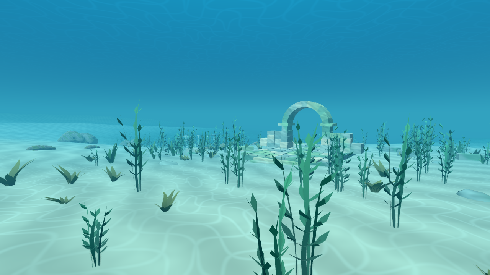
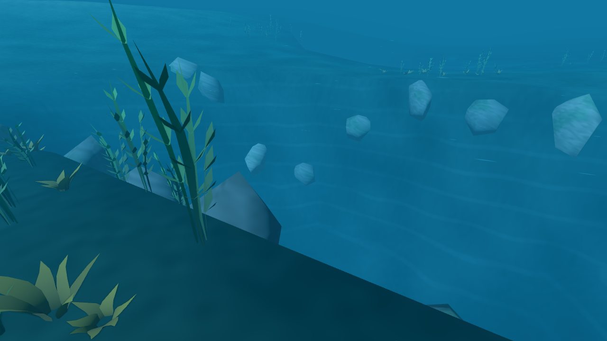
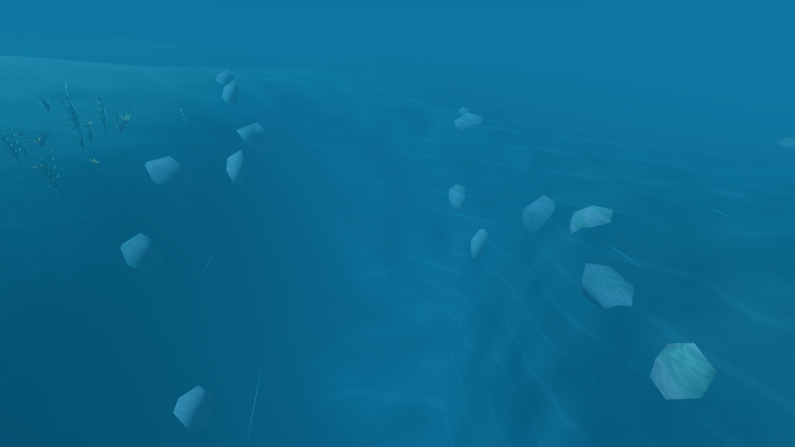
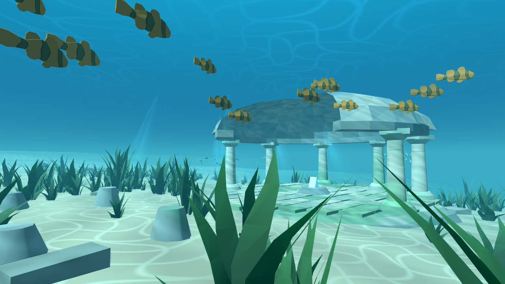
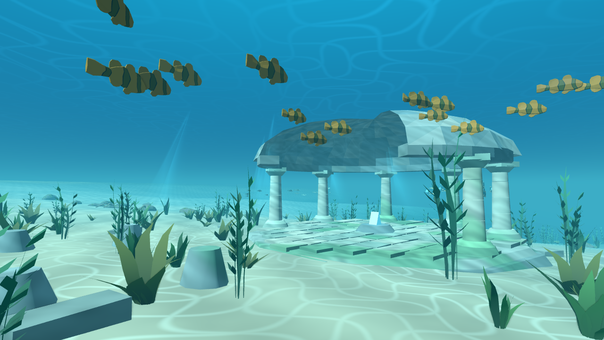

# A1 · Di tích, khe vực và thảm rong

Ảnh trực tiếp từ Godot 4.6.3 Compatibility, Mesa llvmpipe, 1280 × 720. Trời quang lúc 13:30 trong game. Bản mới ở commit `e2bd30b724f606e9bec5e92eb3b70ae5e7576dd9` trên nhánh `gpt`. Bản trước là `4ac905e2d9a76a299c29527c55fe37b2cda7ea2a`.

## Bơi khám phá

| Hành lang cột | Tháp vỡ | Thảm rong gờ nông |
| --- | --- | --- |
|  |  |  |

| Khe tây | Khe đông |
| --- | --- |
|  |  |

Hai khe có độ sâu khoảng 42–50 m tại tâm. Người chơi có thể nhìn xuống từ mép, với giới hạn lặn khoảng 18 m ngay trên các khe. Ảnh HUD được chụp bằng camera gameplay sau khi giữ nút lặn. Bản đồ chụp qua phím M trong Godot. [HUD khi chạm dòng chảy](08-gioi-han-lan.png) · [Bản đồ di tích](09-ban-do-ho.png)

## So sánh cùng góc nhìn của đình cũ

| Trước | Sau khi thêm thảm rong |
| --- | --- |
|  |  |

1.248 cụm rong lá dải, rong thân cao và bụi lá quạt. Dùng 88 nhóm MultiMesh chia theo ô, với giới hạn khoảng cách vẽ cho từng dạng. Giữ lối bơi trống ở chân công trình.

## Kiểm thử

`a1_superworld_test.gd` và `smoke_test.gd` đều đạt. Đã bơi xuyên lối mở của cả ba di tích mới, kiểm nền và đáy bằng raycast, lặn thẳng xuống cả hai khe, bơi ngang vào khe đông từ tầng sâu hơn, và nổi lên bằng Space. Lượt headless đo chi phí streaming P95 4,25 ms, đỉnh 5,02 ms. Chưa đo FPS trên GPU Windows. Hai cảnh báo texture khi đóng Godot đã có từ bản trước.

[Hướng dẫn và tọa độ](https://github.com/VietCodeBug/a-place-to-belong/blob/gpt/docs/world/A1_UNDERWATER_PAVILION.md) · [PR nháp #16](https://github.com/VietCodeBug/a-place-to-belong/pull/16)
