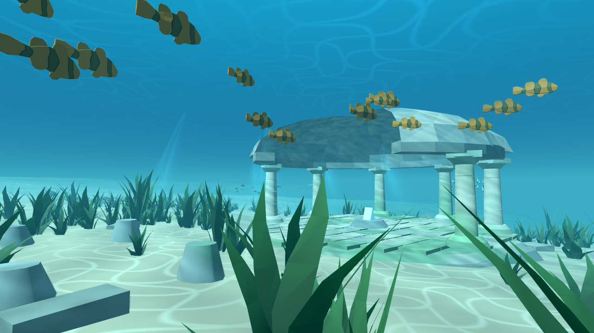
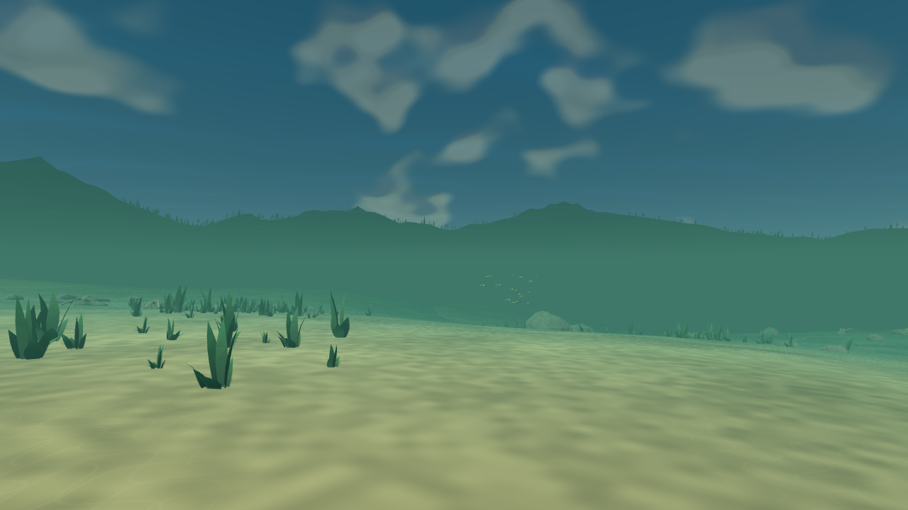
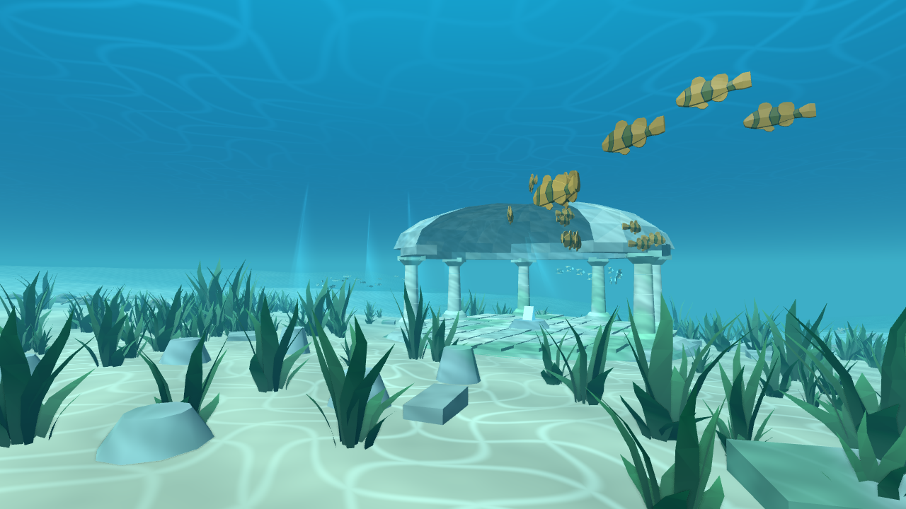
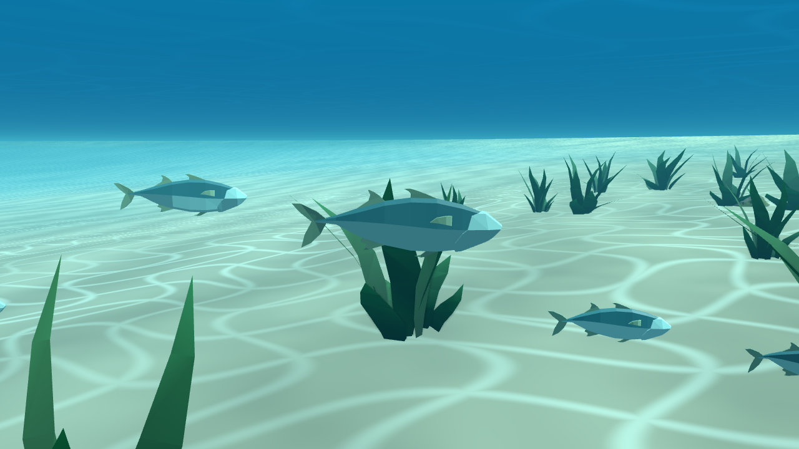
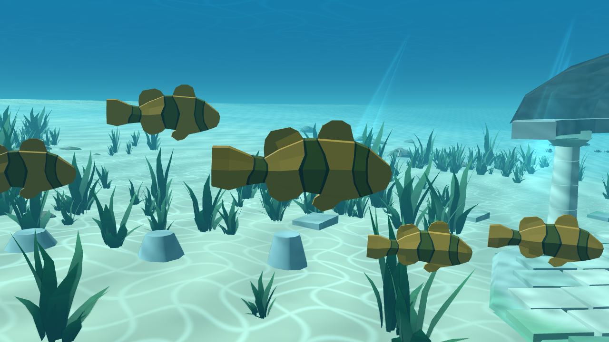
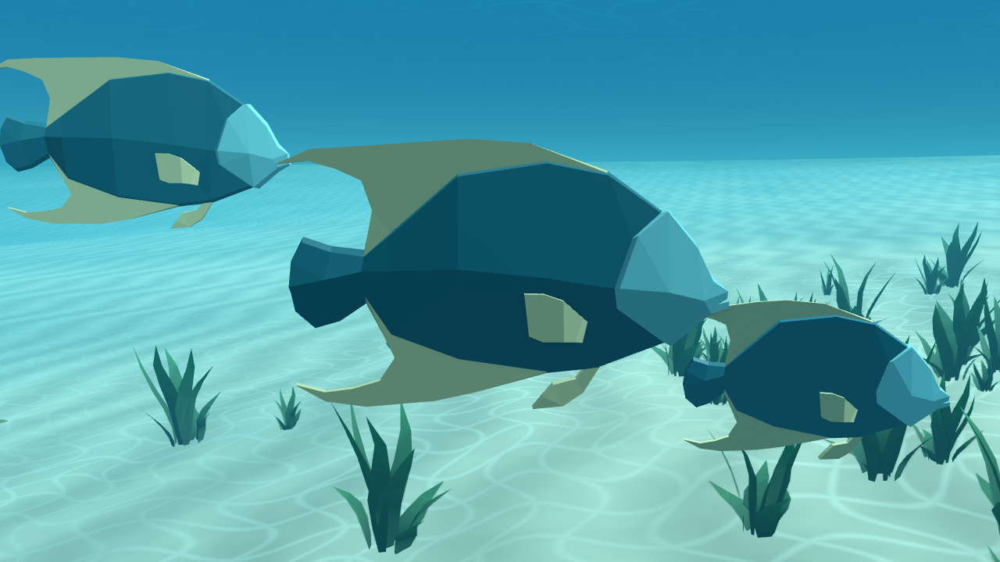

# A1 · Đình đá chìm và ba mẫu cá

Ảnh chụp thật từ Godot 4.6.3, Compatibility, Mesa llvmpipe, 1280 × 720. Trời quang, 13:30 trong game. Camera review tự do, ẩn HUD. Bản gốc là `gemini-ultra` tại `ec3f9672cdaf08df51a3f2550b351dc748cadbb8`. Bản mới là `gpt` tại `4ac905e2d9a76a299c29527c55fe37b2cda7ea2a`.

## Cùng góc tiếp cận

| Bản gốc | Bản mới |
| --- | --- |
|  |  |

[Chân cột dưới mái vỡ](02-duoi-vom.png) · [Nhìn từ phía đông](03-se-lo-dan-ca.png) · [Bến bờ tây](04-bo-tay.png) · [Đàn cá qua đình](06-dan-ca.png)

## Ba dáng cá trong hồ

| Cá thân thon ánh bạc | Cá vàng ô-liu sọc tối | Cá thân tròn xanh lam |
| --- | --- | --- |
|  |  |  |

Quaternius Animated Fish Pack, CC0 1.0. Tổng cộng 65 con trong 4 đàn. [Nguồn cá](https://quaternius.com/packs/animatedfish.html) · [Mã và hướng dẫn chơi](https://github.com/VietCodeBug/a-place-to-belong/blob/gpt/docs/world/A1_UNDERWATER_PAVILION.md)

## Kiểm thử

A1 Superworld và smoke test đều qua. Kiểm bơi từ bờ, lặn, nổi lên, rời hồ, bơi xuyên lối mở của đình, ray chạm mái, tải đủ ba mesh cá, collider terrain và các mốc Làng A. Lượt headless đo chi phí dựng chunk P95 4,28 ms, đỉnh 9,37 ms. Chưa có đo FPS trên GPU Windows. Hai cảnh báo texture khi đóng Godot xuất hiện cả ở lượt chụp bản gốc.
