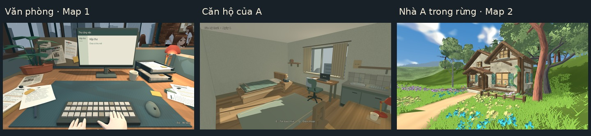
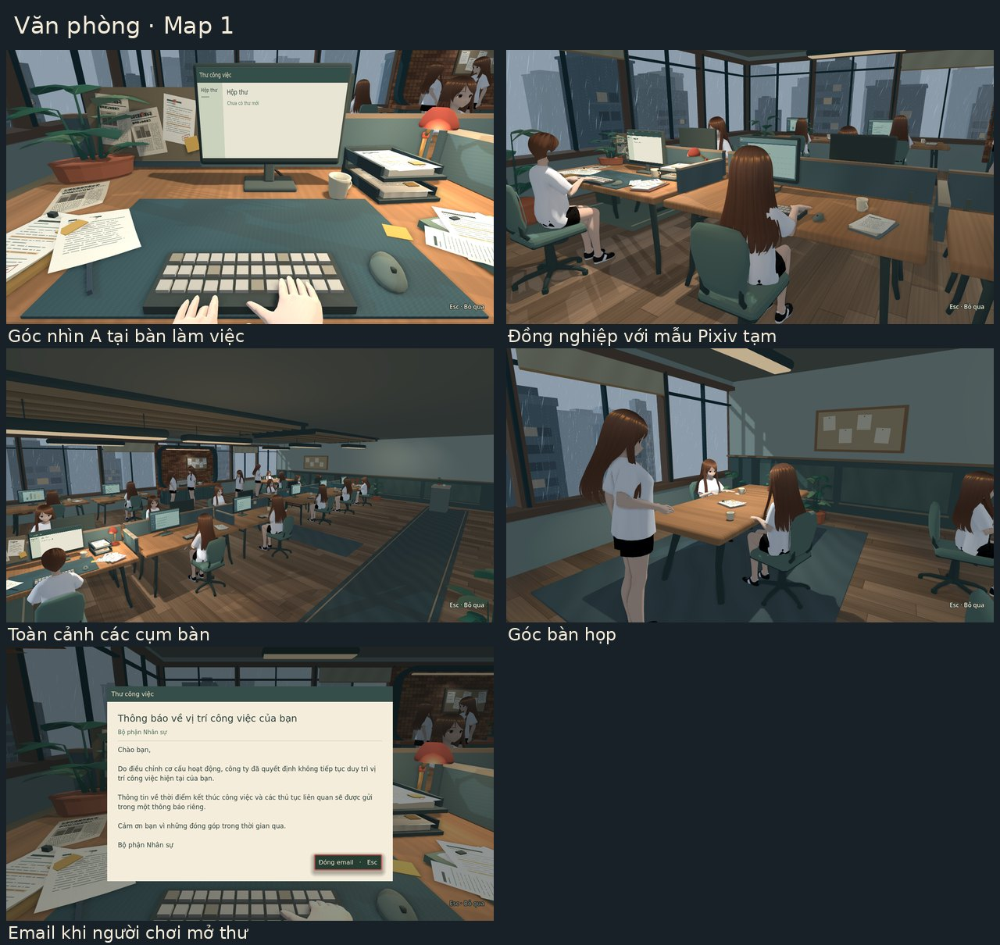
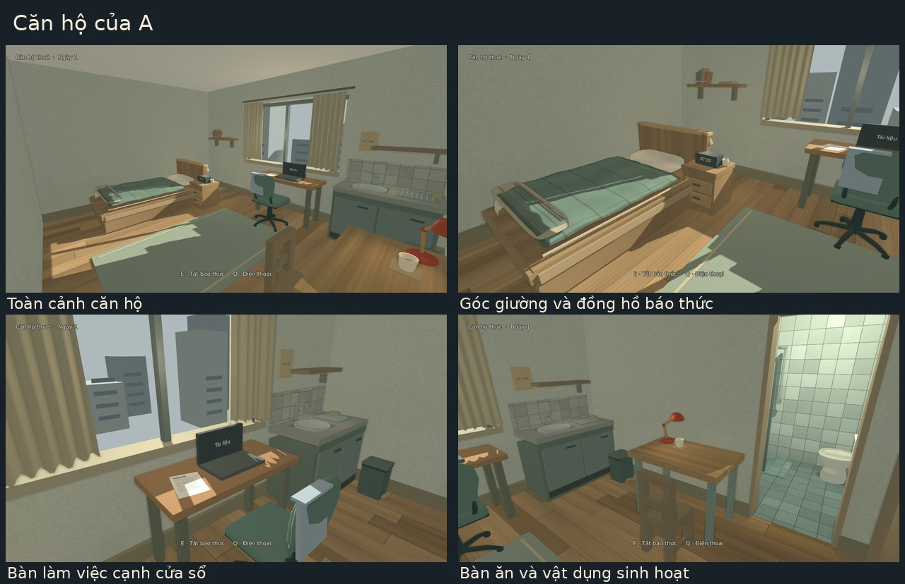
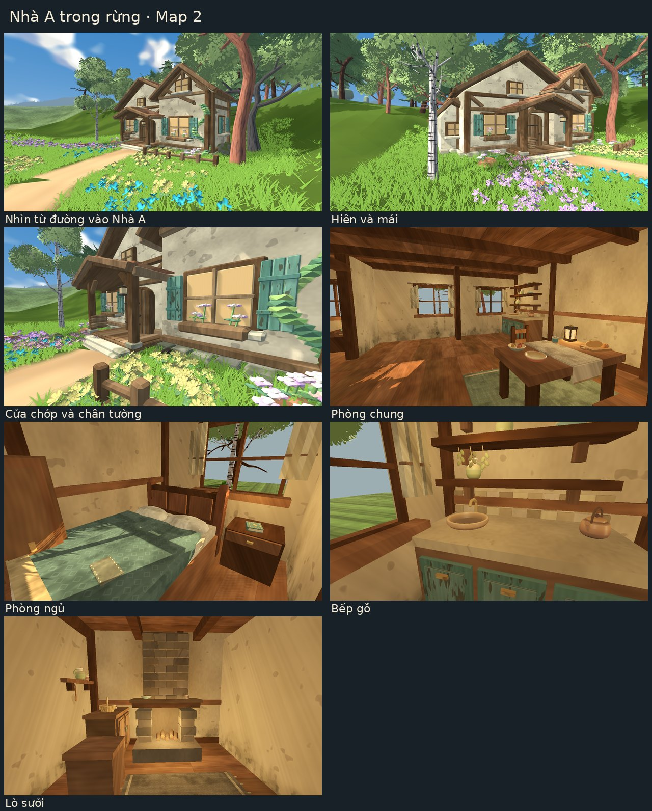

# Văn phòng → Căn hộ → Nhà A trong rừng

Bộ 16 ảnh chụp trong Godot 4.6.3 Compatibility từ commit `ec3f9672cdaf08df51a3f2550b351dc748cadbb8`. Các góc quan sát dùng camera tự do trong chính scene game. Góc bàn làm việc và email dùng camera của A. Nhấn tên ảnh để xem bản 1280 × 720.

## Văn phòng · Map 1

- [Góc nhìn A tại bàn làm việc](van-phong/01-ban-lam-viec.png)
- [Đồng nghiệp với mẫu Pixiv tạm](van-phong/02-dong-nghiep.png)
- [Toàn cảnh các cụm bàn](van-phong/03-toan-canh-cum-ban.png)
- [Góc bàn họp](van-phong/04-ban-hop.png)
- [Email khi người chơi mở thư](van-phong/05-email.png)

## Căn hộ của A

- [Toàn cảnh căn hộ](can-ho/06-toan-canh-can-ho.png)
- [Góc giường và đồng hồ báo thức](can-ho/07-goc-giuong.png)
- [Bàn làm việc cạnh cửa sổ](can-ho/08-ban-va-cua-so.png)
- [Bàn ăn và vật dụng sinh hoạt](can-ho/09-goc-an.png)

## Nhà A trong rừng · Map 2

- [Nhìn từ đường vào Nhà A](nha-a/05-nha-trong-rung.png)
- [Hiên và mái](nha-a/07-hien-va-mai.png)
- [Cửa chớp và chân tường](nha-a/06-cua-va-chan-tuong.png)
- [Phòng chung](nha-a/01-phong-chung.png)
- [Phòng ngủ](nha-a/02-phong-ngu.png)
- [Bếp gỗ](nha-a/03-bep-go.png)
- [Lò sưởi](nha-a/04-lo-suoi.png)
