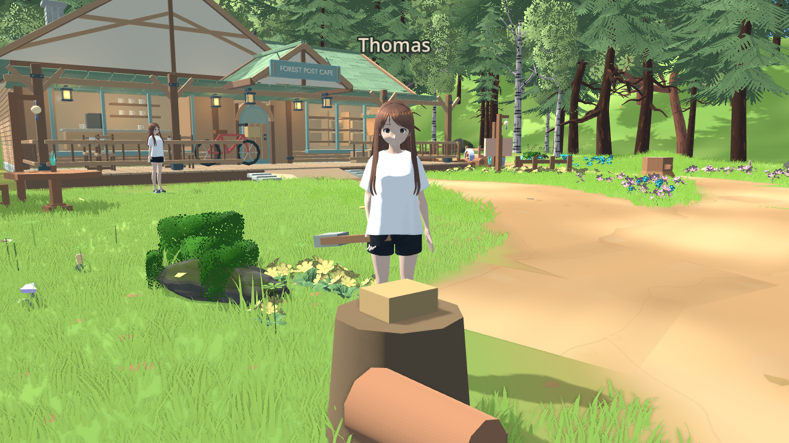

# Mẫu VRM Pixiv trong game

Ảnh chụp trong cảnh chơi Godot 4.6.3 Compatibility ở commit `ec3f9672cdaf08df51a3f2550b351dc748cadbb8`. Mẫu Pixiv dùng tạm cho A và NPC. Lịch, hội thoại và vị trí tương tác tiếp tục lấy từ game.

- [Góc nhìn A tại bàn phím](a-va-ban-phim.png)
- [Đồng nghiệp trong văn phòng](dong-nghiep.png)
- [Thomas tại bệ củi](thomas.png)

Bản native giữ khớp humanoid và các constraint ở vai, khuỷu và cổ tay. Phần tóc dùng mesh gốc với vật liệu native của Godot. Cờ `--original-cast` cho phép xem lại dàn model cũ.

[Nguồn và giấy phép](https://github.com/VietCodeBug/a-place-to-belong/blob/ec3f9672cdaf08df51a3f2550b351dc748cadbb8/assets/characters/pixiv_vrm_sample/README.md) · [PR #15](https://github.com/VietCodeBug/a-place-to-belong/pull/15)
