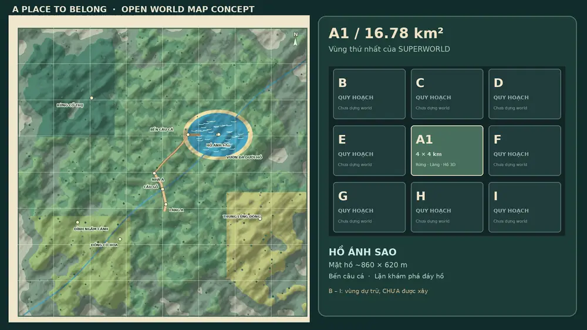

# A1 Superworld Prototype — 4 × 4 km

This is an **isolated, experimental Godot project** seeded into the existing game repository for AI engineering handoff. **Do not merge or substitute for the current game without integration tests.**

## Runtime review

The current integrated prototype is opt-in from the original root project. See
[the Vietnamese review and launch guide](../../docs/world/A1_SUPERWORLD_SLICE.md).
The standalone retains its own scene and draft coordinates. Its boot and chunk
collision lifecycle were checked in Godot 4.6.3.

## Start here

1. [AI engineering handoff / specifications](../../docs/world/A1_SUPERWORLD_AI_HANDOFF.md)
2. [Playable standalone prototype source](standalone/) — import `standalone/project.godot` as a **separate Godot project**.
3. [World generator](standalone/scripts/world_gen.gd) · [Chunk loader](standalone/scripts/world_chunks.gd) · [Lake/landmarks](standalone/scripts/world_props.gd) · [Player/swimming](standalone/scripts/player.gd) · [Map UI](standalone/scripts/a1_map.gd)
4. [Original compressed source package](source/a1_superworld_code.tar.xz), if you want exact reference bytes (extract with `tar -xJf a1_superworld_code.tar.xz`).
5. [Region registry draft](../../docs/world/SUPERWORLD_REGIONS_DRAFT.json).

## Design reference images

- 
- [Detailed A1 design map](standalone/assets/A1_world_design_map.webp)
- [Future B–I atlas concept](standalone/assets/SUPERWORLD_regions.webp)

**These are concept illustrations, NOT Godot gameplay screenshots.** Images were optimized for GitHub; original high-resolution art is in the prior conversation download archive.

## Prototype capabilities (coded, runtime unverified)

- Target A1: 4,096 × 4,096 metres = 16.78 km².
- Streaming terrain tiles of 128 m, with collision on nearby tiles.
- An elliptical large lake (~860 × 620 m), bathymetric terrain, basic water surface, pier, dive/swim draft and underwater stone garden.
- Minimal temporary house/village, trees, rocks and landscape props; **do not replace the game's existing handcrafted assets**.
- Map M and reserved regional atlas B–I. Fishing `E` is **placeholder only**; no actual minigame.
- F1–F4 visual season palette only, NOT the game's completed seasonal gameplay.

## What the AI coder must do next

- First validate that the standalone **runs in Godot 4.6.3 Compatibility**. Fix parser/runtime issues before integrating.
- Build a coordinate-safe bridge to the existing A1 core in `scenes/world/forest_hub.tscn`. Existing House A and Village A coordinates are different; do not overwrite their positions.
- Refactor terrain/chunk streaming to work with the game's current terrain, collision, environment, season and vegetation systems.
- Convert the lake into a real underwater exploration feature with safe movement, shoreline, bottom terrain and performance tests.
- Preserve story, village, camera and 21 existing buildings. Add B–I only as future region registry entries.
- Capture actual Godot screenshots/video and benchmark on target GPU. **No auto-merge.**

Godot's root project in this repo is NOT the standalone project. The marker `prototypes/a1_superworld/.gdignore` keeps the nested sample from being imported by the root editor.
